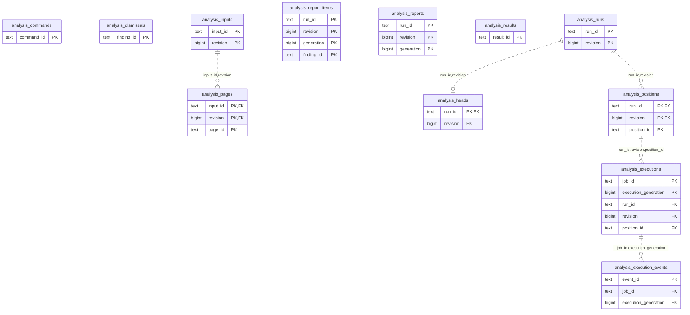

# Intelligence: Analysis

Analysis inputs and runs, positions/executions, immutable results/reports, command/event receipts and dismissals.

**Current source schema, deployment unverified.** Owner: Intelligence; SQL schema `intelligence`. Derived from checked-in DDL at the `14ad5754` baseline with file relocation only. No live database was queried. [Database index](../../README.md).

Charts show primary/foreign key columns; the dictionary lists **every stored field and its SQL type**. `PK` means primary key (all marked fields form one composite key); `FK` means an enforced SQL foreign key. Parent `||`/`o|` means a required/optional parent; child `o{` means zero or more children and `o|` zero or one (a unique referencing tuple). Edges describe allowed SQL cardinality, not an obligation to create children. Nullable components of a composite FK can leave the tuple unlinked under PostgreSQL MATCH SIMPLE. No edge is inferred from a similar field name.

## Data dictionary

### `intelligence.analysis_commands`

Primary key: (`command_id`). DDL: [0002_analysis.sql](../../ddl/migrations/0002_analysis.sql).

| Field | SQL type | Null allowed | Keys |
| --- | --- | --- | --- |
| `command_id` | `text` | no | PK |
| `digest` | `text` | no |  |
| `payload` | `jsonb` | no |  |

### `intelligence.analysis_dismissals`

Primary key: (`finding_id`). DDL: [0002_analysis.sql](../../ddl/migrations/0002_analysis.sql).

| Field | SQL type | Null allowed | Keys |
| --- | --- | --- | --- |
| `finding_id` | `text` | no | PK |
| `revision` | `bigint` | no |  |
| `state` | `text` | no |  |
| `supporting_games` | `jsonb` | no |  |

### `intelligence.analysis_execution_events`

Primary key: (`event_id`). DDL: [0002_analysis.sql](../../ddl/migrations/0002_analysis.sql).

| Field | SQL type | Null allowed | Keys |
| --- | --- | --- | --- |
| `event_id` | `text` | no | PK |
| `job_id` | `text` | no | FK job_id,execution_generation → intelligence.analysis_executions(`job_id`, `execution_generation`) |
| `execution_generation` | `bigint` | no | FK job_id,execution_generation → intelligence.analysis_executions(`job_id`, `execution_generation`) |
| `payload` | `jsonb` | no |  |

Foreign key delete actions: (`job_id`, `execution_generation`) NO ACTION.

### `intelligence.analysis_executions`

Primary key: (`job_id`, `execution_generation`). DDL: [0002_analysis.sql](../../ddl/migrations/0002_analysis.sql).

| Field | SQL type | Null allowed | Keys |
| --- | --- | --- | --- |
| `job_id` | `text` | no | PK |
| `execution_generation` | `bigint` | no | PK |
| `run_id` | `text` | no | FK run_id,revision,position_id → intelligence.analysis_positions(`run_id`, `revision`, `position_id`) |
| `revision` | `bigint` | no | FK run_id,revision,position_id → intelligence.analysis_positions(`run_id`, `revision`, `position_id`) |
| `position_id` | `text` | no | FK run_id,revision,position_id → intelligence.analysis_positions(`run_id`, `revision`, `position_id`) |
| `stage` | `text` | no |  |
| `payload` | `jsonb` | no |  |

Foreign key delete actions: (`run_id`, `revision`, `position_id`) NO ACTION.

### `intelligence.analysis_heads`

Primary key: (`run_id`). DDL: [0002_analysis.sql](../../ddl/migrations/0002_analysis.sql).

| Field | SQL type | Null allowed | Keys |
| --- | --- | --- | --- |
| `run_id` | `text` | no | PK; FK run_id,revision → intelligence.analysis_runs(`run_id`, `revision`) |
| `revision` | `bigint` | no | FK run_id,revision → intelligence.analysis_runs(`run_id`, `revision`) |

Foreign key delete actions: (`run_id`, `revision`) NO ACTION.

### `intelligence.analysis_inputs`

Primary key: (`input_id`, `revision`). DDL: [0002_analysis.sql](../../ddl/migrations/0002_analysis.sql).

| Field | SQL type | Null allowed | Keys |
| --- | --- | --- | --- |
| `input_id` | `text` | no | PK |
| `revision` | `bigint` | no | PK |
| `payload` | `jsonb` | no |  |
| `digest` | `text` | no |  |
| `state` | `text` | no |  |

### `intelligence.analysis_pages`

Primary key: (`input_id`, `revision`, `page_id`). DDL: [0002_analysis.sql](../../ddl/migrations/0002_analysis.sql).

| Field | SQL type | Null allowed | Keys |
| --- | --- | --- | --- |
| `input_id` | `text` | no | PK; FK input_id,revision → intelligence.analysis_inputs(`input_id`, `revision`) |
| `revision` | `bigint` | no | PK; FK input_id,revision → intelligence.analysis_inputs(`input_id`, `revision`) |
| `page_id` | `text` | no | PK |
| `payload` | `jsonb` | no |  |
| `digest` | `text` | no |  |

Foreign key delete actions: (`input_id`, `revision`) NO ACTION.

### `intelligence.analysis_positions`

Primary key: (`run_id`, `revision`, `position_id`). DDL: [0002_analysis.sql](../../ddl/migrations/0002_analysis.sql).

| Field | SQL type | Null allowed | Keys |
| --- | --- | --- | --- |
| `run_id` | `text` | no | PK; FK run_id,revision → intelligence.analysis_runs(`run_id`, `revision`) |
| `revision` | `bigint` | no | PK; FK run_id,revision → intelligence.analysis_runs(`run_id`, `revision`) |
| `ordinal` | `integer` | no |  |
| `position_id` | `text` | no | PK |
| `payload` | `jsonb` | no |  |
| `state` | `text` | no |  |
| `execution_generation` | `bigint` | no |  |
| `stage` | `text` | no |  |
| `attempts` | `integer` | no |  |
| `next_attempt_at` | `timestamptz` | yes |  |
| `lease_token` | `text` | yes |  |
| `leased_until` | `timestamptz` | yes |  |
| `accepted_root` | `text` | yes |  |
| `accepted_played` | `text` | yes |  |
| `error_code` | `text` | yes |  |
| `created_at` | `timestamptz` | no |  |

Unique tuples (including non-partial simple unique indexes): (`run_id`, `revision`, `ordinal`).

Foreign key delete actions: (`run_id`, `revision`) NO ACTION.

### `intelligence.analysis_report_items`

Primary key: (`run_id`, `revision`, `generation`, `finding_id`). DDL: [0002_analysis.sql](../../ddl/migrations/0002_analysis.sql).

| Field | SQL type | Null allowed | Keys |
| --- | --- | --- | --- |
| `run_id` | `text` | no | PK |
| `revision` | `bigint` | no | PK |
| `generation` | `bigint` | no | PK |
| `finding_id` | `text` | no | PK |
| `ordinal` | `integer` | no |  |
| `payload` | `jsonb` | no |  |

### `intelligence.analysis_reports`

Primary key: (`run_id`, `revision`, `generation`). DDL: [0002_analysis.sql](../../ddl/migrations/0002_analysis.sql).

| Field | SQL type | Null allowed | Keys |
| --- | --- | --- | --- |
| `run_id` | `text` | no | PK |
| `revision` | `bigint` | no | PK |
| `generation` | `bigint` | no | PK |
| `payload` | `jsonb` | no |  |

### `intelligence.analysis_results`

Primary key: (`result_id`). DDL: [0002_analysis.sql](../../ddl/migrations/0002_analysis.sql).

| Field | SQL type | Null allowed | Keys |
| --- | --- | --- | --- |
| `result_id` | `text` | no | PK |
| `job_id` | `text` | no |  |
| `execution_generation` | `bigint` | no |  |
| `payload` | `jsonb` | no |  |

Unique tuples (including non-partial simple unique indexes): (`job_id`, `execution_generation`).

### `intelligence.analysis_runs`

Primary key: (`run_id`, `revision`). DDL: [0002_analysis.sql](../../ddl/migrations/0002_analysis.sql).

| Field | SQL type | Null allowed | Keys |
| --- | --- | --- | --- |
| `run_id` | `text` | no | PK |
| `revision` | `bigint` | no | PK |
| `payload` | `jsonb` | no |  |
| `digest` | `text` | no |  |
| `state` | `text` | no |  |
| `budget` | `integer` | no |  |
| `requested_generation` | `bigint` | no |  |
| `published_generation` | `bigint` | yes |  |
| `last_complete_generation` | `bigint` | yes |  |
| `created_at` | `timestamptz` | no |  |
