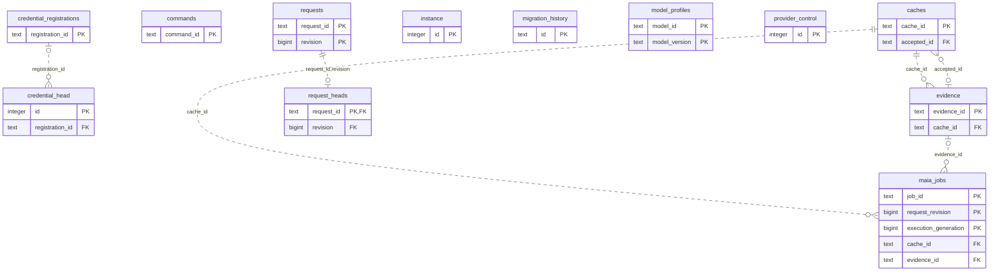

# Intelligence: Sources Evidence (1)

Provider requests, cache heads, accepted source evidence, credentials metadata and Maia jobs.

**Current source schema, deployment unverified.** Owner: Intelligence; SQL schema `intelligence`. Derived from checked-in DDL at the `14ad5754` baseline with file relocation only. No live database was queried. [Database index](../../README.md).

Charts show primary/foreign key columns; the dictionary lists **every stored field and its SQL type**. `PK` means primary key (all marked fields form one composite key); `FK` means an enforced SQL foreign key. Parent `||`/`o|` means a required/optional parent; child `o{` means zero or more children and `o|` zero or one (a unique referencing tuple). Edges describe allowed SQL cardinality, not an obligation to create children. Nullable components of a composite FK can leave the tuple unlinked under PostgreSQL MATCH SIMPLE. No edge is inferred from a similar field name.

## Data dictionary

### `intelligence.caches`

Primary key: (`cache_id`). DDL: [0001_sources.sql](../../ddl/migrations/0001_sources.sql).

| Field | SQL type | Null allowed | Keys |
| --- | --- | --- | --- |
| `cache_id` | `text` | no | PK |
| `descriptor` | `jsonb` | no |  |
| `input_snapshot` | `jsonb` | no |  |
| `kind` | `text` | no |  |
| `generation` | `bigint` | no |  |
| `execution_generation` | `bigint` | no |  |
| `state` | `text` | no |  |
| `attempts` | `integer` | no |  |
| `retryable` | `boolean` | no |  |
| `next_attempt_at` | `timestamptz` | yes |  |
| `error_code` | `text` | yes |  |
| `lease_token` | `text` | yes |  |
| `leased_until` | `timestamptz` | yes |  |
| `accepted_id` | `text` | yes | FK accepted_id → intelligence.evidence(`evidence_id`) |
| `updated_at` | `timestamptz` | no |  |

Foreign key delete actions: (`accepted_id`) NO ACTION.

### `intelligence.commands`

Primary key: (`command_id`). DDL: [0001_sources.sql](../../ddl/migrations/0001_sources.sql).

| Field | SQL type | Null allowed | Keys |
| --- | --- | --- | --- |
| `command_id` | `text` | no | PK |
| `payload` | `jsonb` | no |  |
| `result` | `jsonb` | no |  |

### `intelligence.credential_head`

Primary key: (`id`). DDL: [0001_sources.sql](../../ddl/migrations/0001_sources.sql).

| Field | SQL type | Null allowed | Keys |
| --- | --- | --- | --- |
| `id` | `integer` | no | PK |
| `generation` | `bigint` | no |  |
| `registration_id` | `text` | yes | FK registration_id → intelligence.credential_registrations(`registration_id`) |

Foreign key delete actions: (`registration_id`) NO ACTION.

### `intelligence.credential_registrations`

Primary key: (`registration_id`). DDL: [0001_sources.sql](../../ddl/migrations/0001_sources.sql).

| Field | SQL type | Null allowed | Keys |
| --- | --- | --- | --- |
| `registration_id` | `text` | no | PK |
| `generation` | `bigint` | no |  |
| `status` | `text` | no |  |
| `expires_at` | `timestamptz` | yes |  |
| `created_at` | `timestamptz` | no |  |

Unique tuples (including non-partial simple unique indexes): (`generation`).

### `intelligence.evidence`

Primary key: (`evidence_id`). DDL: [0001_sources.sql](../../ddl/migrations/0001_sources.sql).

| Field | SQL type | Null allowed | Keys |
| --- | --- | --- | --- |
| `evidence_id` | `text` | no | PK |
| `cache_id` | `text` | no | FK cache_id → intelligence.caches(`cache_id`) |
| `generation` | `bigint` | no |  |
| `execution_generation` | `bigint` | no |  |
| `descriptor` | `jsonb` | no |  |
| `input_snapshot` | `jsonb` | no |  |
| `payload` | `jsonb` | no |  |
| `input_digest` | `text` | no |  |
| `output_digest` | `text` | no |  |
| `accepted_at` | `timestamptz` | no |  |

Unique tuples (including non-partial simple unique indexes): (`cache_id`, `generation`, `execution_generation`).

Foreign key delete actions: (`cache_id`) NO ACTION.

### `intelligence.instance`

Primary key: (`id`). DDL: [0001_sources.sql](../../ddl/migrations/0001_sources.sql).

| Field | SQL type | Null allowed | Keys |
| --- | --- | --- | --- |
| `id` | `integer` | no | PK |
| `workspace_id` | `text` | no |  |

### `intelligence.maia_jobs`

Primary key: (`job_id`, `request_revision`, `execution_generation`). DDL: [0001_sources.sql](../../ddl/migrations/0001_sources.sql).

| Field | SQL type | Null allowed | Keys |
| --- | --- | --- | --- |
| `job_id` | `text` | no | PK |
| `request_revision` | `bigint` | no | PK |
| `execution_generation` | `bigint` | no | PK |
| `cache_id` | `text` | no | FK cache_id → intelligence.caches(`cache_id`) |
| `payload` | `jsonb` | no |  |
| `status` | `text` | no |  |
| `status_payload` | `jsonb` | yes |  |
| `result_payload` | `jsonb` | yes |  |
| `evidence_id` | `text` | yes | FK evidence_id → intelligence.evidence(`evidence_id`) |

Foreign key delete actions: (`cache_id`) NO ACTION, (`evidence_id`) NO ACTION.

### `intelligence.migration_history`

Primary key: (`id`). DDL: [0001_sources.sql](../../ddl/migrations/0001_sources.sql).

| Field | SQL type | Null allowed | Keys |
| --- | --- | --- | --- |
| `id` | `text` | no | PK |
| `checksum` | `text` | no |  |

### `intelligence.model_profiles`

Primary key: (`model_id`, `model_version`). DDL: [0001_sources.sql](../../ddl/migrations/0001_sources.sql).

| Field | SQL type | Null allowed | Keys |
| --- | --- | --- | --- |
| `model_id` | `text` | no | PK |
| `model_version` | `text` | no | PK |
| `artifact_sha256` | `text` | no |  |
| `ratings` | `jsonb` | no |  |

### `intelligence.provider_control`

Primary key: (`id`). DDL: [0001_sources.sql](../../ddl/migrations/0001_sources.sql).

| Field | SQL type | Null allowed | Keys |
| --- | --- | --- | --- |
| `id` | `integer` | no | PK |
| `next_attempt_at` | `timestamptz` | yes |  |
| `lease_token` | `text` | yes |  |
| `leased_until` | `timestamptz` | yes |  |

### `intelligence.request_heads`

Primary key: (`request_id`). DDL: [0001_sources.sql](../../ddl/migrations/0001_sources.sql).

| Field | SQL type | Null allowed | Keys |
| --- | --- | --- | --- |
| `request_id` | `text` | no | PK; FK request_id,revision → intelligence.requests(`request_id`, `revision`) |
| `revision` | `bigint` | no | FK request_id,revision → intelligence.requests(`request_id`, `revision`) |

Foreign key delete actions: (`request_id`, `revision`) NO ACTION.

### `intelligence.requests`

Primary key: (`request_id`, `revision`). DDL: [0001_sources.sql](../../ddl/migrations/0001_sources.sql).

| Field | SQL type | Null allowed | Keys |
| --- | --- | --- | --- |
| `request_id` | `text` | no | PK |
| `revision` | `bigint` | no | PK |
| `payload` | `jsonb` | no |  |
| `bindings` | `jsonb` | no |  |
| `created_at` | `timestamptz` | no |  |
