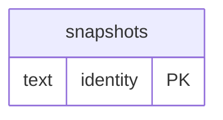

# Intelligence: Sources Evidence (2)

Provider requests, cache heads, accepted source evidence, credentials metadata and Maia jobs.

**Current source schema, deployment unverified.** Owner: Intelligence; SQL schema `intelligence`. Derived from checked-in DDL at the `14ad5754` baseline with file relocation only. No live database was queried. [Database index](../../README.md).

Charts show primary/foreign key columns; the dictionary lists **every stored field and its SQL type**. `PK` means primary key (all marked fields form one composite key); `FK` means an enforced SQL foreign key. Parent `||`/`o|` means a required/optional parent; child `o{` means zero or more children and `o|` zero or one (a unique referencing tuple). Edges describe allowed SQL cardinality, not an obligation to create children. Nullable components of a composite FK can leave the tuple unlinked under PostgreSQL MATCH SIMPLE. No edge is inferred from a similar field name.

## Data dictionary

### `intelligence.snapshots`

Primary key: (`identity`). DDL: [0001_sources.sql](../../ddl/migrations/0001_sources.sql).

| Field | SQL type | Null allowed | Keys |
| --- | --- | --- | --- |
| `identity` | `text` | no | PK |
| `payload` | `jsonb` | no |  |
