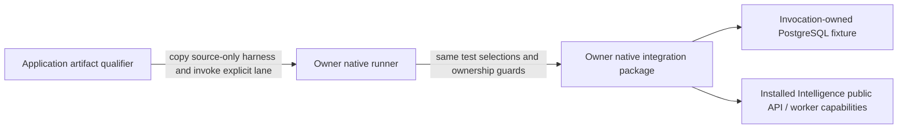

# Intelligence database tooling

**Current source placement; runner execution unverified for this move.**
[`run_postgres.py`](run_postgres.py) is the existing invocation-owned PostgreSQL
runner. The code still refuses an external database URL, allocates its own
bounded disposable resource, selects the same tests and verifies owned cleanup.
Only service/fixture/native file discovery and source-input fingerprint paths
changed. Source-distribution-only tooling is excluded from runtime wheels.

From the repository root, the existing explicit native command is now:

```sh
services/intelligence/.venv/bin/python database/tempo_intelligence_database/tooling/run_postgres.py /absolute/evidence/native
```

This command was **not run** for relocation validation. The optional actual A/B
lanes still require their same explicit inputs; no actual lane was executed.



Application artifact orchestration remains in
[`qualify_artifacts.py`](../../../services/intelligence/integration/qualify_artifacts.py).
It copies the owner `tests`/`tooling` into a clean consumer's `database/` tree,
retains application tests/fixtures and invokes this runner. Its source-input
fingerprint now includes the centralized owner files. The runner fingerprints
those moved inputs plus its actual build metadata; dated receipts remain unchanged.
Repository/service resource paths, extracted sdists and staged consumers are
checked without calling native entry points. No new runner, test framework,
transaction/role policy or live-resource action is introduced.
