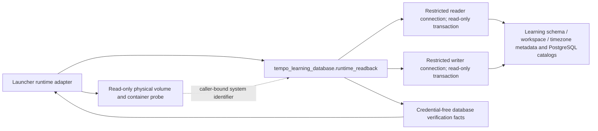

# Learning runtime database

**Current source schema; live deployment/schema unverified.** This owner directory groups existing persistence files within the single repository-root database tree. It creates no shared database runtime and changes no SQL, transaction policy or ownership. SQL namespace: `learning`.

| Directory | Contents |
| --- | --- |
| [adapters](adapters/README.md) | Concrete persistence implementations and read projections. |
| [ddl](ddl/README.md) | Schema metadata, ordered migrations and explicit owner migration entry points. |
| [schema](schema/README.md) | Rendered Mermaid relationships and complete field/type dictionaries. |
| [connections.py](connections.py) | Existing component-owned connection/transaction routing. |
| [runtime_readback.py](runtime_readback.py) | Installed public read-only verification before application startup. |

Learning alone owns queue/review/scheduling writes. Remediation DDL is supplied by its installed Learning-owned package and applied by this migration owner. There is no Games table access or Games serving prerequisite introduced here.

## Logical relationships (not SQL foreign keys)

Content publication IDs/generations and Game Evidence evidence/delivery identifiers are accepted protocol facts. They are not foreign keys into producer databases. Several local receipt/card fields deliberately have no FK so deletion/replay facts survive.

The dictionaries distinguish nullable fields, primary/composite keys, enforced FKs and uniqueness. Defaults/checks/triggers/partial or expression indexes remain authoritative in the linked DDL; they are not restated as extra relationships.

## Installed read-only runtime verification

**Implemented source and fake-boundary proof; native deployment unverified.**
The normal launcher runtime adapter may invoke the installed public module before
starting Learning or Study web. The existing Learning wheel hook includes this
top-level module; it does not require the source-only `tooling/` directory or
import the HTTP application, runtime connection pools, or another domain.



The public command is:

```text
python -I -m tempo_learning_database.runtime_readback
  --expected-database NAME --expected-workspace WORKSPACE
  --expected-schema sha256:DIGEST --expected-timezone IANA_TIMEZONE
  --expected-system-identifier INTEGER --expected-hostaddr IP --expected-port PORT
```

All expected values are supplied identities, never inferred from a candidate
database name. `--help` needs neither the database driver nor a connection.
`TEMPO_LEARNING_DATABASE_URL` and `TEMPO_LEARNING_READER_URL` must be the exact
credential-free four-field host/port/dbname/user DSNs emitted by the persistent
bootstrap. `TEMPO_LEARNING_WORKSPACE` and `TEMPO_LEARNING_TIMEZONE` must match.
`PGPASSFILE` references an absolute, nonsymlink, current-UID-owned private file.
Other nonempty `PG*` environment variables and hidden DSN routing/options/password
fields are refused. Passwords are never passed in arguments or returned.

Both connections are forced to the selected IP/port and bounded read-only
transactions. The adapter verifies database/session/current role, endpoint,
restricted role flags and absence of inherited membership/schema creation,
reader role read-only default and absence of reader write grants, exact installed
and applied migration-map SHA-256, workspace and timezone. It never scans content
for emptiness: ordinary installed Study content and progress are allowed.

On success, the version-1 JSON result contains `status=verified`, `scope=observed`,
`read_only=true`, database/workspace/timezone/schema, reader/writer role identities,
the selected endpoint and a fact digest `evidenceId`. Its
`server.identity_scope=caller-bound` is deliberate: restricted credentials do not
query `pg_control_system()` and receive no additional grants. The launcher owns
independent before/after `pg_controldata`, exact container, network and volume
binding. A caller-supplied system identifier is never represented as SQL proof.
These facts alone grant no admission, graph acceptance or authority switch.

Failures return only a fixed blocked code and exit 1; driver text and connection
strings are suppressed. No migrations, role changes, grants, queue endpoints,
application requests, writes, provisioning or recovery operations are exposed.

The owning fake suite is
[tests/test_runtime_readback.py](tests/test_runtime_readback.py).
Its source-only cases cover populated targets, endpoint/role/schema/metadata
mismatches, private configuration, hidden routing, read-only enforcement and
sanitized errors. No actual PostgreSQL or installed-container acceptance is
claimed. Stored schema and table relationships are unchanged.
