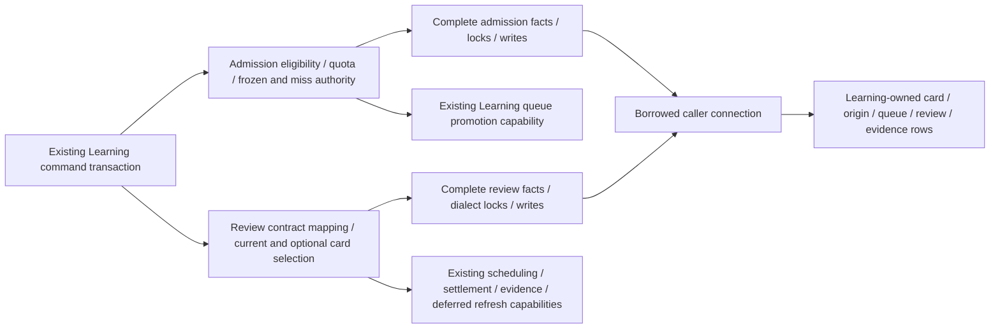

# Foreground admission and review storage

**Current source; deployment unverified.** Existing Learning admission and legacy review composition now use complete root-owner database operations. The application retains eligibility/quota/frozen authority, typed review contract mapping, optional/current card lock selection/order, clocks and required/deferred callbacks. This is a function split, with no new schema, constraints, migration, public contract, runtime framework or transaction owner.

| Application / composition outside database | Centralized storage |
| --- | --- |
| [admission.py](../../../../services/learning/runtime/src/tempo_learning_runtime/admission.py) keeps active/deleted/due/locked/family checks, new-card quota selection/comparison, frozen proposal/revision/publication fences, buried/protected miss rejection and queue-promotion decisions. Current card → queue-date lock → prelocked recheck stays in composition. | [Admission operations](../admission.py) retain complete bound reads for card/eligibility/route/origin quota/queue facts, unchanged card and protected-ID operations, existing candidate CTE and writes. Existing pure storage helper exports remain aliases; there is one implementation. |
| [review_adapter.py](../../../../services/learning/runtime/src/tempo_learning_runtime/review_adapter.py) retains Learning review DTO mapping, current-versus-optional sorted lock selection, archived-card short circuit, receipt/evidence/recovered-origin authority, explicit clocks and unchanged scheduling/reconciliation/settlement/evidence/refresh composition. | [Review operations](../review_adapter.py) retain complete policy/receipt/card/attempt/history/evidence reads, driver-specific current/optional card locks and bound completion/receipt/priority/evidence writes. Optional advisory denial still returns before a row wait; a successful PostgreSQL optional lock still uses `FOR UPDATE SKIP LOCKED`. |

No helper opens or commits a connection. The caller still owns transaction and rollback. Admission keeps its existing writer authority; physical colocation creates no second authority or private cross-owner access. Review still completes the original identified/legacy attempt around the same captured/preserved order provenance. Recovered-origin-only completion still avoids rewriting the daily attempt. Deferred daily → remediation → projection ordering, settlement callbacks and follow-up identity remain application-owned. These are existing composition boundaries; whole-runtime/domain isolation and native PostgreSQL races/locks remain unverified for this move.

The unchanged canonical source ER charts and full field/type dictionaries show the affected storage:

- [Study queue/review](../../schema/study-queue-review-1/README.md): `cards` holds accepted definition/schedule/introduction facts; `daily_queue` holds membership, position/admission/attempt state/result and an enforced card FK. Composite-keyed `queue_attempt_origins` preserves original quota and issuance/definition facts without an enforced queue FK. `reviews` holds card-bound history; `review_attempt_receipts` holds attempt identity, original request/outcome/time and retained result. Receipt card/queue/review associations are logical, with no invented FKs.
- [Authored content](../../schema/authored-content/README.md) and [opening graph](../../schema/opening-graph/README.md): repertoires/lines/memberships and published routes provide existing integrity, route and quota inputs. [Study definitions](../../schema/study-queue-review-2/README.md) supply published exercise and sibling-burial facts.
- [Opening evidence](../../schema/opening-evidence/README.md): attempts, frozen ranks/activation and queue contexts hold existing exposure/completion and inherited scope facts. Follow that ER view for actual composite keys and enforced relationships.
- [Runtime settings](../../schema/runtime-metadata/README.md), [practice families](../../schema/practice-families/README.md) and [publication evidence](../../schema/publications-evidence/README.md) document family quotas/policy, tactic clean-pass facts and priority advisory notifications.

All 56 original SQL strings/fragments match across the original 53 database call sites (21 admission/32 review sites). Forty-three representative original/new paths preserve results/DTOs, exact query/parameter order, capability calls, deferred state and clock placement (111 queries and two clock reads); synthetic PostgreSQL selection opens no connection. [Eighteen semantic boundary cases](../../../../services/learning/runtime/tests/test_admission_review_storage_separation.py) complement existing [review policy](../../../../services/learning/runtime/tests/test_review_policy.py) and [queue persistence](../../../../services/learning/runtime/tests/test_queue_persistence.py) proofs. Native eligibility/transaction suites retain actual concurrency/rollback ownership and were not run. Six Learning baseline mixed files and the initial root-store policy audit remain unfinished; this is not owner-completion or live-schema qualification.
