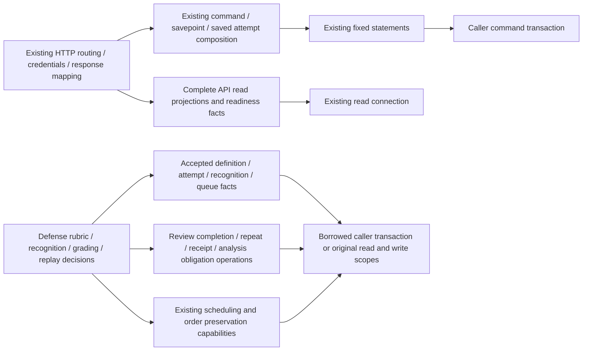

# Learning HTTP projections and defense storage

**Current source; deployment unverified.** Learning HTTP composition and defense practice decisions remain outside database. Complete bound reads, writes, savepoint statements and driver/dialect details live in the root Learning owner adapters. No schema, constraint, migration, route, public request/response, credential rule, writer/queue authority or framework changes.

| Application / composition outside database | Centralized storage |
| --- | --- |
| [api.py](../../../../services/learning/runtime/src/tempo_learning_runtime/api.py) retains all route/handler registration, credentials/origin/host/configuration, lifecycle/maintenance, exceptions/status/request mapping and receipt/queue authority. Reconciliation still decides handled savepoint rollback; readiness compares actual and expected migration facts. Queue entry status/day/head mapping, evidence JSON, safe exercise presentation, committed feedback and publication retry/preparation stay in HTTP composition. | [API operations](../api.py) retain complete existing migration-history, queue-entry/head, evidence-event, exercise/committed-specification and operation-intent reads/writes. The head uses the existing owner availability builder and unchanged miss reason entirely within database. Driver exception/PoolTimeout imports retain original class identities for HTTP translation. |
| [defense.py](../../../../services/learning/runtime/src/tempo_learning_runtime/defense.py) retains accepted-definition assembly/current checks, report/rubric validation, preview/grading, recognition correctness and stale-evidence checks, replay/response mapping, clocks, repeat selection and scheduling/order capabilities. Original borrowed versus independently opened read/write scopes and card → queue-date lock → current/replay ordering remain. | [Defense operations](../defense.py) retain fixed accepted-definition, attempt/recognition/queue/source-game/settings reads; card row locks; completion/reinforcement/receipt/recognition/analysis-obligation writes. The existing configured-store predicate is evaluated in the owner adapter at its original two application decision points. |

No new helper opens or commits a connection. The existing scheduling/queue writer remains authoritative; defense borrows it through existing semantic capabilities. A caller-provided defense transaction still avoids opening another read/write scope. API readiness reads the same ordered migration resources and compares facts without migration application. Runtime availability exports remain unused callable compatibility wrappers; no application caller now assembles or executes their SQL. Their presence does not change domain boundaries or establish whole-runtime isolation.

The unchanged canonical source ER charts and full field/type dictionaries locate actual storage:

- [Runtime metadata](../../schema/runtime-metadata/README.md): migration history, settings and retained operation intent support readiness, the existing interval and publication retries. No migration executes in this view.
- [Study queue/review](../../schema/study-queue-review-1/README.md) and [typed Study definitions](../../schema/study-queue-review-2/README.md): card/queue current facts, completion/repeat placement and committed exercise revision/specifications retain original keys and constraints. Presentation still omits answer fields, while committed feedback reads the original attempt-bound revision.
- [Practice families](../../schema/practice-families/README.md): accepted defense definitions, defense attempt and recognition receipts; durable analysis obligations retain their original stored identities/outcomes. Associations that are logical remain labeled as such in those ER views; this split creates no FKs.
- [Opening evidence](../../schema/opening-evidence/README.md): attempt and bounded ordered events remain separate existing read scopes, with a missing attempt rejected before event access.

Forty-two original SQL execution sites retain all 33 distinct fixed SQL strings and the existing ordering fragment and the exact expanded availability query. Defense shares repeated reads at their original call positions; API gateway command execution is not a database statement. Sixty-five original/current fake-connection paths match results/errors, exact SQL/parameters/cursor consumption, capability order, 37 clock reads and 108 original scope-boundary events across 297 query executions. Borrowed successful recognition, control completion, defense completion and analysis-obligation paths create no new scopes. [Twenty semantic cases](../../../../services/learning/runtime/tests/test_api_defense_storage_separation.py) complement eleven existing [queue projection/composition checks](../../../../services/learning/runtime/tests/test_queue_persistence.py). These do not qualify native PostgreSQL rollback, locking, grading-report integration or races. All original Learning mixed-file checklist paths are separated; source classification and any necessary extraction of application policy in the initially moved adapters remain unfinished. Live schema and deployment/resource isolation remain unverified.
