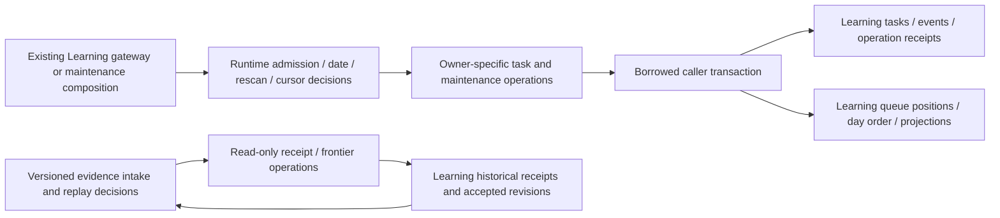

# Essential Learning work and receipt storage

**Current source; live deployment unverified.** These are existing operations split from three Learning runtime modules. Learning still owns the connection, transaction, task lifecycle and required settlement. No schema, migration, stored field, constraint, public request or response changes here.

| Application / composition outside database | Complete storage operations |
| --- | --- |
| [Durable task admission](../../../../services/learning/runtime/src/tempo_learning_runtime/durable_tasks.py) keeps essential-kind admission, date ordering, same-day active-sweep rescan and reset decisions. | [durable_tasks.py](../durable_tasks.py) keeps original bound SQL for enqueue/events, create-or-lock, payload/reset writes and claim. Claim retains `FOR UPDATE SKIP LOCKED` and the existing two-second lease. No connection/commit is added. |
| [Maintenance](../../../../services/learning/runtime/src/tempo_learning_runtime/maintenance.py) keeps operation-first scheduling, retries, late rescan merge, cursor/order planning, timestamps, error handling and projection publication order. | [maintenance.py](../maintenance.py) keeps original queued-operation reads/defer, fenced task payload/completion/release and queue/day/projection reads/writes. Existing driver exception identities are imported by composition so its original catch behavior remains. |
| [Evidence intake](../../../../services/learning/runtime/src/tempo_learning_runtime/receivers.py) keeps version/workspace validation, custom receiver authority, digest/replay conflicts and remediation acknowledgement translation. | [evidence_receipts.py](../evidence_receipts.py) borrows the caller transaction for only the two historical receipt/frontier reads. Required remediation continues through its existing public receiver interface. |

The claim transaction still commits before application work. A yielded application transaction rolls back before a separate fenced lease release. Remediation completion reads the current payload under its existing late row lock, merges an arriving rescan, and keeps the generation/lease/expiry fence. Queue position locks and task completion still precede projection publication. This is existing Learning composition, not a claim that every runtime module is now a storage-independent domain.

The source-schema views remain the canonical ER charts and complete dictionaries:

- [Runtime metadata](../../schema/runtime-metadata/README.md): `background_tasks` stores task identity, text JSON payload, generation/state/phase, priority/retry bounds and lease token/timestamps. `background_task_events` stores task/generation/event/time; its `task_id` has an enforced FK to tasks. `operation_receipts` stores command/request identity, text JSON request/response/error and retry timestamps.
- [Study queue](../../schema/study-queue-review-1/README.md): `daily_queue` stores card membership/status and position; `daily_queue_days` stores the date/seed/membership hash/generated time; `queue_projections` stores readiness/generation/refresh state. The day value shared by tasks, queue days and projections is a logical relationship, not an added FK.
- [Publication evidence](../../schema/publications-evidence/README.md): `evidence_deliveries` retains delivery digest and response JSON; `accepted_evidence_revisions` retains the composite workspace/evidence key, revision and semantic digest. Their logical evidence identities do not imply an enforced FK.

All 20 SQL literals in these three splits match captured original source; locks, bound values and caller transaction authority remain. [Focused semantic tests](../../../../services/learning/runtime/tests/test_essential_work_storage_separation.py) cover coalescing, stale-day no-op, lease fences, rollback-before-release, retained operation deferral, projection publication ordering, workspace denial, historical replay/conflict and current-frontier/custom-receiver authority. The native enqueue/remediation/evidence transaction suites remain the owners of real PostgreSQL races/locking; they were not run in this relocation batch. The other fifteen Learning baseline mixed files remain extraction work; no live schema or data was inspected.
