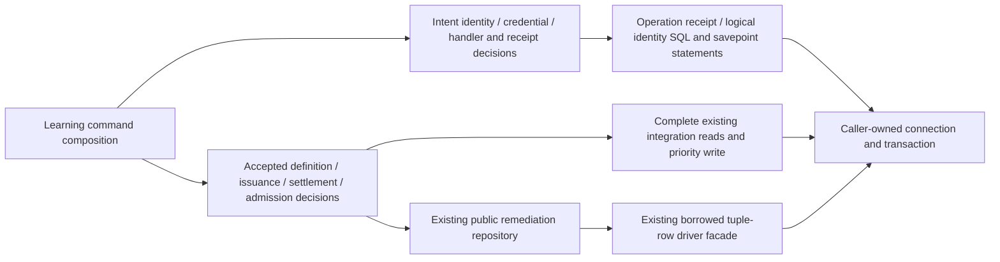

# Command receipts and remediation integration storage

**Current source; deployment unverified.** Existing command lifecycle and remediation decisions stay in Learning runtime. Complete SQL and the existing borrowed tuple-row driver facade live in this root-owner database directory. No schema, constraint, migration, public contract, framework or transaction owner changes.

| Application / composition outside database | Centralized storage |
| --- | --- |
| [gateway.py](../../../../services/learning/runtime/src/tempo_learning_runtime/gateway.py) retains handler registration, request digests, credentials, immutable logical identity decisions, publication fences, error/result mapping and outer transaction/savepoint orchestration. Driver errors keep their original class identities and escape to the outer rollback. Handled conflicts retain the savepoint rollback and failed receipt. | [Gateway operations](../gateway.py) execute the existing intent/receipt reads and writes, operation advisory/row locks, logical identity binding and savepoint statements on the caller connection. Four duplicate SQL statements share one named implementation each. |
| [remediation_adapter.py](../../../../services/learning/runtime/src/tempo_learning_runtime/remediation_adapter.py) retains accepted-definition projection/uniqueness checks, sorted affected-card locks, workspace context, immutable issued-at/binding authority, settlement qualification, clocks, miss clearing, follow-up ordering and maintenance/admission decisions. | [Remediation integration operations](../remediation_adapter.py) retain complete card/publication/alias/route/queue/review/origin reads, the existing priority write and original integration reads of remediation workspace/obligation/attempt rows. `BorrowedConnection` is an intact move of the existing per-cursor tuple-row facade; its runtime export remains an alias. |

No helper opens or commits a connection. Runtime composition still owns the transaction, savepoint lifecycle and public remediation repository connection borrowing. The existing direct remediation integration reads are preserved, with no new tables or access added; this move does not establish private-table isolation. The repository remains the existing remediation writer authority. Physical colocation does not introduce another owner or a shared runtime module.

The unchanged canonical source ER charts and full field/type dictionaries describe actual storage and constraints:

- [Runtime metadata](../../schema/runtime-metadata/README.md): `operation_receipts` stores operation identity, command/hash/payload, queued/terminal state, retained response/error and timestamps; the operation key and state are transport receipt authority.
- [Authored content](../../schema/authored-content/README.md): `logical_request_bindings` retains the composite family/attempt identity and request hash, without an invented receipt FK.
- [Publication evidence](../../schema/publications-evidence/README.md): accepted/serving publication identities, payloads and physical/content aliases supply existing definition authority. Follow those charts for enforced composite keys/FKs versus logical associations.
- [Study queue/review](../../schema/study-queue-review-1/README.md): cards, queue membership/priority, original issuance facts, review outcome/guidance/source/validity and deleted-card markers supply settlement/candidate facts. [Opening graph](../../schema/opening-graph/README.md) supplies published route membership and integrity fences.
- [Remediation schema](../../../tempo_remediation_database/schema/README.md): workspace revision, obligation heads and immutable attempt bindings remain remediation-owned storage. Read access above already existed in this integration; no relationship or constraint is added by relocation.

All 15 original remediation SQL strings match. Gateway retains all 16 original SQL occurrences as 12 distinct stored statements, sharing the four previously duplicated operations. Twenty-nine representative original/current paths preserve results, exact SQL/parameters, transaction events, callback order and clock placement (93 queries, seven clock reads and 40 transaction-boundary events). [Seventeen semantic boundary cases](../../../../services/learning/runtime/tests/test_gateway_remediation_storage_separation.py) cover credential/savepoint/driver handling, receipt idempotency, accepted authority, immutable issuance, settlement and follow-up order. These use fakes and do not qualify native PostgreSQL savepoint/rollback, locking or races. Four Learning baseline mixed files and source classification of the initially moved root adapters remain unfinished; this is not full-runtime or live-schema qualification.
