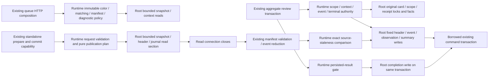

# Opening evidence application and storage

**Current source; deployment unverified.** Existing opening-evidence decisions moved out of database into the Learning runtime [opening_evidence directory](../../../../services/learning/runtime/src/tempo_learning_runtime/opening_evidence/README.md). The original root adapter now owns complete fixed SQL, driver identities and the original managed read sections. This is the remaining application-policy split identified by the initial adapter audit, with no schema, constraints, models, public request/response, framework, writer or queue authority change.

| Application / composition outside database | Root-owner storage |
| --- | --- |
| [Runtime opening_evidence](../../../../services/learning/runtime/src/tempo_learning_runtime/opening_evidence/__init__.py) retains canonical protocol JSON, HTTP conflict/fallback mapping, immutable learner-color and presentation matching, checkpoint model/manifest validation, scope/card/deletion/parent authority, context/queue/terminal/event identity, contiguous sequence/completion decisions, observation reduction/deltas/clean-day selection, exact source-staleness fence and response/pagination mapping. The existing `PreparedOpeningCheckpoint` DTO and pure preparation function move intact. | [postgres_opening_evidence.py](../postgres_opening_evidence.py) owns complete parameter-bound snapshot/context, original-card/receipt/scope, header/event, observation/summary/clean-day and decision projection operations. The configured-store/driver identities and original managed read scopes stay here. `_read_checkpoint_source` remains an intact storage implementation, aliased by application composition. |
| [API composition](../../../../services/learning/runtime/src/tempo_learning_runtime/api.py) now imports the runtime application capability for optional manifests, preparation/persistence and decision output. [Review composition](../../../../services/learning/runtime/src/tempo_learning_runtime/review_adapter.py) imports the same runtime error/persistence/completion functions. | Storage no longer imports runtime manifest/reduction/validation or card-deletion application policy, and no longer builds HTTP errors or prepared publication models. Existing pure scheduling-record interface imports in the separate scheduling store remain legitimate interface dependencies. |

Managed snapshot/queue/source readers retain their original resource sections, including queue-identity binding inside the read scope. Connections close before manifest/chess validation or pure standalone reduction. Foreground and standalone writers still borrow the caller transaction; no helper acquires a writer, commits, creates another settlement/queue authority or splits aggregate review/evidence atomicity. Existing advisory identity → deletion gate → row/scope/receipt locks and journal/summary/observation order remain. Source staleness still raises the identical `psycopg.errors.SerializationFailure` class before publishing events/observations. The standalone public functions remain even though this scoped source search did not establish a Learning-runtime caller; absence of a caller is not deletion authorization.

Actual source tables, fields, types, composite keys and enforced versus logical relationships remain in the unchanged [opening-evidence ER chart and dictionary](../../schema/opening-evidence/README.md):

- Immutable `opening_evidence_presentations` and `opening_evidence_queue_contexts` retain card/revision/executable/color and queue/repertoire scope facts.
- `opening_evidence_attempts` retains immutable context/manifest, origin/queue association, contiguous/terminal/lifecycle state, completion/review result and retirement facts. `opening_evidence_events` retains sequence-bound canonical event content.
- `opening_evidence_observations`, `opening_evidence_summaries` and `opening_evidence_clean_days` retain per-decision observed recall facts, count deltas and distinct clean-day facts. These are shadow evidence; they do not schedule or mutate cards/queue/review state.
- Original card/queue and review receipt inputs are described by [Study queue/review](../../schema/study-queue-review-1/README.md). No absent FK is implied by this composition view.

All thirty distinct SQL strings/fragments match captured originals (33 original literals/fragments across 32 direct SQL sites; 31 physical strings/fragments after sharing the snapshot read and checkpoint update). Six pure helpers, the prepared DTO and the bounded source reader retain identical source text. Forty-nine original/current fake-connection paths match results/errors, exact SQL/bound parameters/cursor consumption, durable fake journal/observation facts and 24 read-scope boundary events across 280 query executions. [Nineteen semantic boundary cases](../../../../services/learning/runtime/tests/test_opening_evidence_storage_separation.py) cover close-before-compute, resource cleanup, fallback/current/replay authority, immutable identity, clean-day/idempotent deltas, staleness and publication order. Existing queue/review policy checks retain caller composition coverage. Native PostgreSQL locking, rollback, race, standalone usage and deployment/resource independence remain unverified; no native/live/full-system campaign ran.
