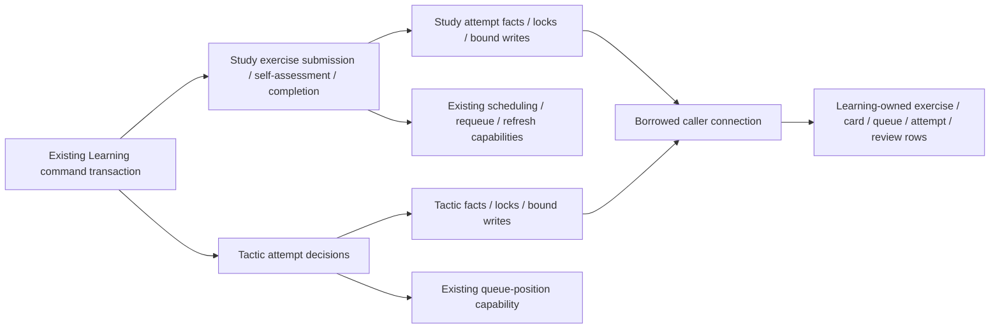

# Study exercise and tactic attempt storage

**Current source; deployment unverified.** Three existing Learning command/completion modules now use complete owner-specific storage operations in the single root database tree. Grading, request validation, replay/revision conflicts, guided ratings, due-date choices and queue/refresh decisions stay in the application. These function splits change no schema, constraints, migrations, public contracts, transaction owner or stored values.

| Application / composition outside database | Centralized storage |
| --- | --- |
| [Study exercise completion](../../../../services/learning/runtime/src/tempo_learning_runtime/study_attempts.py) checks current card/queue revision, selects guided versus requested rating, invokes existing scheduling/requeue, assembles the result and decides sibling exposure/day values. Practice completion still creates no scheduling/queue effects. | [study_attempts.py](../study_attempts.py) retains completion facts/settings/latest review reads, finalization and queue result writes, and existing sibling query/burial/block SQL. The sibling iterator executes and consumes its database cursor inside the adapter. |
| [Study exercise commands](../../../../services/learning/runtime/src/tempo_learning_runtime/study_attempt_commands.py) retain request hashing/replay, ownership/revision/retirement checks, answer grading, pending self-assessment and refresh decisions. | [study_attempt_commands.py](../study_attempt_commands.py) retains advisory identity lock, card/queue/attempt row locks and complete reads/bound insertion. Identical existing attempt-by-id and queue-date queries share named operations, called at their original points. Card → queue-date position lock → queue row → attempt/review checks remains the original sequence. |
| [Tactic attempt](../../../../services/learning/runtime/src/tempo_learning_runtime/tactic_commands.py) retains content-derived identity, deletion guard, immutable receipt replay, clean/light due-date choice, normal/guided recovery and response selection from the persisted schedule. | [tactic_commands.py](../tactic_commands.py) retains puzzle lock, receipt/settings reads, repertoire/progress/card persistence, card row lock, queued-attempt read and retained schedule/result writes. Existing daily tactic admission and queue-position locks keep their original owners/order. |

Learning's gateway/caller still owns connection, commit and rollback. No adapter opens a connection, commits independently or imports application/domain implementations. Application composition continues calling existing Learning-owned scheduling and queue capabilities; this drawing does not certify a complete future domain-folder boundary or runtime extraction.

The unchanged canonical ER charts and full field/type dictionaries show where the affected data live:

- [Study queue/review](../../schema/study-queue-review-1/README.md): `study_attempts` stores immutable answer/hash/assessment, context and card/queue/cycle binding, grader/hint/exposure metadata, commit/finalization timestamps and retained result JSON. Its enforced exercise/card/queue FKs and unique queue binding are documented there, alongside `cards`, `daily_queue` and `reviews`.
- [Study definitions/burials](../../schema/study-queue-review-2/README.md): `study_exercises`, `study_exercise_revisions` and `study_positions` supply accepted exercise/revision/specification/FEN facts. `study_sibling_burials` retains the composite exercise/day key and reason; follow the chart for actual enforced relationships.
- [Practice families](../../schema/practice-families/README.md): `tactic_progress` stores puzzle/deck/card admission and clean-pass facts; `tactic_discovery_attempts` stores attempt identity, source deck/puzzle, clean flag and result JSON. Their logical identities do not add cross-table foreign keys.
- [Runtime settings](../../schema/runtime-metadata/README.md): the existing `light_first_interval_days` setting remains the input to application scheduling/due-date decisions.

All 43 original query sites use unchanged SQL strings; two repeated command reads now share operations, leaving 41 physical SQL literals. A one-time comparison of seven representative original/new paths found identical returned values, SQL order and bound parameters (55 total query executions), including completion/requeue/sibling effects, automatic/pending Study answers, review self-assessment and clean/failed tactic attempts. [Focused semantic tests](../../../../services/learning/runtime/tests/test_attempt_storage_separation.py) retain the application fences and decisions without parsing SQL or opening a connection. Native family/eligibility/transaction suites retain actual PostgreSQL locking/race/rollback proof and were not run for this move. Twelve Learning baseline mixed files remain; no live schema/data was inspected.
