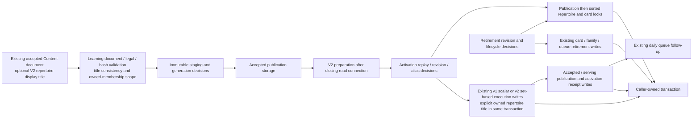

# Accepted publication execution storage

**Current source; deployment unverified.** Learning remains the sole accepted-execution writer. Runtime validates publication documents and executable identity, then calls complete root-owner storage operations on its existing caller-owned transaction. The additive V2 repertoire-title capability below extends the existing route contract and name write; it changes no schema, constraints, migrations, lease authority, transaction owner or framework.

| Application / composition outside database | Centralized storage |
| --- | --- |
| [publications.py](../../../../services/learning/runtime/src/tempo_learning_runtime/publications.py) retains `ExecutionFacts` / v1 bundle validation, legal moves/learner turn, completeness/parent cycles/frozen identity checks, serialized hash, immutable staging and generation gates. Activation retains receipt/revision/definition/family/ownership decisions, stable repertoire/card lock selection, typed family and frozen rank projection/fingerprints, exact opening-graph verification, timestamps and refresh. Retirement retains revision checks, lifecycle orchestration and response. | [Publication operations](../publications.py) retain complete accepted/serving/receipt reads and writes, existing advisory/row locks, scalar v1 card/membership/study/endgame/defense/graph/frozen operations and existing retirement updates. No operation opens or commits a connection. |
| [publication_bridge.py](../../../../services/learning/runtime/src/tempo_learning_runtime/publication_bridge.py) retains v2 route/decision and alias models, canonical hashes, physical alias fallback, status mapping, exact operation validation/fencing and preparation context lifecycle. Activation retains historical alias/adoption/revision comparisons and original ordering of card, alias, membership, integrity and route row construction, retirement/supersession selection and clocks. | [Bridge operations](../publication_bridge.py) retain complete read projections, sorted set-based card advisory/row locks, original PostgreSQL JSONB wrapping and bound set-based writes. Identical accepted/serving/receipt operations are imported from the same owner's publication adapter, with a single implementation. |

Preparation still closes its read connection before document/model work and before entering gateway dispatch. The prepared digest is rechecked against immutable staging under writer locks. Publication → sorted removed/new repertoire ownership → card locks → execution/queue effects retains the original order. V1 keeps per-card locks; v2 keeps one ordered set-based advisory statement. Application composition still makes all conflict/replay/adoption/retirement decisions and owns required atomicity with the gateway receipt. Existing card schedule/review history and accepted physical identity retain the original upsert behavior. Generic SQL execution ports or an additional writer were not introduced.

## Optional repertoire display title

The existing public Content bridge export already supplies
`routes[].repertoire_title`. The [public bridge CLI](../../../../tools/analysis-restoration/a_bridge/src/tempo_a_bridge/cli.py)
now retains it in the existing Learning V2 route payload. No Content store or
private cross-domain function is imported. Learning's existing `Route` model
accepts an optional, nonblank title of at most 2,000 characters. It preserves the
authored text exactly. Every explicitly supplied title for a repertoire must
agree, and the repertoire must occur in accepted opening-fact memberships.
An unbound extra route cannot authorize a name write outside the existing
membership ownership locks.

Omitted or null titles carry no name instruction. They remain omitted from
serialized routes, preserving prior payload/digest bytes. Mixed old untitled
routes and titled routes are allowed; the one consistent explicit title supplies
the name. An all-untitled activation retains the previous insert-on-conflict
no-op behavior, including an existing repertoire's name and source metadata.

After the existing publication/repertoire/card locks and compatibility checks,
the activation calls its existing `insert_repertoires` adapter. Explicit names
update only `repertoires.name`, using bound JSONB rows additionally restricted to
the passed repertoire ID set. The caller's activation transaction still owns
the entire graph/name/serving/receipt change. A later activation failure rolls
the title back with the graph; replay of a completed activation returns its
receipt before any name write and cannot revert a newer generation's title.

The immutable full V2 bundle digest binds supplied names. The existing public
`routes_digest` remains the routing-graph projection, excluding this display-only
field, so existing public bridge snapshots and graph consumers remain compatible.
The source/export digest also binds the authored title. No optional service or
new endpoint is involved. The [generated V2 schema fixture](../../../../tools/analysis-restoration/a_bridge/fixtures/schemas/learning-publication-bundle-v2.json)
comes from the owning `tempo-learning publication-schema` command.

Focused proofs live in the existing bridge `test_operator.py`, Learning
`test_decision_projection.py` / `test_publication_storage_separation.py`, and the
named title cases in `test_content_bridge.py`. The latter use the owning
invocation-disposable PostgreSQL runner for actual name persistence,
title-absent metadata preservation, receipt replay, writer-scope restriction and
activation rollback. Source tests alone do not establish those storage claims.

The unchanged canonical source ER charts and full field/type dictionaries locate the actual data:

- [Publication evidence](../../schema/publications-evidence/README.md): `accepted_publications` holds immutable generation/digest/payload and state; `serving_publications` retains the selected generation and activation revision; `activation_receipts` stores operation/request/result replay authority; `content_card_aliases` stores one-to-one authored/physical bindings. Follow this view for actual composite keys/enforced references versus logical relationships.
- [Authored content](../../schema/authored-content/README.md) and [opening graph](../../schema/opening-graph/README.md): repertoires, membership/integrity blocks, lines and executable graph steps store accepted routes and ownership inputs. The graph comparison retains actual executable facts rather than comparing counts alone.
- [Study queue/review](../../schema/study-queue-review-1/README.md) and [typed Study definitions](../../schema/study-queue-review-2/README.md): accepted card definitions coexist with retained scheduling/history; daily queue entries are superseded under the same existing conditions; typed authored exercises retain revision/specification facts.
- [Practice families](../../schema/practice-families/README.md) and [opening evidence](../../schema/opening-evidence/README.md): endgame templates, accepted defense exercises and frozen runs/ranks/activation retain their original stored fields and lifecycle.

The preceding extraction retained all 70 distinct original SQL strings. Ninety-four original call sites used 72 physical literals after sharing identical operations; duplicated lock SQL across distinct semantic lock namespaces remained explicit. Its 55 original/current fake-connection paths preserved returned values/errors, exact query/bound parameter/cursor order, capability calls, prepared context and clock placement (637 query executions and 39 clock reads). The additive title capability introduces one bound name-update statement only when a title is explicit; those historical extraction counts are not a new title-qualification receipt. The existing semantic boundary suite covers immutable staging, receipt replay, preparation, alias/revision fences, accepted physical identity, exact graph verification and retirement/lock/follow-up order; [decision projection](../../../../services/learning/runtime/tests/test_decision_projection.py) checks retain v2 model behavior. Fake/source checks do not establish native PostgreSQL locking, contention, rollback, lease fencing or full publication integration. API/defense baseline extraction and initial-adapter policy classification remain unfinished; live schema and deployment isolation remain unverified.
