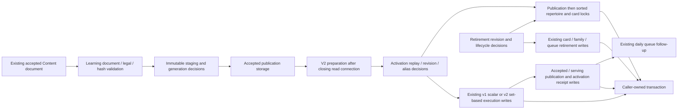

# Accepted publication execution storage

**Current source; deployment unverified.** Learning remains the sole accepted-execution writer. Runtime validates publication documents and executable identity, then calls complete root-owner storage operations on its existing caller-owned transaction. No schema, constraints, migrations, public contracts, lease authority, transaction owner or framework changed.

| Application / composition outside database | Centralized storage |
| --- | --- |
| [publications.py](../../../../services/learning/runtime/src/tempo_learning_runtime/publications.py) retains `ExecutionFacts` / v1 bundle validation, legal moves/learner turn, completeness/parent cycles/frozen identity checks, serialized hash, immutable staging and generation gates. Activation retains receipt/revision/definition/family/ownership decisions, stable repertoire/card lock selection, typed family and frozen rank projection/fingerprints, exact opening-graph verification, timestamps and refresh. Retirement retains revision checks, lifecycle orchestration and response. | [Publication operations](../publications.py) retain complete accepted/serving/receipt reads and writes, existing advisory/row locks, scalar v1 card/membership/study/endgame/defense/graph/frozen operations and existing retirement updates. No operation opens or commits a connection. |
| [publication_bridge.py](../../../../services/learning/runtime/src/tempo_learning_runtime/publication_bridge.py) retains v2 route/decision and alias models, canonical hashes, physical alias fallback, status mapping, exact operation validation/fencing and preparation context lifecycle. Activation retains historical alias/adoption/revision comparisons and original ordering of card, alias, membership, integrity and route row construction, retirement/supersession selection and clocks. | [Bridge operations](../publication_bridge.py) retain complete read projections, sorted set-based card advisory/row locks, original PostgreSQL JSONB wrapping and bound set-based writes. Identical accepted/serving/receipt operations are imported from the same owner's publication adapter, with a single implementation. |

Preparation still closes its read connection before document/model work and before entering gateway dispatch. The prepared digest is rechecked against immutable staging under writer locks. Publication → sorted removed/new repertoire ownership → card locks → execution/queue effects retains the original order. V1 keeps per-card locks; v2 keeps one ordered set-based advisory statement. Application composition still makes all conflict/replay/adoption/retirement decisions and owns required atomicity with the gateway receipt. Existing card schedule/review history and accepted physical identity retain the original upsert behavior. Generic SQL execution ports or an additional writer were not introduced.

The unchanged canonical source ER charts and full field/type dictionaries locate the actual data:

- [Publication evidence](../../schema/publications-evidence/README.md): `accepted_publications` holds immutable generation/digest/payload and state; `serving_publications` retains the selected generation and activation revision; `activation_receipts` stores operation/request/result replay authority; `content_card_aliases` stores one-to-one authored/physical bindings. Follow this view for actual composite keys/enforced references versus logical relationships.
- [Authored content](../../schema/authored-content/README.md) and [opening graph](../../schema/opening-graph/README.md): repertoires, membership/integrity blocks, lines and executable graph steps store accepted routes and ownership inputs. The graph comparison retains actual executable facts rather than comparing counts alone.
- [Study queue/review](../../schema/study-queue-review-1/README.md) and [typed Study definitions](../../schema/study-queue-review-2/README.md): accepted card definitions coexist with retained scheduling/history; daily queue entries are superseded under the same existing conditions; typed authored exercises retain revision/specification facts.
- [Practice families](../../schema/practice-families/README.md) and [opening evidence](../../schema/opening-evidence/README.md): endgame templates, accepted defense exercises and frozen runs/ranks/activation retain their original stored fields and lifecycle.

All 70 distinct original SQL strings remain. Ninety-four original call sites use 72 physical literals after sharing identical operations; duplicated lock SQL across distinct semantic lock namespaces remains explicit. Fifty-five original/current fake-connection paths preserve returned values/errors, exact query/bound parameter/cursor order, capability calls, prepared context and clock placement (637 query executions and 39 clock reads). [Twenty semantic boundary cases](../../../../services/learning/runtime/tests/test_publication_storage_separation.py) cover immutable staging, receipt replay, preparation, alias/revision fences, accepted physical identity, exact graph verification and retirement/lock/follow-up order; existing [decision projection](../../../../services/learning/runtime/tests/test_decision_projection.py) checks retain v2 model behavior. These checks do not establish native PostgreSQL locking, contention, rollback, lease fencing or full publication integration. API/defense baseline extraction and initial-adapter policy classification remain unfinished; live schema and deployment isolation remain unverified.
