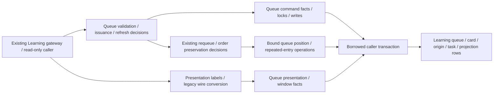

# Foreground Learning queue storage

**Current source; deployment unverified.** This is a mechanical split of the existing queue application/command modules. Runtime retains presentation classification, bounded wire conversion, retry placement, retained-attempt/issuance conflicts, burial, and task/projection refresh decisions. Complete queries, cursor reads, dialect checks and locks live in the same owner's root database tree. No schema, constraints, stored values, migration, public request/response or transaction authority changes here.

| Application / composition | Centralized storage and preserved behavior |
| --- | --- |
| [queue_application.py](../../../../services/learning/runtime/src/tempo_learning_runtime/queue_application.py) retains explicit/review/new presentation labels, eligibility annotation, requeue offset/fallback decisions and pre/post mutation order provenance. It keeps window limits, JSON/typed snapshot conversion and the original legacy wire-field allowlist. | [Queue application operations](../queue_application.py) retain complete presentation/history/eligibility reads, cycle/position/offset facts, position shifts, repeated-entry insertion and metadata write, typed source/latest-review/window/count/projection reads and pending-projection write. Card JSON is still decoded before the original per-card source reads. |
| [queue_commands.py](../../../../services/learning/runtime/src/tempo_learning_runtime/queue_commands.py) retains current-day/head checks, origin/revision conflict translation, first-issuance binding, failed/buried results and ready/coalesced/new refresh choices. | [Queue command operations](../queue_commands.py) retain card advisory/row locks, optional PostgreSQL queue-position lock, available/head/origin facts, issuance/failure/burial writes, first-task creation serialization/recheck and task/projection locks/writes. The adapter owns driver/dialect branches; the application supplies its unchanged semantic miss reason rather than SQL fragments. |

The existing gateway/caller still owns connection, transaction, commit and rollback. Task locking still precedes projection locking; an absent task is serialized/rechecked before a projection can be held. Retained attempts still require current availability plus current-head or prior issued-head authority. Binding still occurs after validation and before marking head issuance. Queue mutation still captures/preserves presentation provenance around the same writes. Refresh requests still enqueue daily work → remediation → pending projection on the same transaction.

The availability query/predicates now have one implementation inside database. Runtime's existing `available_attempt_sql()` exports remain compatibility wrappers for the pending [API entry-state query](../../../../services/learning/runtime/src/tempo_learning_runtime/api.py); that mixed API file is still on the extraction checklist. These wrappers are transitional unfinished work, not a new SQL execution interface or a claim that every runtime caller is storage-independent. Other remaining review/admission commands and the initial adapter policy audit also remain unfinished.

The unchanged source-schema ER charts and complete field/type dictionaries remain canonical:

- [Study queue/review](../../schema/study-queue-review-1/README.md): `daily_queue` stores date/card/cycle membership, position/status, admission, attempt failure/state and retained review result; its card FK is enforced. `queue_attempt_origins` retains the composite queue-entry/card/revision identity and original issuance/completion facts without an enforced queue FK. `daily_queue_days` holds date/seed/membership hash/generated time; `queue_projections` holds date/readiness/generation/refresh/error metadata. Shared day values are logical relationships, not added FKs.
- [Runtime metadata](../../schema/runtime-metadata/README.md): `background_tasks` retains the unique kind/deduplication pair, payload/generation/state/error/lease/retry metadata. Existing `settings` supplies family eligibility. This slice changes no writer or task/queue relationship.
- [Study definitions](../../schema/study-queue-review-2/README.md), [opening evidence](../../schema/opening-evidence/README.md), [authored content](../../schema/authored-content/README.md) and [practice families](../../schema/practice-families/README.md) describe the accepted definition, exposure/teaching/history, membership and defense-source facts used by the existing availability/window queries. Follow their charts for actual enforced versus logical relationships.

All original SQL literal strings remain; the repeated maximum-position read now shares one operation. A one-time original/new comparison passed 16 representative paths and 74 query executions, preserving results, exact SQL order, bound parameters and existing capability order. A synthetic PostgreSQL connection class selected the existing dialect paths without initializing a connection. [Semantic tests](../../../../services/learning/runtime/tests/test_queue_storage_separation.py) and the existing [queue persistence suite](../../../../services/learning/runtime/tests/test_queue_persistence.py) cover decisions, typed/legacy windows and borrowed refresh order without native infrastructure. Native enqueue/eligibility/queue-presentation/transaction suites remain the actual PostgreSQL concurrency/locking proof and were not run for this move. Ten Learning baseline mixed files remain; no live schema/data was inspected.
