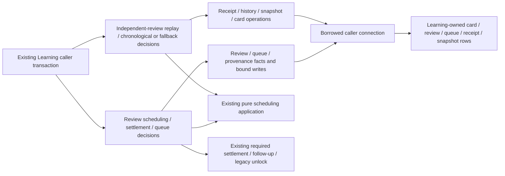

# Review service and reconciliation storage

**Current source; deployment unverified.** Existing review service/reconciliation files now keep complete SQL and cursor operations under Learning's root database owner. Schedule replay, maturity/time-zone/history decisions, queue positioning/provenance, settlement and follow-up callbacks remain in runtime. No schema, constraint, migration, stored value, request/response or transaction authority changes here.

| Application / composition outside database | Complete centralized operations |
| --- | --- |
| [review_service.py](../../../../services/learning/runtime/src/tempo_learning_runtime/review_service.py) replays valid defense reviews, chooses maturity, generates day/timestamps, captures/preserves order fingerprints, composes scheduling and required settlement, and selects ordinary/protected queue positioning. Idempotent scheduling still returns before review lookup/settlement/unlock. | [Review service storage](../review_service.py) retains original review/settings/queue/provenance facts, defense/card metadata writes, queue insertion/positions and complete protected-priority projection. That projection still uses remediation's existing public `current_miss_sql` predicate; the application supplies the original workspace identity. No new cross-owner table access is added. |
| [review_reconciliation.py](../../../../services/learning/runtime/src/tempo_learning_runtime/review_reconciliation.py) retains receipt identity/conflicts, history-only admission, review-time/time-zone cutoffs, the original 64-later-review replay bound, scheduler/maturity inputs, conservative fallback date, warnings/results and unlock/callback ordering. | [Reconciliation storage](../review_reconciliation.py) owns the original schedule column list, current-state/snapshot/receipt facts and writes, history cursor iteration, bound review insertion/interval updates and final card/due writes. Existing public helpers remain aliases; there is one implementation per moved operation. |

All effects continue on the caller-owned transaction. Clock reads and callbacks remain at their original application points. Each chronological event saves its pre-review snapshot, computes the next state, and writes intervals before the final card state; unlock follows those effects and precedes the immutable attempt receipt. Missing time/snapshot fallback preserves the computer schedule with the original conservative due date. These are existing composition boundaries, not full runtime/domain isolation or live transaction qualification.

The unchanged canonical source-schema ER charts and complete field/type dictionaries show where the affected data live:

- [Study queue/review](../../schema/study-queue-review-1/README.md): `cards` stores scheduling state and `reviews` retains rating/internal rating, guided flag, timestamp, previous/next interval and source identity, with an enforced card FK. `review_schedule_snapshots` stores review-keyed JSON state; `review_attempt_receipts` stores attempt identity/binding/outcome/time/review/status/warning/result/request. Snapshot/receipt review/card/queue associations are logical; their keys do not imply absent FKs. The same view documents queue positions/admission metadata and day-order fingerprints.
- [Authored content](../../schema/authored-content/README.md): `opening_card_schedule_seeds` retains baseline successful days/recent clean outcomes and source-card identity. Its two card FKs are enforced and documented with delete actions.
- [Runtime metadata](../../schema/runtime-metadata/README.md): `settings.light_first_interval_days` remains the existing scheduling input. [Opening evidence](../../schema/opening-evidence/README.md) documents frozen activation/ranks used by queue provenance.

All 32 SQL literal strings match captured original source. A one-time comparison passed 18 original/new paths with identical results, SQL order, bound parameters, capability/callback order and explicit clock-read placement (94 query executions and eight clock reads), including protected queue slots and chronological/fallback replay. [Twelve semantic boundary cases](../../../../services/learning/runtime/tests/test_review_storage_separation.py) cover scheduling, immutable replay, revision, callback and time-cutoff safeguards without a database. Existing native transaction/family/eligibility suites remain the owners of actual PostgreSQL locking/rollback/races and were not run for this mechanical split. Eight Learning baseline mixed files plus the initial adapter policy audit remain unfinished; no live schema/data was inspected.
