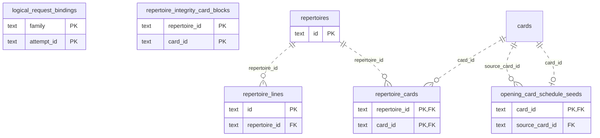

# Learning runtime: Authored Content

Repertoire/line/membership and annotation source data or related authored-content projections.

**Current source schema, deployment unverified.** Owner: Learning runtime; SQL schema `learning`. Derived from checked-in DDL at the `14ad5754` baseline with file relocation only. No live database was queried. [Database index](../../README.md).

Charts show primary/foreign key columns; the dictionary lists **every stored field and its SQL type**. `PK` means primary key (all marked fields form one composite key); `FK` means an enforced SQL foreign key. Parent `||`/`o|` means a required/optional parent; child `o{` means zero or more children and `o|` zero or one (a unique referencing tuple). Edges describe allowed SQL cardinality, not an obligation to create children. Nullable components of a composite FK can leave the tuple unlinked under PostgreSQL MATCH SIMPLE. No edge is inferred from a similar field name.

Referenced tables outside this view: `learning.cards`. Follow the [schema index](../README.md) for their full definitions.

## Data dictionary

### `learning.logical_request_bindings`

Primary key: (`family`, `attempt_id`). DDL: [0001_core.sql](../../ddl/migrations/0001_core.sql).

| Field | SQL type | Null allowed | Keys |
| --- | --- | --- | --- |
| `family` | `text` | no | PK |
| `attempt_id` | `text` | no | PK |
| `request_hash` | `text` | no |  |

### `learning.opening_card_schedule_seeds`

Primary key: (`card_id`). DDL: [0001_core.sql](../../ddl/migrations/0001_core.sql).

| Field | SQL type | Null allowed | Keys |
| --- | --- | --- | --- |
| `card_id` | `text` | no | PK; FK card_id → learning.cards(`id`) |
| `source_card_id` | `text` | no | FK source_card_id → learning.cards(`id`) |
| `baseline_successful_days` | `bigint` | no |  |
| `baseline_recent_clean` | `bigint` | no |  |
| `verification_due` | `text` | no |  |
| `created_at` | `text` | no |  |

Foreign key delete actions: (`card_id`) CASCADE, (`source_card_id`) CASCADE.

### `learning.repertoire_cards`

Primary key: (`repertoire_id`, `card_id`). DDL: [0001_core.sql](../../ddl/migrations/0001_core.sql).

| Field | SQL type | Null allowed | Keys |
| --- | --- | --- | --- |
| `repertoire_id` | `text` | no | PK; FK repertoire_id → learning.repertoires(`id`) |
| `card_id` | `text` | no | PK; FK card_id → learning.cards(`id`) |

Foreign key delete actions: (`repertoire_id`) NO ACTION, (`card_id`) NO ACTION.

### `learning.repertoire_integrity_card_blocks`

Primary key: (`repertoire_id`, `card_id`). DDL: [0001_core.sql](../../ddl/migrations/0001_core.sql).

| Field | SQL type | Null allowed | Keys |
| --- | --- | --- | --- |
| `repertoire_id` | `text` | no | PK |
| `card_id` | `text` | no | PK |

### `learning.repertoire_lines`

Primary key: (`id`). DDL: [0001_core.sql](../../ddl/migrations/0001_core.sql).

| Field | SQL type | Null allowed | Keys |
| --- | --- | --- | --- |
| `id` | `text` | no | PK |
| `repertoire_id` | `text` | no | FK repertoire_id → learning.repertoires(`id`) |
| `trained_color` | `text` | no |  |
| `created_at` | `text` | no |  |

Foreign key delete actions: (`repertoire_id`) NO ACTION.

### `learning.repertoires`

Primary key: (`id`). DDL: [0001_core.sql](../../ddl/migrations/0001_core.sql).

| Field | SQL type | Null allowed | Keys |
| --- | --- | --- | --- |
| `id` | `text` | no | PK |
| `name` | `text` | no |  |
| `source_name` | `text` | no |  |
| `created_at` | `text` | no |  |
| `is_main` | `bigint` | no |  |
| `new_cards_per_day` | `bigint` | yes |  |
