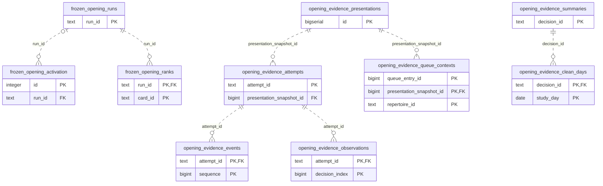

# Learning runtime: Opening Evidence

Persisted opening decision evidence, presentation snapshots and attempts, segmentation and frozen ordering.

**Current source schema, deployment unverified.** Owner: Learning runtime; SQL schema `learning`. Derived from checked-in DDL at the `14ad5754` baseline with file relocation only. No live database was queried. [Database index](../../README.md).

Charts show primary/foreign key columns; the dictionary lists **every stored field and its SQL type**. `PK` means primary key (all marked fields form one composite key); `FK` means an enforced SQL foreign key. Parent `||`/`o|` means a required/optional parent; child `o{` means zero or more children and `o|` zero or one (a unique referencing tuple). Edges describe allowed SQL cardinality, not an obligation to create children. Nullable components of a composite FK can leave the tuple unlinked under PostgreSQL MATCH SIMPLE. No edge is inferred from a similar field name.

## Data dictionary

### `learning.frozen_opening_activation`

Primary key: (`id`). DDL: [0001_core.sql](../../ddl/migrations/0001_core.sql).

| Field | SQL type | Null allowed | Keys |
| --- | --- | --- | --- |
| `id` | `integer` | no | PK |
| `run_id` | `text` | yes | FK run_id → learning.frozen_opening_runs(`run_id`) |
| `epoch` | `bigint` | no |  |

Foreign key delete actions: (`run_id`) NO ACTION.

### `learning.frozen_opening_ranks`

Primary key: (`run_id`, `card_id`). DDL: [0001_core.sql](../../ddl/migrations/0001_core.sql).

| Field | SQL type | Null allowed | Keys |
| --- | --- | --- | --- |
| `run_id` | `text` | no | PK; FK run_id → learning.frozen_opening_runs(`run_id`) |
| `card_id` | `text` | no | PK |
| `ordinal` | `bigint` | no |  |
| `fingerprint` | `text` | no |  |
| `memberships_json` | `text` | no |  |
| `definition_json` | `text` | no |  |

Unique tuples (including non-partial simple unique indexes): (`run_id`, `ordinal`).

Foreign key delete actions: (`run_id`) NO ACTION.

### `learning.frozen_opening_runs`

Primary key: (`run_id`). DDL: [0001_core.sql](../../ddl/migrations/0001_core.sql).

| Field | SQL type | Null allowed | Keys |
| --- | --- | --- | --- |
| `run_id` | `text` | no | PK |
| `reader_version` | `text` | no |  |

### `learning.opening_evidence_attempts`

Primary key: (`attempt_id`). DDL: [0001_core.sql](../../ddl/migrations/0001_core.sql).

| Field | SQL type | Null allowed | Keys |
| --- | --- | --- | --- |
| `attempt_id` | `text` | no | PK |
| `manifest_id` | `text` | no |  |
| `presentation_snapshot_id` | `bigint` | no | FK presentation_snapshot_id → learning.opening_evidence_presentations(`id`) |
| `repertoire_id` | `text` | no |  |
| `card_id` | `text` | no |  |
| `card_revision` | `bigint` | no |  |
| `trained_color` | `text` | no |  |
| `context_json` | `text` | no |  |
| `manifest_json` | `text` | no |  |
| `started_at` | `timestamptz` | no |  |
| `study_timezone` | `text` | no |  |
| `queue_entry_id` | `bigint` | yes |  |
| `contiguous_sequence` | `bigint` | no |  |
| `state` | `text` | no |  |
| `terminal_json` | `text` | yes |  |
| `completed_at` | `timestamptz` | yes |  |
| `review_id` | `bigint` | yes |  |
| `review_result_json` | `text` | yes |  |
| `retired_operation_id` | `text` | yes |  |

Foreign key delete actions: (`presentation_snapshot_id`) NO ACTION.

### `learning.opening_evidence_clean_days`

Primary key: (`decision_id`, `study_day`). DDL: [0001_core.sql](../../ddl/migrations/0001_core.sql).

| Field | SQL type | Null allowed | Keys |
| --- | --- | --- | --- |
| `decision_id` | `text` | no | PK; FK decision_id → learning.opening_evidence_summaries(`decision_id`) |
| `study_day` | `date` | no | PK |

Foreign key delete actions: (`decision_id`) NO ACTION.

### `learning.opening_evidence_events`

Primary key: (`attempt_id`, `sequence`). DDL: [0001_core.sql](../../ddl/migrations/0001_core.sql).

| Field | SQL type | Null allowed | Keys |
| --- | --- | --- | --- |
| `attempt_id` | `text` | no | PK; FK attempt_id → learning.opening_evidence_attempts(`attempt_id`) |
| `sequence` | `bigint` | no | PK |
| `event_json` | `text` | no |  |

Foreign key delete actions: (`attempt_id`) CASCADE.

### `learning.opening_evidence_observations`

Primary key: (`attempt_id`, `decision_index`). DDL: [0001_core.sql](../../ddl/migrations/0001_core.sql).

| Field | SQL type | Null allowed | Keys |
| --- | --- | --- | --- |
| `attempt_id` | `text` | no | PK; FK attempt_id → learning.opening_evidence_attempts(`attempt_id`) |
| `decision_index` | `bigint` | no | PK |
| `decision_id` | `text` | no |  |
| `observed_at` | `timestamptz` | no |  |
| `failure_at` | `timestamptz` | yes |  |
| `observation_json` | `text` | no |  |

Foreign key delete actions: (`attempt_id`) CASCADE.

### `learning.opening_evidence_presentations`

Primary key: (`id`). DDL: [0001_core.sql](../../ddl/migrations/0001_core.sql).

| Field | SQL type | Null allowed | Keys |
| --- | --- | --- | --- |
| `id` | `bigserial` | no | PK |
| `content_fingerprint` | `text` | no |  |
| `card_id` | `text` | no |  |
| `revision` | `bigint` | no |  |
| `start_fen` | `text` | no |  |
| `moves_json` | `text` | no |  |
| `trained_color` | `text` | yes |  |
| `captured_at` | `timestamptz` | no |  |

Unique tuples (including non-partial simple unique indexes): (`content_fingerprint`).

### `learning.opening_evidence_queue_contexts`

Primary key: (`queue_entry_id`, `presentation_snapshot_id`, `repertoire_id`). DDL: [0001_core.sql](../../ddl/migrations/0001_core.sql).

| Field | SQL type | Null allowed | Keys |
| --- | --- | --- | --- |
| `queue_entry_id` | `bigint` | no | PK |
| `presentation_snapshot_id` | `bigint` | no | PK; FK presentation_snapshot_id → learning.opening_evidence_presentations(`id`) |
| `repertoire_id` | `text` | no | PK |
| `effective_trained_color` | `text` | no |  |

Foreign key delete actions: (`presentation_snapshot_id`) NO ACTION.

### `learning.opening_evidence_summaries`

Primary key: (`decision_id`). DDL: [0001_core.sql](../../ddl/migrations/0001_core.sql).

| Field | SQL type | Null allowed | Keys |
| --- | --- | --- | --- |
| `decision_id` | `text` | no | PK |
| `first_responses` | `bigint` | no |  |
| `clean_successes` | `bigint` | no |  |
| `incorrect_responses` | `bigint` | no |  |
| `assisted_responses` | `bigint` | no |  |
| `manual_failures` | `bigint` | no |  |
| `corrections` | `bigint` | no |  |
| `distinct_clean_days` | `bigint` | no |  |
