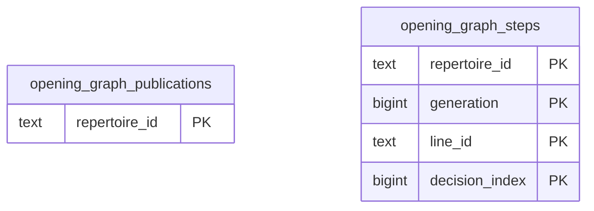

# Learning runtime: Opening Graph

Versioned opening graph routes, source mappings, canonical prefixes, publication/transition state and diagnostics.

**Current source schema, deployment unverified.** Owner: Learning runtime; SQL schema `learning`. Derived from checked-in DDL at the `14ad5754` baseline with file relocation only. No live database was queried. [Database index](../../README.md).

Charts show primary/foreign key columns; the dictionary lists **every stored field and its SQL type**. `PK` means primary key (all marked fields form one composite key); `FK` means an enforced SQL foreign key. Parent `||`/`o|` means a required/optional parent; child `o{` means zero or more children and `o|` zero or one (a unique referencing tuple). Edges describe allowed SQL cardinality, not an obligation to create children. Nullable components of a composite FK can leave the tuple unlinked under PostgreSQL MATCH SIMPLE. No edge is inferred from a similar field name.

## Data dictionary

### `learning.opening_graph_publications`

Primary key: (`repertoire_id`). DDL: [0001_core.sql](../../ddl/migrations/0001_core.sql).

| Field | SQL type | Null allowed | Keys |
| --- | --- | --- | --- |
| `repertoire_id` | `text` | no | PK |
| `generation` | `bigint` | no |  |
| `state` | `text` | no |  |

### `learning.opening_graph_steps`

Primary key: (`repertoire_id`, `generation`, `line_id`, `decision_index`). DDL: [0001_core.sql](../../ddl/migrations/0001_core.sql).

| Field | SQL type | Null allowed | Keys |
| --- | --- | --- | --- |
| `repertoire_id` | `text` | no | PK |
| `generation` | `bigint` | no | PK |
| `line_id` | `text` | no | PK |
| `decision_index` | `bigint` | no | PK |
| `card_id` | `text` | no |  |
| `parent_card_id` | `text` | yes |  |
| `starting_fen` | `text` | no |  |
| `moves_json` | `text` | no |  |
| `trained_color` | `text` | no |  |
