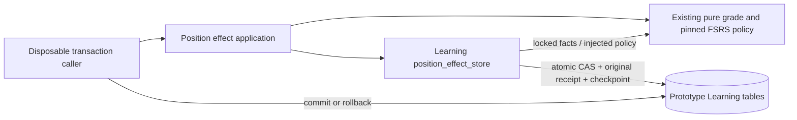

# Disposable position effect owner prototype

Source-only, non-serving prototype on the #920 baseline. The public application
entry point is `tempo_learning_runtime.position_effect_owner.accept_position_effect`.
It borrows a psycopg transaction; its database adapter reconstructs frozen facts,
then invokes the existing pure `decide_position_grade` policy. No connection,
commit, startup registration, adoption or activation is exposed. A receipt
returned inside a transaction must not be acknowledged until its caller commits.

Required keyword inputs: original `attempt_id`, `event_id`, transport
`operation_id`, immutable `request_digest`, aware owner `accepted_at`,
`expected_owner_epoch`, `expected_source_digest`. Optional `accepted_study_day`
must equal the IANA-configured owner day derived from acceptance time.
`source_kind` defaults to `study`; `game_lapse` holds without human mutation.

The original plan and first response are durable before acceptance. SHA256 checks
bind exact original TEXT bytes to their digests and typed stored projections.
The request digest is the legacy SHA256 of `plan_digest:response_payload_digest`
(both fixed-width SHA256 hex). Effect identity is the existing SHA256 of
`study:first_response:` followed by the exact original event ID. The prototype
does not reinterpret historical legacy plan JSON as its smaller fixture codec.

Exact logical replay returns its original immutable receipt, including original
operation, clock, day and schedule, before checking newer owner/source/day.
A different transport operation may replay the same logical effect. Reusing an
original operation for another event, a changed digest or another event at an
occupied `(attempt_id, decision_index)` conflicts. Replays never increment the
checkpoint. An incomplete correct response remains pending under its original
identity and may complete later; independently saved wrong evidence earns Again.

Locks are operation advisory, original attempt FOR UPDATE, source/owner authority
FOR SHARE, exact position FOR UPDATE. The isolated fixture has no card/day/queue
writers. Future serving integration must retain the existing original
card/day/queue/attempt locks before source and position locks; this prototype
grants no replacement lock protocol. Receipt lookups are bounded by event,
attempt/index, operation, or one exact position/day Good. State CAS, grade/receipt
and attempt checkpoint occur in the same borrowed transaction; SQL errors
propagate and require rollback. Holds occur before mutation. A locked position
serializes racing grades; the partial unique index protects one Good per day
across epochs. Lock timeout/contention remains a transient database exception.

DDL: [0007_position_effect_owner.sql](../../ddl/migrations/0007_position_effect_owner.sql).
The coordinator owns its manifest registration after 0006. No staging table,
legacy table, production credential or runtime selection is changed.

| Table | Key and retained facts |
| --- | --- |
| `position_effect_authorities` | repertoire PK; epoch, source digest, IANA zone, scope constrained to `disposable-prototype` |
| `position_effect_states` | repertoire/variant/position PK; definition, epoch/source, positive version, unique positive FSRS ID, exact FSRS TEXT and due instant |
| `position_effect_attempts` | original attempt PK; card/revision/queue identity, definition, epoch/source, exact frozen plan TEXT/digest, due/day/version/issuance witnesses, original completion receipt/time, checkpoint |
| `position_effect_responses` | event PK; attempt FK; unique attempt/index; exact first-response TEXT/digest and first durable acceptance instant |
| `position_effect_receipts` | effect PK; unique event, operation and attempt/index; response composite FK; original request digest, grade, epoch/position/day/clock, before/after FSRS TEXT/version and checkpoint |

All fields are non-null except paired completion receipt/time. Primary keys,
checks and FKs are enforced as declared in DDL. A Good partial unique index uses
repertoire/variant/position/day, deliberately excluding epoch. Source identity
is a logical assertion of the disposable fixture, not a Content FK or proof.

Finite proof: `tests/test_position_effect_owner_native.py` under the existing
Learning essential native runner covers one legal established position's exact
pinned next-state/due, replay with lost ACK/new transport, corruption/stale holds,
completion retry, transaction crash rollback, racing Good, cross-epoch Good,
human Again, midnight/DST owner day and operation/first-response collisions.
It directly applies 0007 inside each task-owned fixture after normal migrations;
manifest registration and installed migration qualification remain coordinator
and T01 responsibilities.

Required remaining gates: real Content currentness/legality/definition ports,
qualified retained-stage adoption, full original plan/history migration, Games
accepted-debt port, actual durable human aggregate proof, queue/card ownership,
HTTP/browser save-to-playable-next, hard old-writer denial and deployment.
Fixture completion rows are synthetic; a stored completion ID here is not proof
that an installed authoritative review was saved. No runtime parity, assembled,
merge-qualified, installed or activated claim follows from this prototype.
