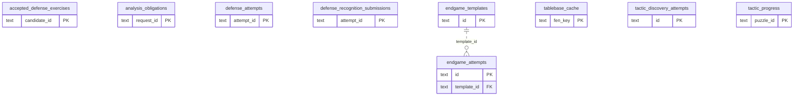

# Learning runtime: Practice Families

Tactic, defense, threat and endgame exercise/progress/attempt facts and tablebase cache.

**Current source schema, deployment unverified.** Owner: Learning runtime; SQL schema `learning`. Derived from checked-in DDL at the `14ad5754` baseline with file relocation only. No live database was queried. [Database index](../../README.md).

Charts show primary/foreign key columns; the dictionary lists **every stored field and its SQL type**. `PK` means primary key (all marked fields form one composite key); `FK` means an enforced SQL foreign key. Parent `||`/`o|` means a required/optional parent; child `o{` means zero or more children and `o|` zero or one (a unique referencing tuple). Edges describe allowed SQL cardinality, not an obligation to create children. Nullable components of a composite FK can leave the tuple unlinked under PostgreSQL MATCH SIMPLE. No edge is inferred from a similar field name.

## Data dictionary

### `learning.accepted_defense_exercises`

Primary key: (`candidate_id`). DDL: [0001_core.sql](../../ddl/migrations/0001_core.sql).

| Field | SQL type | Null allowed | Keys |
| --- | --- | --- | --- |
| `candidate_id` | `text` | no | PK |
| `card_id` | `text` | no |  |
| `exercise_revision` | `bigint` | no |  |
| `definition_json` | `text` | no |  |

### `learning.analysis_obligations`

Primary key: (`request_id`). DDL: [0001_core.sql](../../ddl/migrations/0001_core.sql).

| Field | SQL type | Null allowed | Keys |
| --- | --- | --- | --- |
| `request_id` | `text` | no | PK |
| `candidate_id` | `text` | no |  |
| `request_json` | `text` | no |  |
| `state` | `text` | no |  |

### `learning.defense_attempts`

Primary key: (`attempt_id`). DDL: [0001_core.sql](../../ddl/migrations/0001_core.sql).

| Field | SQL type | Null allowed | Keys |
| --- | --- | --- | --- |
| `attempt_id` | `text` | no | PK |
| `candidate_id` | `text` | no |  |
| `card_id` | `text` | no |  |
| `queue_entry_id` | `bigint` | no |  |
| `exercise_revision` | `bigint` | no |  |
| `move_uci` | `text` | no |  |
| `grade_json` | `text` | no |  |
| `reviewed_at` | `text` | no |  |

### `learning.defense_recognition_submissions`

Primary key: (`attempt_id`). DDL: [0001_core.sql](../../ddl/migrations/0001_core.sql).

| Field | SQL type | Null allowed | Keys |
| --- | --- | --- | --- |
| `attempt_id` | `text` | no | PK |
| `candidate_id` | `text` | no |  |
| `queue_entry_id` | `bigint` | no |  |
| `exercise_revision` | `bigint` | no |  |
| `answer_json` | `text` | no |  |
| `recognition_correct` | `bigint` | no |  |
| `created_at` | `text` | no |  |

### `learning.endgame_attempts`

Primary key: (`id`). DDL: [0001_core.sql](../../ddl/migrations/0001_core.sql).

| Field | SQL type | Null allowed | Keys |
| --- | --- | --- | --- |
| `id` | `text` | no | PK |
| `template_id` | `text` | no | FK template_id → learning.endgame_templates(`id`) |
| `start_fen` | `text` | no |  |
| `target` | `text` | no |  |
| `status` | `text` | no |  |
| `user_moves` | `bigint` | no |  |
| `created_at` | `text` | no |  |
| `completed_at` | `text` | yes |  |

Foreign key delete actions: (`template_id`) CASCADE.

### `learning.endgame_templates`

Primary key: (`id`). DDL: [0001_core.sql](../../ddl/migrations/0001_core.sql).

| Field | SQL type | Null allowed | Keys |
| --- | --- | --- | --- |
| `id` | `text` | no | PK |
| `card_id` | `text` | no |  |
| `name` | `text` | no |  |
| `white_material` | `text` | no |  |
| `black_material` | `text` | no |  |
| `trained_color` | `text` | no |  |
| `goal_mix` | `text` | no |  |
| `enabled` | `bigint` | no |  |
| `created_at` | `text` | no |  |

Unique tuples (including non-partial simple unique indexes): (`card_id`).

### `learning.tablebase_cache`

Primary key: (`fen_key`). DDL: [0001_core.sql](../../ddl/migrations/0001_core.sql).

| Field | SQL type | Null allowed | Keys |
| --- | --- | --- | --- |
| `fen_key` | `text` | no | PK |
| `response_json` | `text` | no |  |
| `fetched_at` | `text` | no |  |

### `learning.tactic_discovery_attempts`

Primary key: (`id`). DDL: [0001_core.sql](../../ddl/migrations/0001_core.sql).

| Field | SQL type | Null allowed | Keys |
| --- | --- | --- | --- |
| `id` | `text` | no | PK |
| `deck_id` | `text` | no |  |
| `puzzle_id` | `text` | no |  |
| `clean` | `bigint` | no |  |
| `result_json` | `text` | no |  |

### `learning.tactic_progress`

Primary key: (`puzzle_id`). DDL: [0001_core.sql](../../ddl/migrations/0001_core.sql).

| Field | SQL type | Null allowed | Keys |
| --- | --- | --- | --- |
| `puzzle_id` | `text` | no | PK |
| `deck_id` | `text` | no |  |
| `card_id` | `text` | yes |  |
| `clean_pass_at` | `text` | yes |  |
| `admitted_at` | `text` | yes |  |
| `admission_mode` | `text` | no |  |
