# Learning runtime: Publications Evidence

Accepted/staged/serving publication identities and receipts, advisory/evidence notifications and practice obligations.

**Current source schema, deployment unverified.** Owner: Learning runtime; SQL schema `learning`. Derived from checked-in DDL at the `14ad5754` baseline with file relocation only. No live database was queried. [Database index](../../README.md).

Charts show primary/foreign key columns; the dictionary lists **every stored field and its SQL type**. `PK` means primary key (all marked fields form one composite key); `FK` means an enforced SQL foreign key. Parent `||`/`o|` means a required/optional parent; child `o{` means zero or more children and `o|` zero or one (a unique referencing tuple). Edges describe allowed SQL cardinality, not an obligation to create children. Nullable components of a composite FK can leave the tuple unlinked under PostgreSQL MATCH SIMPLE. No edge is inferred from a similar field name.

```mermaid
erDiagram
  accepted_evidence_revisions {
    text workspace_id PK
    text evidence_id PK
  }
  accepted_publications {
    text publication_id PK
    bigint generation PK
  }
  activation_receipts {
    text operation_id PK
  }
  advisory_notifications {
    text kind PK
    text subject PK
  }
  content_card_aliases {
    text content_card_id PK
  }
  evidence_deliveries {
    text delivery_id PK
  }
  learning_obligations {
    text obligation_id PK
  }
  serving_publications {
    text publication_id PK
  }
```

## Data dictionary

### `learning.accepted_evidence_revisions`

Primary key: (`workspace_id`, `evidence_id`). DDL: [0002_evidence_revisions.sql](../../ddl/migrations/0002_evidence_revisions.sql).

| Field | SQL type | Null allowed | Keys |
| --- | --- | --- | --- |
| `workspace_id` | `text` | no | PK |
| `evidence_id` | `text` | no | PK |
| `evidence_revision` | `bigint` | no |  |
| `semantic_digest` | `text` | yes |  |
| `updated_at` | `timestamptz` | no |  |

### `learning.accepted_publications`

Primary key: (`publication_id`, `generation`). DDL: [0001_core.sql](../../ddl/migrations/0001_core.sql).

| Field | SQL type | Null allowed | Keys |
| --- | --- | --- | --- |
| `publication_id` | `text` | no | PK |
| `generation` | `bigint` | no | PK |
| `digest` | `text` | no |  |
| `payload_json` | `text` | no |  |
| `state` | `text` | no |  |

### `learning.activation_receipts`

Primary key: (`operation_id`). DDL: [0001_core.sql](../../ddl/migrations/0001_core.sql).

| Field | SQL type | Null allowed | Keys |
| --- | --- | --- | --- |
| `operation_id` | `text` | no | PK |
| `request_hash` | `text` | no |  |
| `result_json` | `text` | no |  |

### `learning.advisory_notifications`

Primary key: (`kind`, `subject`). DDL: [0001_core.sql](../../ddl/migrations/0001_core.sql).

| Field | SQL type | Null allowed | Keys |
| --- | --- | --- | --- |
| `kind` | `text` | no | PK |
| `subject` | `text` | no | PK |
| `generation` | `bigint` | no |  |

### `learning.content_card_aliases`

Primary key: (`content_card_id`). DDL: [0003_content_bridge.sql](../../ddl/migrations/0003_content_bridge.sql).

| Field | SQL type | Null allowed | Keys |
| --- | --- | --- | --- |
| `content_card_id` | `text` | no | PK |
| `learning_card_id` | `text` | no |  |
| `publication_id` | `text` | no |  |
| `binding_digest` | `text` | no |  |

Unique tuples (including non-partial simple unique indexes): (`learning_card_id`).

### `learning.evidence_deliveries`

Primary key: (`delivery_id`). DDL: [0001_core.sql](../../ddl/migrations/0001_core.sql).

| Field | SQL type | Null allowed | Keys |
| --- | --- | --- | --- |
| `delivery_id` | `text` | no | PK |
| `digest` | `text` | no |  |
| `result_json` | `text` | no |  |

### `learning.learning_obligations`

Primary key: (`obligation_id`). DDL: [0001_core.sql](../../ddl/migrations/0001_core.sql).

| Field | SQL type | Null allowed | Keys |
| --- | --- | --- | --- |
| `obligation_id` | `text` | no | PK |
| `source_evidence_id` | `text` | no |  |
| `source_revision` | `bigint` | no |  |
| `card_id` | `text` | no |  |
| `decision_id` | `text` | no |  |
| `publication_generation` | `bigint` | no |  |
| `kind` | `text` | no |  |
| `observed_at` | `timestamptz` | no |  |
| `satisfied_at` | `timestamptz` | yes |  |
| `payload_json` | `text` | no |  |

### `learning.serving_publications`

Primary key: (`publication_id`). DDL: [0001_core.sql](../../ddl/migrations/0001_core.sql).

| Field | SQL type | Null allowed | Keys |
| --- | --- | --- | --- |
| `publication_id` | `text` | no | PK |
| `generation` | `bigint` | no |  |
| `activation_revision` | `bigint` | no |  |
