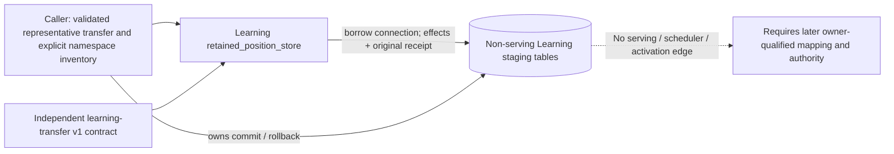
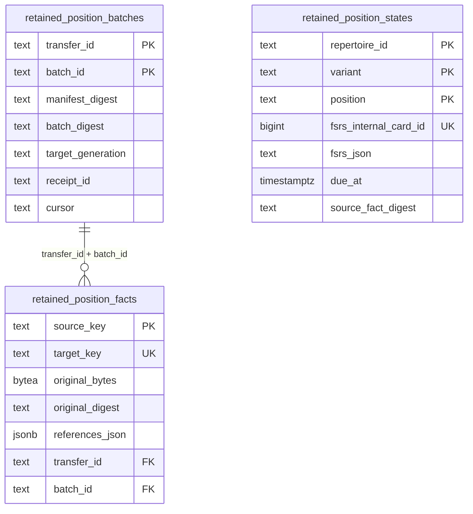

# Representative retained position staging

`0004_retained_position.sql` defines non-serving staging tables. `retained_position_states` retains the exact logical position, source/epoch, version, FSRS bytes and internal ID, due/introduction timestamps, and donor identity. `retained_position_facts` stores original captured bytes, full source and target keys, digest and source references, including review invalidation, plans, receipts and grades. `retained_position_batches` owns immutable transaction receipts. The caller owns transaction and namespace inventory completeness; the adapter does not activate the target, invoke a scheduler or certify migration parity. Stored facts are not runtime review tables. Reconciliation, complete source capture, namespace fencing and behavior after transfer require separate owners and proof.

| Source facts | Target representation | Disposition and identity |
| --- | --- | --- |
| `study_position_states` full row, including FSRS TEXT, due, introduction, definition, epoch, version, donor | `retained_position_states` and `retained_position_facts` | EXACT; repertoire, variant, position; duplicate key conflicts |
| Epoch, owner, seed run/outcome, issued plan, first response, grade | `retained_position_facts` | EXACT original full primary key, bytes, digest and source references |
| Donor card, repertoire, queue/day, reviews, invalidations, receipts and review schedule snapshots | `retained_position_facts` | EXACT original full primary key, bytes, digest and source references |
| Original transfer and batch | `retained_position_batches` | Same digest and receipt replay unchanged; changed binding conflicts |

The selected synthetic source uses PostgreSQL `row_to_json` UTF-8 as a fixture codec. That captures the database's typed JSONB representation, not original JSONB input formatting; TEXT values remain unchanged. A real exporter, complete inventory, checked namespace fence and an executable target mapping remain unverified. No staged fact itself grants issuance, review or activation authority.

## Canonical staging persistence and transaction view

State-to-fact linkage is an adapter-validated logical source identity/digest, not
a SQL foreign key. Raw facts retain original owner table names in their encoded
logical target keys; they are not rows in active target review/receipt tables.

## Field dictionary

Source DDL: [0004_retained_position.sql](../../ddl/migrations/0004_retained_position.sql).
The states table has primary key `(repertoire_id, variant, position)`, a unique
positive `fsrs_internal_card_id`, and positive `version`. Fact `source_key` is
the primary key and `target_key` unique; facts reference batch composite keys.

### `learning.retained_position_batches`

| Field | Type | Null allowed |
| --- | --- | --- |
| `transfer_id` | `text` | no |
| `batch_id` | `text` | no |
| `manifest_digest` | `text` | no |
| `batch_digest` | `text` | no |
| `target_generation` | `text` | no |
| `receipt_id` | `text` | no |
| `cursor` | `text` | yes |

### `learning.retained_position_states`

| Field | Type | Null allowed |
| --- | --- | --- |
| `repertoire_id` | `text` | no |
| `variant` | `text` | no |
| `position` | `text` | no |
| `expected_uci` | `text` | no |
| `policy_version` | `text` | no |
| `owner_epoch` | `text` | no |
| `source_digest` | `text` | no |
| `version` | `bigint` | no |
| `fsrs_internal_card_id` | `bigint` | no |
| `fsrs_json` | `text` | no |
| `due_at` | `timestamptz` | no |
| `introduced_at` | `timestamptz` | yes |
| `donor_card_id` | `text` | no |
| `donor_card_revision` | `bigint` | no |
| `donor_fingerprint` | `text` | no |
| `donor_selection_policy` | `text` | no |
| `source_fact_digest` | `text` | no |

### `learning.retained_position_facts`

| Field | Type | Null allowed |
| --- | --- | --- |
| `source_key` | `text` | no |
| `target_key` | `text` | no |
| `family` | `text` | no |
| `codec` | `text` | no |
| `original_bytes` | `bytea` | no |
| `original_digest` | `text` | no |
| `references_json` | `jsonb` | no |
| `transfer_id` | `text` | no |
| `batch_id` | `text` | no |
