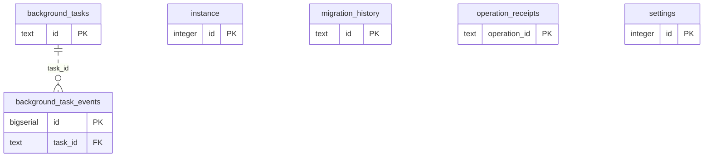

# Learning runtime: Runtime Metadata

Schema/import progress, workspace settings, durable operations and background scheduling/lease metadata.

**Current source schema, deployment unverified.** Owner: Learning runtime; SQL schema `learning`. Derived from checked-in DDL at the `14ad5754` baseline with file relocation only. No live database was queried. [Database index](../../README.md).

Charts show primary/foreign key columns; the dictionary lists **every stored field and its SQL type**. `PK` means primary key (all marked fields form one composite key); `FK` means an enforced SQL foreign key. Parent `||`/`o|` means a required/optional parent; child `o{` means zero or more children and `o|` zero or one (a unique referencing tuple). Edges describe allowed SQL cardinality, not an obligation to create children. Nullable components of a composite FK can leave the tuple unlinked under PostgreSQL MATCH SIMPLE. No edge is inferred from a similar field name.

## Data dictionary

### `learning.background_task_events`

Primary key: (`id`). DDL: [0001_core.sql](../../ddl/migrations/0001_core.sql).

| Field | SQL type | Null allowed | Keys |
| --- | --- | --- | --- |
| `id` | `bigserial` | no | PK |
| `task_id` | `text` | no | FK task_id → learning.background_tasks(`id`) |
| `generation` | `bigint` | no |  |
| `event` | `text` | no |  |
| `created_at` | `timestamptz` | no |  |

Foreign key delete actions: (`task_id`) NO ACTION.

### `learning.background_tasks`

Primary key: (`id`). DDL: [0001_core.sql](../../ddl/migrations/0001_core.sql).

| Field | SQL type | Null allowed | Keys |
| --- | --- | --- | --- |
| `id` | `text` | no | PK |
| `kind` | `text` | no |  |
| `deduplication_key` | `text` | no |  |
| `generation` | `bigint` | no |  |
| `payload_json` | `text` | no |  |
| `state` | `text` | no |  |
| `priority` | `bigint` | no |  |
| `phase` | `text` | no |  |
| `lease_token` | `text` | yes |  |
| `lease_expires_at` | `timestamptz` | yes |  |
| `next_attempt_at` | `timestamptz` | no |  |
| `attempt_count` | `bigint` | no |  |
| `max_attempts` | `bigint` | no |  |
| `last_error` | `text` | yes |  |
| `created_at` | `timestamptz` | no |  |
| `updated_at` | `timestamptz` | no |  |

Unique tuples (including non-partial simple unique indexes): (`kind`, `deduplication_key`).

### `learning.instance`

Primary key: (`id`). DDL: [0001_core.sql](../../ddl/migrations/0001_core.sql).

| Field | SQL type | Null allowed | Keys |
| --- | --- | --- | --- |
| `id` | `integer` | no | PK |
| `workspace_id` | `text` | no |  |

### `learning.migration_history`

Primary key: (`id`). DDL: [0001_core.sql](../../ddl/migrations/0001_core.sql).

| Field | SQL type | Null allowed | Keys |
| --- | --- | --- | --- |
| `id` | `text` | no | PK |
| `checksum` | `text` | no |  |
| `applied_at` | `timestamptz` | no |  |

### `learning.operation_receipts`

Primary key: (`operation_id`). DDL: [0001_core.sql](../../ddl/migrations/0001_core.sql).

| Field | SQL type | Null allowed | Keys |
| --- | --- | --- | --- |
| `operation_id` | `text` | no | PK |
| `command_name` | `text` | no |  |
| `request_hash` | `text` | no |  |
| `payload_json` | `text` | no |  |
| `state` | `text` | no |  |
| `response_json` | `text` | yes |  |
| `error_json` | `text` | yes |  |
| `next_retry_at` | `timestamptz` | yes |  |
| `created_at` | `timestamptz` | no |  |
| `updated_at` | `timestamptz` | no |  |

### `learning.settings`

Primary key: (`id`). DDL: [0001_core.sql](../../ddl/migrations/0001_core.sql).

| Field | SQL type | Null allowed | Keys |
| --- | --- | --- | --- |
| `id` | `integer` | no | PK |
| `timezone` | `text` | no |  |
| `light_first_interval_days` | `bigint` | no |  |
| `new_cards_per_day` | `bigint` | no |  |
| `study_new_per_day` | `bigint` | no |  |
| `tactic_new_per_day` | `bigint` | no |  |
| `include_defensive_cards_in_daily_stack` | `bigint` | no |  |
| `study_only_mode` | `bigint` | no |  |
