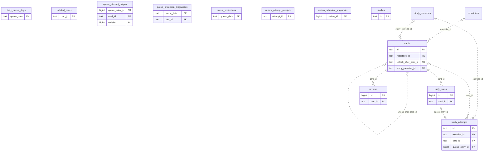

# Learning runtime: Study Queue Review (1)

Accepted cards/exercises, queue membership and presentation, teaching progress, review/attempt receipts and scheduling history.

**Current source schema, deployment unverified.** Owner: Learning runtime; SQL schema `learning`. Derived from checked-in DDL at the `14ad5754` baseline with file relocation only. No live database was queried. [Database index](../../README.md).

Charts show primary/foreign key columns; the dictionary lists **every stored field and its SQL type**. `PK` means primary key (all marked fields form one composite key); `FK` means an enforced SQL foreign key. Parent `||`/`o|` means a required/optional parent; child `o{` means zero or more children and `o|` zero or one (a unique referencing tuple). Edges describe allowed SQL cardinality, not an obligation to create children. Nullable components of a composite FK can leave the tuple unlinked under PostgreSQL MATCH SIMPLE. No edge is inferred from a similar field name.

Referenced tables outside this view: `learning.repertoires`, `learning.study_exercises`. Follow the [schema index](../README.md) for their full definitions.

## Data dictionary

### `learning.cards`

Primary key: (`id`). DDL: [0001_core.sql](../../ddl/migrations/0001_core.sql).

| Field | SQL type | Null allowed | Keys |
| --- | --- | --- | --- |
| `id` | `text` | no | PK |
| `repertoire_id` | `text` | yes | FK repertoire_id → learning.repertoires(`id`) |
| `kind` | `text` | no |  |
| `start_fen` | `text` | no |  |
| `moves_json` | `text` | no |  |
| `state` | `text` | no |  |
| `due_date` | `text` | no |  |
| `interval_days` | `bigint` | no |  |
| `ease` | `double precision` | no |  |
| `repetitions` | `bigint` | no |  |
| `lapses` | `bigint` | no |  |
| `unlock_after_card_id` | `text` | yes | FK unlock_after_card_id → learning.cards(`id`) |
| `fsrs_card_json` | `text` | yes |  |
| `first_correct_at` | `text` | yes |  |
| `reinforcement_pending` | `bigint` | no |  |
| `stability` | `double precision` | no |  |
| `guided_review` | `bigint` | no |  |
| `maximum_interval` | `bigint` | no |  |
| `content_type` | `text` | no |  |
| `scheduling_mode` | `text` | no |  |
| `hard_correct_streak` | `bigint` | no |  |
| `recent_attempts_json` | `text` | no |  |
| `archived` | `bigint` | no |  |
| `superseded_by` | `text` | yes |  |
| `source_ref` | `text` | yes |  |
| `source_fen` | `text` | yes |  |
| `revision` | `bigint` | no |  |
| `introduced_at` | `text` | yes |  |
| `trained_color` | `text` | yes |  |
| `pending_validation` | `bigint` | no |  |
| `prefix_split_rejected_after_review_id` | `bigint` | no |  |
| `study_exercise_id` | `text` | yes | FK study_exercise_id → learning.study_exercises(`id`) |
| `serving_active` | `bigint` | no |  |
| `publication_id` | `text` | yes |  |
| `publication_generation` | `bigint` | no |  |

Foreign key delete actions: (`repertoire_id`) CASCADE, (`unlock_after_card_id`) SET NULL, (`study_exercise_id`) NO ACTION.

### `learning.daily_queue`

Primary key: (`id`). DDL: [0001_core.sql](../../ddl/migrations/0001_core.sql).

| Field | SQL type | Null allowed | Keys |
| --- | --- | --- | --- |
| `id` | `bigint` | no | PK |
| `queue_date` | `text` | no |  |
| `card_id` | `text` | no | FK card_id → learning.cards(`id`) |
| `cycle` | `bigint` | no |  |
| `position` | `bigint` | no |  |
| `status` | `text` | no |  |
| `attempt_state` | `text` | no |  |
| `review_result_json` | `text` | yes |  |
| `attempt_failed` | `bigint` | no |  |
| `card_bucket` | `text` | yes |  |
| `admission_kind` | `text` | yes |  |
| `gameplay_priority_reason` | `text` | yes |  |
| `admission_repertoire_id` | `text` | yes |  |
| `admission_source` | `text` | yes |  |

Unique tuples (including non-partial simple unique indexes): (`queue_date`, `card_id`, `cycle`).

Foreign key delete actions: (`card_id`) CASCADE.

### `learning.daily_queue_days`

Primary key: (`queue_date`). DDL: [0001_core.sql](../../ddl/migrations/0001_core.sql).

| Field | SQL type | Null allowed | Keys |
| --- | --- | --- | --- |
| `queue_date` | `text` | no | PK |
| `seed` | `bigint` | no |  |
| `membership_hash` | `text` | no |  |
| `generated_at` | `text` | no |  |

### `learning.deleted_cards`

Primary key: (`card_id`). DDL: [0001_core.sql](../../ddl/migrations/0001_core.sql).

| Field | SQL type | Null allowed | Keys |
| --- | --- | --- | --- |
| `card_id` | `text` | no | PK |
| `deleted_at` | `timestamptz` | no |  |

### `learning.queue_attempt_origins`

Primary key: (`queue_entry_id`, `card_id`, `revision`). DDL: [0001_core.sql](../../ddl/migrations/0001_core.sql).

| Field | SQL type | Null allowed | Keys |
| --- | --- | --- | --- |
| `queue_entry_id` | `bigint` | no | PK |
| `card_id` | `text` | no | PK |
| `revision` | `bigint` | no | PK |
| `queue_date` | `text` | no |  |
| `cycle` | `bigint` | no |  |
| `admission_kind` | `text` | yes |  |
| `admission_repertoire_id` | `text` | yes |  |
| `attempt_failed` | `bigint` | no |  |
| `last_status` | `text` | no |  |
| `review_result_json` | `text` | yes |  |
| `legacy` | `bigint` | no |  |
| `start_fen` | `text` | no |  |
| `moves_json` | `text` | no |  |
| `trained_color` | `text` | yes |  |
| `content_type` | `text` | no |  |
| `issued_as_head` | `bigint` | no |  |

### `learning.queue_projection_diagnostics`

Primary key: (`queue_date`, `card_id`). DDL: [0001_core.sql](../../ddl/migrations/0001_core.sql).

| Field | SQL type | Null allowed | Keys |
| --- | --- | --- | --- |
| `queue_date` | `text` | no | PK |
| `card_id` | `text` | no | PK |
| `message` | `text` | no |  |

### `learning.queue_projections`

Primary key: (`queue_date`). DDL: [0001_core.sql](../../ddl/migrations/0001_core.sql).

| Field | SQL type | Null allowed | Keys |
| --- | --- | --- | --- |
| `queue_date` | `text` | no | PK |
| `state` | `text` | no |  |
| `generation` | `bigint` | no |  |
| `updated_at` | `text` | yes |  |
| `refresh_pending` | `bigint` | no |  |
| `last_error` | `text` | yes |  |
| `blocked_count` | `bigint` | no |  |

### `learning.review_attempt_receipts`

Primary key: (`attempt_id`). DDL: [0001_core.sql](../../ddl/migrations/0001_core.sql).

| Field | SQL type | Null allowed | Keys |
| --- | --- | --- | --- |
| `attempt_id` | `text` | no | PK |
| `card_id` | `text` | no |  |
| `queue_entry_id` | `bigint` | yes |  |
| `outcome` | `text` | no |  |
| `guided` | `bigint` | no |  |
| `completed_at` | `text` | yes |  |
| `review_id` | `bigint` | yes |  |
| `scheduling_status` | `text` | no |  |
| `warning` | `text` | yes |  |
| `result_json` | `text` | no |  |
| `request_json` | `text` | yes |  |

### `learning.review_schedule_snapshots`

Primary key: (`review_id`). DDL: [0001_core.sql](../../ddl/migrations/0001_core.sql).

| Field | SQL type | Null allowed | Keys |
| --- | --- | --- | --- |
| `review_id` | `bigint` | no | PK |
| `state_json` | `text` | no |  |

### `learning.reviews`

Primary key: (`id`). DDL: [0001_core.sql](../../ddl/migrations/0001_core.sql).

| Field | SQL type | Null allowed | Keys |
| --- | --- | --- | --- |
| `id` | `bigint` | no | PK |
| `card_id` | `text` | no | FK card_id → learning.cards(`id`) |
| `rating` | `text` | no |  |
| `reviewed_at` | `text` | no |  |
| `previous_interval` | `bigint` | no |  |
| `next_interval` | `bigint` | no |  |
| `internal_rating` | `text` | no |  |
| `guided` | `bigint` | no |  |
| `source_kind` | `text` | no |  |
| `source_ref` | `text` | yes |  |
| `invalidated_at` | `text` | yes |  |
| `invalidation_reason` | `text` | yes |  |

Foreign key delete actions: (`card_id`) CASCADE.

### `learning.studies`

Primary key: (`id`). DDL: [0001_core.sql](../../ddl/migrations/0001_core.sql).

| Field | SQL type | Null allowed | Keys |
| --- | --- | --- | --- |
| `id` | `text` | no | PK |
| `title` | `text` | no |  |
| `archived` | `bigint` | no |  |

### `learning.study_attempts`

Primary key: (`id`). DDL: [0001_core.sql](../../ddl/migrations/0001_core.sql).

| Field | SQL type | Null allowed | Keys |
| --- | --- | --- | --- |
| `id` | `text` | no | PK |
| `exercise_id` | `text` | no | FK exercise_id → learning.study_exercises(`id`) |
| `revision` | `bigint` | no |  |
| `card_id` | `text` | yes | FK card_id → learning.cards(`id`) |
| `queue_entry_id` | `bigint` | yes | FK queue_entry_id → learning.daily_queue(`id`) |
| `cycle` | `bigint` | yes |  |
| `context` | `text` | no |  |
| `answer_json` | `text` | no |  |
| `answer_hash` | `text` | no |  |
| `assessment_json` | `text` | no |  |
| `assessment_method` | `text` | no |  |
| `grader_version` | `bigint` | no |  |
| `hint_seen` | `bigint` | no |  |
| `solution_seen_before_answer` | `bigint` | no |  |
| `started_at` | `text` | no |  |
| `committed_at` | `text` | no |  |
| `finalized_at` | `text` | yes |  |
| `result_json` | `text` | yes |  |
| `retired_operation_id` | `text` | yes |  |

Unique tuples (including non-partial simple unique indexes): (`queue_entry_id`).

Foreign key delete actions: (`exercise_id`) NO ACTION, (`card_id`) NO ACTION, (`queue_entry_id`) NO ACTION.
