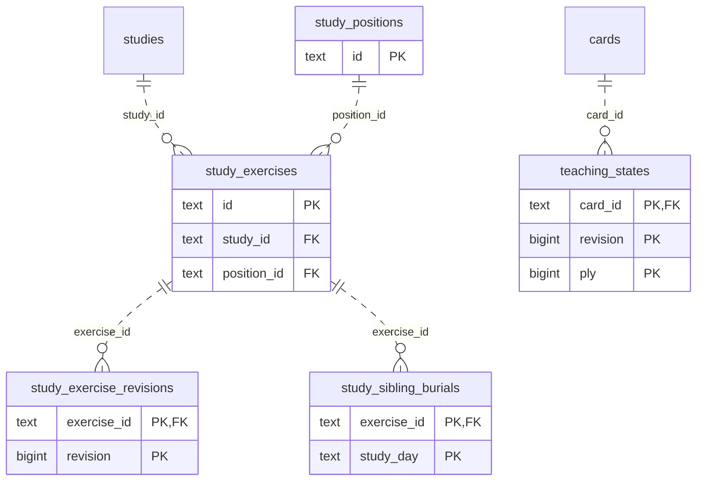

# Learning runtime: Study Queue Review (2)

Accepted cards/exercises, queue membership and presentation, teaching progress, review/attempt receipts and scheduling history.

**Current source schema, deployment unverified.** Owner: Learning runtime; SQL schema `learning`. Derived from checked-in DDL at the `14ad5754` baseline with file relocation only. No live database was queried. [Database index](../../README.md).

Charts show primary/foreign key columns; the dictionary lists **every stored field and its SQL type**. `PK` means primary key (all marked fields form one composite key); `FK` means an enforced SQL foreign key. Parent `||`/`o|` means a required/optional parent; child `o{` means zero or more children and `o|` zero or one (a unique referencing tuple). Edges describe allowed SQL cardinality, not an obligation to create children. Nullable components of a composite FK can leave the tuple unlinked under PostgreSQL MATCH SIMPLE. No edge is inferred from a similar field name.

Referenced tables outside this view: `learning.cards`, `learning.studies`. Follow the [schema index](../README.md) for their full definitions.

## Data dictionary

### `learning.study_exercise_revisions`

Primary key: (`exercise_id`, `revision`). DDL: [0001_core.sql](../../ddl/migrations/0001_core.sql).

| Field | SQL type | Null allowed | Keys |
| --- | --- | --- | --- |
| `exercise_id` | `text` | no | PK; FK exercise_id → learning.study_exercises(`id`) |
| `revision` | `bigint` | no | PK |
| `specification_json` | `text` | no |  |
| `specification_hash` | `text` | no |  |
| `created_at` | `text` | no |  |

Foreign key delete actions: (`exercise_id`) NO ACTION.

### `learning.study_exercises`

Primary key: (`id`). DDL: [0001_core.sql](../../ddl/migrations/0001_core.sql).

| Field | SQL type | Null allowed | Keys |
| --- | --- | --- | --- |
| `id` | `text` | no | PK |
| `study_id` | `text` | no | FK study_id → learning.studies(`id`) |
| `position_id` | `text` | no | FK position_id → learning.study_positions(`id`) |
| `current_revision` | `bigint` | no |  |
| `status` | `text` | no |  |
| `sibling_group` | `text` | yes |  |

Foreign key delete actions: (`study_id`) NO ACTION, (`position_id`) NO ACTION.

### `learning.study_positions`

Primary key: (`id`). DDL: [0001_core.sql](../../ddl/migrations/0001_core.sql).

| Field | SQL type | Null allowed | Keys |
| --- | --- | --- | --- |
| `id` | `text` | no | PK |
| `fen` | `text` | no |  |

### `learning.study_sibling_burials`

Primary key: (`exercise_id`, `study_day`). DDL: [0001_core.sql](../../ddl/migrations/0001_core.sql).

| Field | SQL type | Null allowed | Keys |
| --- | --- | --- | --- |
| `exercise_id` | `text` | no | PK; FK exercise_id → learning.study_exercises(`id`) |
| `study_day` | `text` | no | PK |
| `reason` | `text` | no |  |

Foreign key delete actions: (`exercise_id`) NO ACTION.

### `learning.teaching_states`

Primary key: (`card_id`, `revision`, `ply`). DDL: [0001_core.sql](../../ddl/migrations/0001_core.sql).

| Field | SQL type | Null allowed | Keys |
| --- | --- | --- | --- |
| `card_id` | `text` | no | PK; FK card_id → learning.cards(`id`) |
| `revision` | `bigint` | no | PK |
| `ply` | `bigint` | no | PK |
| `taught_at` | `text` | no |  |

Foreign key delete actions: (`card_id`) CASCADE.
