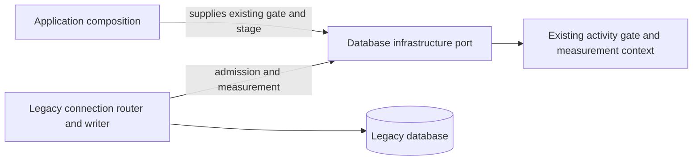
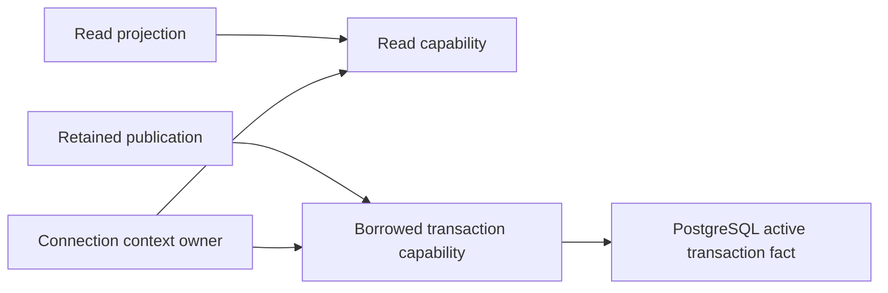

# Legacy backend database

**Current source schema; live deployment/schema unverified.** This owner directory groups existing persistence files within the single repository-root database tree. It creates no shared database runtime and changes no SQL, transaction policy or ownership. SQL namespace: `public`.

| Directory | Contents |
| --- | --- |
| [adapters](adapters/README.md) | Concrete persistence implementations and read projections. |
| [ddl](ddl/README.md) | Schema metadata, ordered migrations and explicit owner migration entry points. |
| [schema](schema/README.md) | Rendered Mermaid relationships and complete field/type dictionaries. |
| [connections.py](connections.py) | Existing component-owned connection/transaction routing. |

The original mixed-source checklist is closed: complete command/service SQL,builders,cursors,driver details and DDL now live in this tree. The [inventory](../INVENTORY.md) separately tracks native tooling/test placement and the subsequent application responsibility/composition work; file closure does not establish clean domain or resource independence. Frozen-order storage now lives here, with [pure Study decisions and legacy composition](../../backend/app/study/frozen_order/README.md) outside this tree. `connections.py` also retains SQLite compatibility startup DDL; [frozen-order SQLite fields and constraints](ddl/frozen-opening/README.md) are documented separately. The principal schema charts describe authoritative PostgreSQL migrations through 050, not a claim that SQLite has identical constraints/types. The legacy database co-locates Games and Study tables; this is existing coupling, not acceptance of a new cross-component dependency.

## Logical relationships (not SQL foreign keys)

Fields such as `source_ref`, publication generation, JSON payload identities and many `card_id`/game references are application facts unless an FK is explicitly listed in the schema dictionary. Legacy remediation identifies `remediation_cards.card_id` against the accepted owner’s card identity without a cross-store FK.

The dictionaries distinguish nullable fields, primary/composite keys, enforced FKs and uniqueness. Defaults/checks/triggers/partial or expression indexes remain authoritative in the linked DDL; they are not restated as extra relationships.

[Native bridge proofs](tests/legacy_bridge/README.md),[Discovery acceptance proofs](tests/discovery_acceptance/README.md),[queue admission proofs](tests/queue_admission/README.md) and their [finite qualification/resource tooling](tooling/legacy_bridge/README.md) now live under this owner. Source paths and discovery change; native execution remains unverified and is not triggered by navigation or ordinary application tests.

## Supplied database infrastructure (D1)

The connection router and SQLite writer consume the admission and measurement
capabilities in [infrastructure.py](infrastructure.py). [Application composition](../../backend/app/product_composition/database_infrastructure.py) binds the
existing activity gate singleton and `database_stage` before controlled access;
missing binding fails explicitly. The gate, measurement context, compatibility
lock and transaction ownership remain unchanged. API and task-worker composition bind before their controlled operations.

The direct tooling entrypoints `writer_latency` and
`recover-opening-publication.py` bind explicitly. The recovery CLI binds after
argument parsing and before either mode enters owner preflight or execution;
importing it remains inert. The same binding is supplied by the standalone background workload, engine fairness,
scheduling turns, prefix transition and study priority test harnesses. Backend
pytest composes the same binding in its configuration. API and task worker entrypoints bind the same helper before their own setup.
The frozen-order browser fixture binds before its first controlled connection;
the diagnostic and defensive-pause standalone checks bind in `main`. The
study-priority overlap runner calls the study-priority `main` before the callback
that starts its maintenance thread, so that thread sees the same process
binding. The associated native/packaged runs remain separate evidence.
The SQLite diagnostic benchmark binds in `main`, canonical-retention's reusable
proof binds on entry, and the threat-candidate standalone runner and its reusable
three-anchor proof bind before controlled access. Background-admission imports
the task composition before its connections; opening-evidence imports the task
or API composition before its selected controlled routes. Direct read-only
`read_connection` and direct concrete `postgres_store` scopes retain their
existing paths; they do not require the controlled router's binding.

## Connection capabilities and borrowed transactions

[Capabilities](capabilities.py) describe the common row/cursor and connection
operations supported by the SQLite compatibility connection and PostgreSQL
wrapper. Reader and borrowed-transaction interfaces expose no commit or close;
the context owner retains those operations. `connection()` can route a
query-only request to the reader, so its return annotation includes both views.
These are static interfaces: `execute` does not prove SQL is read-only, and the
existing database roles and SQLite query-only setting enforce runtime access.

`PostgresConnection.in_transaction` reports the existing exact `INTRANS` fact;
retained Repertoire publication checks it before using the caller's transaction.
No transaction is opened, committed or closed by this observation. SQLite's
existing `in_transaction` reports its own transaction state; it does not imply
PostgreSQL lock or isolation semantics. Native observation remains separately
qualified against PostgreSQL.

