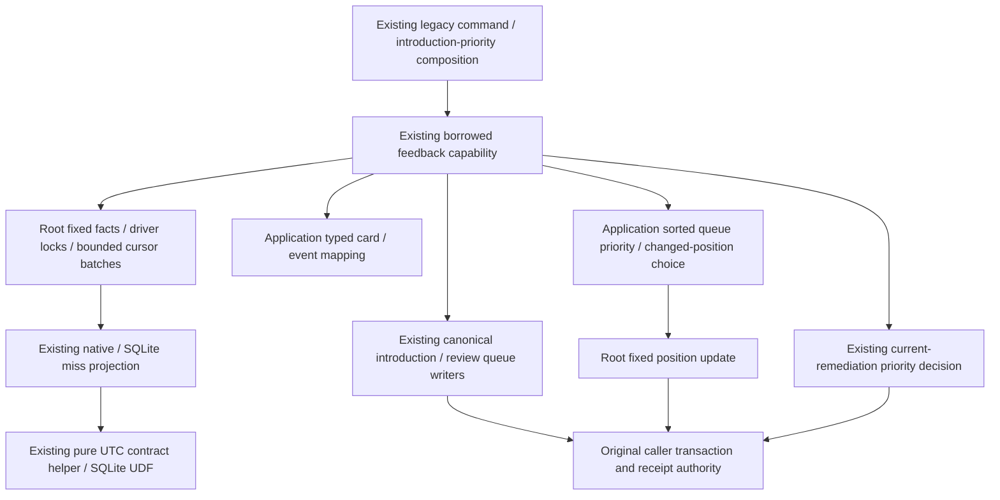

# Legacy backend adapters

[Database overview](../README.md) · [Source schema charts and dictionary](../schema/README.md)

| File | Role |
| --- | --- |
| [database_executor.py](database_executor.py) | Single-owner SQLite writer with foreground-priority scheduling. |
| [discovery_acceptance_store.py](discovery_acceptance_store.py) | Six fixed PostgreSQL acceptance queries on the borrowed transaction; [application coordination](../../../backend/app/services/discovery_acceptance_store.py) retains scope locks, contract projection and task policy. |
| [defensive_analysis.py](defensive_analysis.py) | Existing defensive settings read and SQL admission/recommendation predicates; task policy and HTTP errors stay with application composition. |
| [frozen_order.py](frozen_order.py) | Frozen-order reads, staging/activation and conditional rollback on the caller's transaction; [Study policy and composition](../../../backend/app/study/frozen_order/README.md). |
| [legacy_game_evidence_scope.py](legacy_game_evidence_scope.py) | Native accepted-scope exclusion owned by feedback persistence. |
| [opening_progression.py](opening_progression.py) | Existing completed-practice SQL predicate and legacy-child update, moved intact. |
| [tactic_admission.py](tactic_admission.py) | Existing daily-introduction count and PostgreSQL transaction-scoped admission lock, moved intact. |
| [postgres_store.py](postgres_store.py) | PostgreSQL connection and SQL compatibility seam for the cutover. |
| [real_game_feedback.py](real_game_feedback.py) | Fixed feedback facts/locks/priority writes and bounded cursor batches; [borrowed application composition](../../../backend/app/services/real_game_feedback_store.py) retains typed, queue and remediation choices. |
| [real_game_miss_projection.py](real_game_miss_projection.py) | Persistence-only miss projections shared by explicit queue read adapters. |
| [repertoire_lines.py](repertoire_lines.py) | Existing authored-line snapshot query; [Studies conflict computation](../../../backend/app/studies/README.md) lives outside database. |
| [scheduling_review_store.py](scheduling_review_store.py) | Legacy adapter exports; Learning owns the shared implementation. |
| [snapshot_reads.py](snapshot_reads.py) | Existing SQL snapshot/evidence capture helper, relocated intact with native values, C collation, batch and digest behavior preserved. |

- [queue_position_lock.py](queue_position_lock.py): existing queue-position advisory lock boundary.
- [postgres_readiness.py](postgres_readiness.py): four existing PostgreSQL readiness fact queries on the same reader scope. [Operational health decisions](../../../backend/app/operations/README.md) retain HTTP/Celery/status evaluation outside database.

[Command persistence](commands/README.md) groups the existing account/activity/annotation/statistics/endgame/teaching operations. [Control/read projections](controls/README.md) groups settings, review reconciliation, opening evidence and coverage operations. Their application call-site composition and transaction authority stay outside these helpers.

[Legacy Games command storage](games/README.md) groups game/sync/finding/analysis lease/publication operations. Existing legacy shared-card/queue/feedback coupling remains disclosed at its original composition callers; this move adds no owner permissions or Study dependency.

[Repertoire and tactical projections](projections/README.md) own complete comparison input/publication, statistics and tactical-opportunity queries. Existing application algorithms, cache/state and connection composition remain outside database.

[Queue provenance and lifecycle storage](lifecycle/README.md) owns retained-attempt facts, refresh publication/intents and metric persistence/buffering. Existing recovery, coalescing, clocks and finite metric policy remain application decisions.

[Foreground settings and authoring controls](foreground_controls/README.md) own existing settings/provider-account persistence, main-repertoire locks/edits and prefix-split reads/writes on the original command transaction. Validation and follow-up choices remain in their application owners.

[Redis admission and policy storage](redis_control/README.md) owns the original cached clients, control keys/Lua/pipelines and Study-mode query. Lifecycle, clocks, identity, cancellation, local fallback and policy validation stay at their existing application composition points.

[Derived publications](derived_publications/README.md) contains the next-opponent profile and daily-chess-statistics reads and guarded writes. Existing time/eligibility/math/insight/presentation decisions remain in their application compositions.

[Scheduling storage](scheduling/README.md) owns existing engine/durable turn-state, candidate SQL and dialect/translation mechanics. Class/turn/fairness decisions remain in their original application compositions; lease and turn persistence share the caller's transaction.

[Repertoire scope and saved moves](repertoire_scope/README.md) contains existing generation/freshness SQL, game-refresh queries and bounded line/digest/dialect operations. Application freshness validation, chess/deadline/cursor and task policy remain outside.

[Authored repertoire commands](authored_repertoires/README.md) contains existing canonical-prefix/branch reads, locks and writes. Payload/chess/HTTP validation, revision/route/callback policy and responses remain in the original command compositions.

[Statistics storage](statistics/README.md) contains existing game-feature/dimension projections, daily snapshot/insight writes and job claims. Math/chess/time-zone/day/threshold and response decisions remain in the original application source; the whitelisted projection is captured once before its clock/read scope.

[Authored exercise attempts](study_attempts/README.md) holds existing attempt/replay/card/queue/exercise/review/burial operations. Grading, guided/self-assessed outcomes, dates, requeue and refresh composition stay outside database; legacy Studies content and Study practice boundaries remain distinct.

[Bounded prefix reads](prefix_reads/README.md) contains existing diagnostic graph/evidence projections and the complete native-typed transition state capture, preserving one read-only MVCC scope, query/size/payload order and resource/stale-link guards. Algorithms, typed responses and existing planning authority remain unchanged outside database.

[Introduction-priority storage](introduction_priorities/README.md) holds complete coverage/personal-evidence/card/settings projections, priority job claims and generation publication operations. Scoring, bounded read/page/chunk loops, clocks, foreground yielding, stale-generation decisions and callbacks remain in the existing application owner.

[HTTP composition storage](http_composition/README.md) holds complete system/settings and queue-maintenance queries separated from the existing HTTP composition root. Application settings/HTTP/admission/refresh/lifecycle decisions remain there; all203 original direct/alias query sites, builders and selectors are now root-owned. Backend application responsibility organization remains a separate next phase.

[Priority preparation and retention](priority_lifecycle/README.md) contains existing source-epoch locks, preparation/staging/publication queries and native/SQLite retention statements. Application generation/lease/freshness checks, row budgets, clocks, slice progression and durable callbacks remain outside; complete operations reuse exact introduction-priority queries.

[Queue refresh persistence](queue_refresh/README.md) starts with existing tactical/unseen/due/Study admission statements and eligibility constants. Eligibility/quota/selection/locks/callback composition stays with the caller; the remaining direct/bounded projections and SQL builder/reader bridges are unfinished extraction work.

[Existing opening graph persistence](opening_graph/README.md) holds the graph worker, recovery and compatibility adapters' complete queries, cursor batches and writer scopes. Existing traversal/planning/JSON/card defaults, budget/cleanup and generation/lease/callback/clock policy remain outside.

[Existing legacy opening-evidence storage](opening_evidence/README.md) holds manifest/checkpoint/observation/review/exposure queries and bounded read scopes. Existing evidence computation and reconciliation choices remain outside; Learning evidence has its separate owner. This is existing shadow-evidence storage, not the proposed canonical model.

[Existing coverage explorer and seeding persistence](coverage/README.md) owns complete node/candidate/run/route/scope queries. Traversal, chess, probability/cohort, fingerprint, lease/current-scope decisions and provider/cache/task callbacks stay in the existing applications, with unchanged transaction composition.

[Background diagnostic reads](background_diagnostics/README.md) hold complete bounded aggregates and existing PostgreSQL/SQLite timeout/progress/read scopes. Application clocks, remaining-budget/progress callbacks, error classification, formatting and runtime merge remain outside; lazy engine iteration retains original query interleaving.

Readiness facts use [runtime metadata](../schema/runtime-metadata/README.md) and [queue projection fields](../schema/study-queue-review-2/README.md): maximum migration version, required settings identity, queue state/refresh_pending/last_error and task state/payload. These are source-schema read projections; no table/field/key/FK/ownership changes, and no live schema verification. Application JSON/date/readiness decisions remain outside this tree.

[Borrowed Study review storage](study/review/README.md) owns existing schedule facts/write, queue order receipts and requeue positions/classification. Replay/scheduling/provenance/seed/clock/requeue policy stays outside. Existing feedback coupling is explicitly retained, not accepted as a completed Study isolation boundary.

[Legacy Learning review bridge storage](learning_bridge/README.md) owns complete review/card/attempt/scheduling/evidence/queue projection queries on original borrowed or owned scopes. Review command/recognition/grade/scheduling/deferred compatibility policy stays outside; the shared foreground projection operation retains one SQL home.

[Portable authored/imported Studies storage](studies/portable/README.md) owns fixed content export/import/column-shape queries. Bundle validation, UUID/source-group remapping, replay/conflict and response policy remain outside. Plural Studies is distinct from ordinary daily-practice Study and excludes personal review history.

## Existing borrowed feedback storage and composition

**Current source; live schema and deployment unverified.** [real_game_feedback.py](real_game_feedback.py) owns the original complete parameter-bound miss/card/event projections, queue-priority/position writes, PostgreSQL card/day locks, SQLite projection preparation and single-cursor bounded batches. [real_game_feedback_store.py](../../../backend/app/services/real_game_feedback_store.py) retains the existing fourteen-method borrowed capability: typed DTO mapping, sorted priority planning and changed-position choices, introduction/review queue callbacks and accepted-remediation priority decisions. [real_game_feedback_adapter.py](../../../backend/app/services/real_game_feedback_adapter.py) retains receipt/connection/task composition; the public [feedback ports](../../../backend/app/services/real_game_feedback_ports.py) are unchanged.

| Existing storage | Read/written fields and purpose | Canonical source dictionary / ER |
| --- | --- | --- |
| `cards` | Card identity/state/introduction for typed facts; availability/deletion/integrity/current-membership filters remain in the existing projection | [Cards and deletion](../schema/study-queue-review-1/README.md), [membership/integrity](../schema/authored-content-2/README.md) |
| `daily_queue` | Day/card/status burial read; changed slot position and existing gameplay-priority reason replacement | [Queue](../schema/study-queue-review-1/README.md) |
| `current_repertoire_decision_events` | Existing current-view event/card/game/repertoire/ply/outcome/time projection; one game-event snapshot ordered by ply/id | [Underlying staged events](../schema/game-projections-3/README.md) and [current-view alias](../ddl/migrations/035_canonical_publication_freshness.sql) and [current view definition](../ddl/migrations/041_real_game_study_obligations.sql) |
| `imported_games`, `repertoires`, `repertoire_cards`, integrity blocks, `reviews` | Existing non-excluded/current-membership and safe physical-card projection; exact study-review instant/source/invalidation filter | [Game identity](../schema/authored-content-1/README.md), [repertoires](../schema/authored-content-3/README.md), [membership/integrity](../schema/authored-content-2/README.md), [reviews](../schema/study-queue-review-2/README.md) |

The linked dictionaries describe actual types, primary/composite keys and enforced FK cardinality. The current decision-events view is a projection, not a newly stored table or inferred constraint. No schema, fields, keys, encoding, relationship or grants change. The fixed store never imports application code or opens/commits/rolls back a transaction. Both event iterators retain one query/snapshot, lazy execution and `fetchmany(128)` order; application mapping preserves each yielded batch and early-close behavior. `BATCH_SIZE` remains at its original root import for compatibility.

Existing legacy Study/queue/feedback/remediation coupling remains; it is not a completed domain or optional-producer isolation boundary. Separately, the unchanged `real_game_miss_projection.py` imports the pure `utc_instant` contract helper from the backend feedback ports to implement its SQLite timestamp UDF. That is an existing contract/helper callback edge, not application queue orchestration or proof of app-independent package closure.

Focused checks: 55 existing/new feedback storage, policy, consumer-wiring and store-boundary cases pass, including actual in-memory SQLite filtering, batching and caller rollback. Captured-original/current comparison passes 58 paths: exact query/parameter/cursor events, UDF registration, DTO results/errors, lazy/partial batch iteration and callback order. No native PostgreSQL locks/races/rollback or live/service/full-system validation is claimed. The native fixture's store import changes only; it was not executed.
