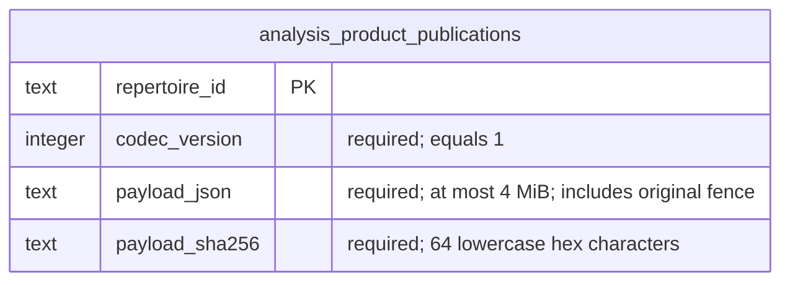

# Analysis publication adapter — #501 private source

This opt-in [adapter](publications.py) implements the existing
[`AnalysisPublications`](../../../../backend/app/analysis/jobs/ports.py) interface.
Its schema is unregistered, no runtime imports or migration are activated, and
actual owner fencing and product integration remain unverified. Its own SQL has
focused disposable PostgreSQL proof. It imports no connection factory, provider, process, Study writer or
lifecycle framework. Existing legacy coverage adapters and their schemas remain
separate. The component registry's Intelligence service and its job contracts
do not provide this product coverage publication store.

## Public use and transaction authority

`PostgresAnalysisPublications(transactions, current_fence=...)` receives a
factory for an **owning** context-managed transaction and a typed
`CurrentAnalysisFence(database, repertoire_id, reserve=...)` callable. SQL uses
the legacy Postgres connection's existing qmark parameter binding. The adapter
does not accept arbitrary SQL from an application and touches only its own table.

`current(repertoire_id)` reads current actual source/settings/personal/evidence
facts in one short transaction. It never substitutes a publication's saved
metadata. `publish_if_current(prepared)` encodes and validates the complete
public value before opening a transaction, then calls the current-fence owner
with `reserve=True` on the **same borrowed database**. Every `AnalysisFence`
field participates in equality: repertoire ID/revision, source revision,
snapshot digest, settings revision/digest, personal revision and evidence
revision. A wrong owner repertoire is an explicit capability error. Non-ready
or obsolete work does not replace the last accepted row. Identical replay
performs no update, including an SQL conflict guard for concurrent inserts.

The injected capability must hold the actual source/settings/personal/evidence
owners' reservations through publication **commit**, even for a first insert.
All corresponding writers must honor those reservations and their established
lock order, with owner locks before the Analysis publication row lock. An
unlocked facts query, transaction snapshot or second later comparison does not
satisfy this contract. The opt-in [source composition](../../../../backend/app/product_composition/analysis_publications.py)
now calls #483's published `reserve_current_snapshot` for the source portion.
Its native concurrency qualification and the actual Analysis generation
capabilities remain pending; the complete guarantee is not yet established.

`CurrentRepertoireAnalysisFence(generations)` first invokes that public source
operation, then passes its existing `RepertoireSnapshot` and the **same borrowed
database** to the required `ReservedAnalysisGenerations` callable. The callable
must reserve actual settings/personal/evidence facts until this caller commits;
no implementation or default generation is supplied. The returned existing
`AnalysisFence` must exactly match the reserved source ID/revision/digest. A
scope/source mismatch or missing capability fails explicitly. Even
`reserve=False` current reads take these short reservations, preserving one
coherent source while the other owner facts are read. The transaction must
already be a Read Committed writer; no connection, commit, SQL, source policy,
provider or Study mutation moves into composition. Busy source work yields
through the owner's `SnapshotReservationUnavailable`; the caller rolls back
partial reservations, and the existing optional runner reports unavailable.

The transaction factory commits before returning success, rolls back on failure,
and releases its connection and reservations on every exit. It must not borrow
an enclosing transaction that remains open after the method returns. Outer
composition supplies bounded optional-Analysis connection, lock and statement
budgets that yield to foreground Study. No provider/process work or codec
decoding occurs in these database sections; the adapter starts no worker or pool.
Shared host/database contention and deployed isolation are unverified.

`current_result(repertoire_id)` reserves actual facts while reading the row,
releases the transaction, decodes the value, and returns it only if every saved
fence field matches those checked facts. This is current at that reserved read;
another owner's subsequent change still requires the receiving owner to recheck
its own acceptance context. `latest_result(repertoire_id)` is an explicit
historical fallback: it returns the last valid result with its **original fence**
and does not assert freshness. Neither read authorizes Study admission.

## Codec and failure behavior

Pydantic `TypeAdapter(PreparedAnalysis)` directly encodes and
reconstructs the existing frozen `PreparedAnalysis`, `CoverageRanking`, nested
coverage dataclasses and immutable public evidence/ranking models. No copied
DTO, pickle or coverage calculation is introduced. JSON roundtrip detaches
inputs, retains tuple structure, normalizes numeric representation, and checks
the ready result's source/snapshot and both rankings' repertoire revisions.
`CoverageRanking.settings_digest` and `AnalysisFence.settings_digest` have
different owning formats and are preserved independently.

Canonical UTF-8 JSON has sorted keys, finite numbers, and an enforced maximum of
4 MiB before parsing and before storage. Its SHA-256 binds the complete encoded
value including the original fence. The checksum detects corruption; it is not
an authorization signature. Reads reject checksum mismatch, invalid UTF-8/text,
unknown format, non-ready or mismatched context, extra/duplicate fields,
noncanonical representation and invalid public values. Failure raises a stable
`AnalysisPublicationError.code`, including `analysis_publication_too_large` and
`analysis_publication_integrity_mismatch`, without exposing the payload. Absent
or stale current results return `None`. Corrupt reads never return a partial or
fabricated current value. Callers retain their existing optional-failure/safe
order behavior; a new valid current result can replace an invalid historical row.

## Proposed stored data

`SCHEMA_SQL` is source for integration-owned migration allocation, **not an
allocated/registered migration or live-schema claim**. It creates one
Analysis-owned last-publication table. There is no FK or write to another owner.
The repertoire relationship is logical; deleted repertoires need an owning
integration cleanup policy before activation.

| Column | Type and constraint | Meaning |
| --- | --- | --- |
| `repertoire_id` | text PK, 1–200 characters | One last accepted publication per repertoire. |
| `codec_version` | integer, required and equal to 1 | Explicit codec compatibility boundary. |
| `payload_json` | text, required, 1–4,194,304 UTF-8 bytes | Entire public `PreparedAnalysis`, including original fence/result. |
| `payload_sha256` | text, required, 64 lowercase hex characters | SHA-256 of exact canonical payload bytes. |



```mermaid
sequenceDiagram
  participant Runner as Bounded AnalysisRunner
  participant Adapter as Analysis publication adapter
  participant Tx as Injected owning transaction
  participant Facts as Opt-in source + required Analysis generation binding
  participant Source as Published #483 source reservation
  participant Store as Analysis publication table (not installed)
  Runner->>Adapter: publish_if_current(public PreparedAnalysis)
  Adapter->>Adapter: Validate, detach, bound and encode before DB
  Adapter->>Tx: Open short owning transaction
  Adapter->>Facts: Same borrowed DB; reserve current fence
  Facts->>Source: reserve_current_snapshot (native proof pending)
  Source-->>Facts: Existing snapshot; source locks held to caller commit
  Facts->>Facts: Reserve actual Analysis generations (capability pending)
  Facts-->>Adapter: Actual fence; reservations held to commit
  alt Every fence field matches
    Adapter->>Store: Lock/read own row; upsert changed payload only
  else Obsolete
    Adapter->>Adapter: Preserve last accepted row
  end
  Adapter->>Tx: Commit and release reservations/connection
  Adapter-->>Runner: Accepted/replay true; obsolete false
```

These are the proposed adapter/schema boundaries, not proof of source-owner
reservations, actual native locking, ordinary Study delivery, runtime adoption
or deployment. This README is the canonical source view for the adapter and proposed stored
data. Shared index links and numbered migration registration remain pending.

## Focused checks and remaining proof

The new [focused tests](../../../../backend/tests/test_product_analysis_publications.py)
exercise the actual public codec, nested immutability, finite/byte bounds,
corruption, all fence generations, wrong repertoire, non-ready refusal,
identical replay, transaction release, commit failure and explicit historical
fallback using a typed fake driver/transaction owner. They do not parse or freeze
SQL literals or claim real owner locks. The regular command passed 22 cases:

`make python-file FILE=backend/tests/test_product_analysis_publications.py`

The [native file](../../../../backend/tests/test_product_analysis_publications_postgres.py)
passed three cases using the existing capped/labelled disposable PostgreSQL
fixture. It proves real SQL/readback, inert replay, concurrent first publication,
transaction rollback and current-versus-historical cache visibility. Its generation
capability reserves a private test row; it does not implement actual source,
settings, personal-game or evidence reservations. The fixture is removed after
verified owner-label checks. Run only this named command under the advisory lock:

`make python-file FILE=backend/tests/test_product_analysis_publications_postgres.py`

Before activation, #501 must supply and prove actual source/settings/personal/
evidence reservations and their writer agreement, allocate the schema in its
authorized migration window, and exercise that real cross-owner fence plus
product wiring, saved settings and ordinary Study acceptance through its owner.
No such product pass is claimed by these storage checks.

The changed [source composition checks](../../../../backend/tests/test_product_analysis_source_fence.py)
exercise exact borrowed-database forwarding/order, both read modes, mismatched
source refusal, contention propagation and last-result preservation with typed
fake owner effects. They are not native locking proof. The new
[native source/publication boundary file](../../../../backend/tests/test_product_analysis_source_fence_postgres.py)
is **prepared, not run**. It uses the actual #483 reservation and Analysis SQL
with the existing capped disposable PostgreSQL fixture, including source-held
publication, introduction-only invalidation, contention rollback and failed
commit release. Its other Analysis generations are explicitly synthetic.

After prioritized Study repair and browser validation, run this boundary only
after the source owner's own native qualification, under the advisory lock:

`make python-file FILE=backend/tests/test_product_analysis_source_fence_postgres.py`
