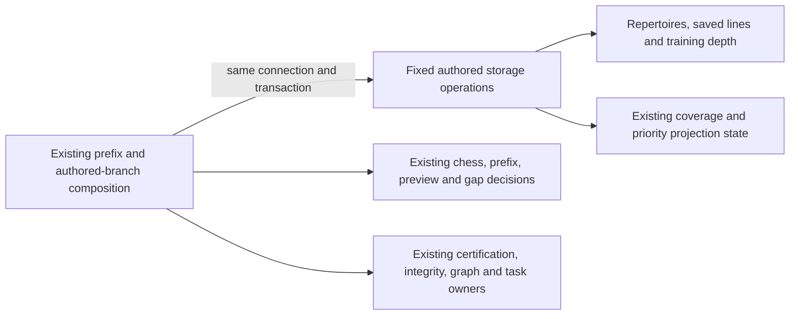

# Legacy authored repertoire command storage

**Current source in this extraction; live schema and deployment unverified.** These are complete existing canonical-prefix and authored-branch queries/locks. Application commands retain validation, chess/source matching, revision policy, refresh/certification callbacks and responses. Each operation borrows the original caller connection/transaction; no receipt, task or commit authority is added.

| Database module | Stored facts / effects | Application owner |
| --- | --- | --- |
| [prefix_commands.py](prefix_commands.py) | Existing repertoire presence, preview row, empty-prefix preview reference, prefix JSON/revision/reference update, local active-coverage failure, priority source epoch increment and priority projection invalidation. Reuses existing [repertoire presence](../projections/repertoire_statistics.py) and [configured-probe](../repertoire_scope/game_refresh.py) operations. | [canonical_prefix_api.py](../../../../backend/app/canonical_prefix_api.py) retains input/HTTP validation, ready/current preview and source checks, empty-prefix fast path, revision calculation, game/opportunity/coverage/priority task calls, idempotent dispatch and response projection. |
| [branches.py](branches.py) | Existing repertoire row locks, idempotent line insert, initial/training depth facts/write, locked source-gap lookup and covered flag, ordered stored-line projection and matching-ID deletion. | [branch_commands.py](../../../../backend/app/branch_commands.py) retains legal move normalization, deterministic identity, prefix-scope validation, gap ownership/response checks, matching-line selection, route certification, integrity/graph/coverage calls and response construction. |

Canonical source schema dictionaries and ER diagrams show actual fields/types, primary/composite keys and enforced versus logical relationships:

- [Repertoire fields](../../schema/authored-content-3/README.md), [saved lines/training depths](../../schema/authored-content-2/README.md) and [canonical preview fields](../../schema/opening-graph/README.md): repertoire prefix move JSON/revision/preview reference; line ID, repertoire, name, trained color, starting FEN, moves and creation time; learner decision count; preview state/expected/source revisions and saved move JSON.
- [Coverage and priority fields](../../schema/discovery-priority/README.md), [priority source epochs](../../schema/authored-content-1/README.md) and [settings](../../schema/runtime-metadata/README.md): candidate node/move identity and covered flag, coverage lifecycle/error state, priority publication/introduction projections, source version and initial depth. Existing JSON/revision freshness relationships are logical checks, not new FKs.

Prefix saves retain the original ready/current preview checks, revision semantics, empty-prefix fast path and callback sequence. Branch edits retain original `FOR UPDATE`/`FOR UPDATE OF candidate`, conflict-ignore/returning behavior, stored line ordering, native array-bound delete and conditional certification/coverage calls. The application still selects exactly which line IDs match and constructs every task payload, timestamp and response. No query, lock, key, FK, migration, view, stored JSON or behavior changes.

Both original application files contain no SQL-bearing literals or direct query/driver calls. Driver configuration probes execute at their original call points through the existing database helper; compatibility imports and command/router registrations remain available. No generic SQL execution port, dispatch framework, independently committing repository or broad domain move is introduced.

Existing authored-source, scope, coverage, priority and task/certification coupling is preserved explicitly. These adapters grant no new cross-owner table access, establish no new domain boundary and prove no Games/Study resource or shutdown isolation. Study gains no Games dependency. Other prefix/preview/graph/integrity/task implementations retain their existing separately coordinated owners.

Seven focused fake/task-temporary SQLite cases pass: branch write/delete and callback order, ready preview save, conflicting/stale preview rejection and clearing/off-scope behavior. Exact source comparison preserves all application logic, 18 query callsites and driver/callback/clock order. Native PostgreSQL execution/locking/rollback, installed-package discovery, live schema and deployment remain unverified.
