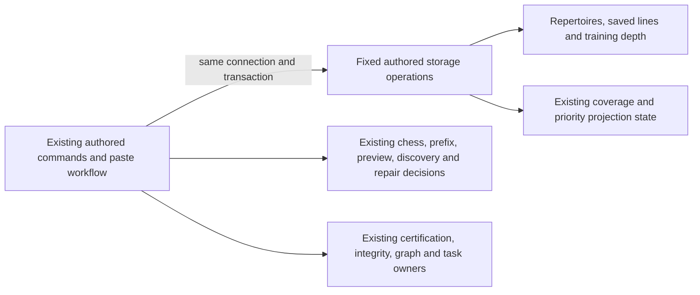

# Legacy authored repertoire command storage

**Current source in this extraction; live schema and deployment unverified.** These are complete existing canonical-prefix, authored-branch, discovery and integrity-repair queries/locks. Application commands retain validation, chess/source matching, revision policy, refresh/certification callbacks and responses. Each operation borrows the original caller connection/transaction; no receipt, task or commit authority is added.

| Database module | Stored facts / effects | Application owner |
| --- | --- | --- |
| [prefix_commands.py](prefix_commands.py) | Existing repertoire presence, preview row, empty-prefix preview reference, prefix JSON/revision/reference update, local active-coverage failure, priority source epoch increment and priority projection invalidation. Reuses existing [repertoire presence](../projections/repertoire_statistics.py) and [configured-probe](../repertoire_scope/game_refresh.py) operations. | [canonical_prefix_api.py](../../../../backend/app/canonical_prefix_api.py) retains input/HTTP validation, ready/current preview and source checks, empty-prefix fast path, revision calculation, game/opportunity/coverage/priority task calls, idempotent dispatch and response projection. |
| [branches.py](branches.py) | Existing repertoire row locks, idempotent line insert, initial/training depth facts/write, locked source-gap lookup and covered flag, ordered stored-line projection and matching-ID deletion. | [branch_commands.py](../../../../backend/app/branch_commands.py) retains legal move normalization, deterministic identity, prefix-scope validation, gap ownership/response checks, matching-line selection, route certification, integrity/graph/coverage calls and response construction. |
| [analysis_paste.py](analysis_paste.py) | Exact repertoire/line snapshot, gap facts, SQLite conditional begin, saved-line/depth insert and covered flag; borrowed transaction, no cursor escapes. | [services/analysis_paste.py](../../../../backend/app/services/analysis_paste.py) retains SAN/PGN/chess/cache/hash/preview/duplicate/conflict/scope/certification/clock and response decisions. |
| [discovery_commands.py](discovery_commands.py) | Exact opportunity dismiss/seen/snooze mutations, locked opportunity/card facts, prefix split/card membership reads and repertoire presence. Linked rows execute eagerly and iterate lazily on the same transaction. | [opportunity_commands.py](../../../../backend/app/opportunity_commands.py) retains HTTP/evidence validation, seven-day snooze policy, clock/day evaluation, queue-lock/admission calls, prefix-split checks and sorted integrity/graph refresh callbacks. |
| [integrity_commands.py](integrity_commands.py) | Existing issue/source/card row locks and membership facts; replacement-line insert, training-depth carry-forward and old-line deletion. Reuses the existing repertoire row lock in `branches.py`. | [integrity_repair_commands.py](../../../../backend/app/integrity_repair_commands.py) retains prepared signature/expected-source checks, deterministic line identity, chess/route validation, graph-task-before-card lock ordering, rewrite/archive/certification and refresh callbacks. |

Canonical source schema dictionaries and ER diagrams show actual fields/types, primary/composite keys and enforced versus logical relationships:

- [Repertoire fields](../../schema/authored-content-3/README.md), [saved lines/training depths](../../schema/authored-content-2/README.md) and [canonical preview fields](../../schema/opening-graph/README.md): repertoire prefix move JSON/revision/preview reference; line ID, repertoire, name, trained color, starting FEN, moves and creation time; learner decision count; preview state/expected/source revisions and saved move JSON.
- [Coverage and priority fields](../../schema/discovery-priority/README.md), [priority source epochs](../../schema/authored-content-1/README.md) and [settings](../../schema/runtime-metadata/README.md): candidate node/move identity and covered flag, coverage lifecycle/error state, priority publication/introduction projections, source version and initial depth. Existing JSON/revision freshness relationships are logical checks, not new FKs.

Prefix saves retain the original ready/current preview checks, revision semantics, empty-prefix fast path and callback sequence. Branch edits retain original `FOR UPDATE`/`FOR UPDATE OF candidate`, conflict-ignore/returning behavior, stored line ordering, native array-bound delete and conditional certification/coverage calls. The application still selects exactly which line IDs match and constructs every task payload, timestamp and response. No query, lock, key, FK, migration, view, stored JSON or behavior changes.

The four extracted application files contain no SQL-bearing literals or direct query/driver calls. Driver configuration probes execute at their original call points through the existing database helper; compatibility imports and command/router registrations remain available. No generic SQL execution port, dispatch framework, independently committing repository or broad domain move is introduced.

Existing authored-source, scope, coverage, priority and task/certification coupling is preserved explicitly. These adapters grant no new cross-owner table access, establish no new domain boundary and prove no Games/Study resource or shutdown isolation. Study gains no Games dependency. Other prefix/preview/graph/integrity/task implementations retain their existing separately coordinated owners.

Seven focused fake/task-temporary SQLite cases pass: branch write/delete and callback order, ready preview save, conflicting/stale preview rejection and clearing/off-scope behavior. Exact source comparison preserves all application logic, 18 query callsites and driver/callback/clock order. Native PostgreSQL execution/locking/rollback, installed-package discovery, live schema and deployment remain unverified.

The discovery and repair commands add no table, field, key or constraint. [Discovery opportunity fields and enforced relationships](../../schema/discovery-priority/README.md) describe IDs, active/dismissed status, evidence JSON, seen/snooze/update timestamps and optional card reference. [Authored content fields and enforced relationships](../../schema/authored-content-2/README.md) describe issue signatures, repertoire/card membership, replacement line JSON/source fields and learner decision counts. [Prefix split fields and relationships](../../schema/opening-graph/README.md) describe source, shortened and continuation card IDs. [Card fields](../../schema/study-queue-review-1/README.md) retain their current source definition. Application checks of prepared issue signatures, expected moves and evidence revisions remain logical freshness checks; no absent FK is implied.

The discovery/repair slice passes nine existing task-SQLite/fake-native cases for state-action and refresh idempotency, prefix graph checkpointing, prepared-plan replay/stale-signature rejection, and copying training depth before deletion. Specific operation expansion reproduces both complete non-import application ASTs; all sixteen original query statements/parameters and clock/callback order remain unchanged. Fifteen new fixed operations reuse one existing lock operation, with four Python sources compiling. No native PostgreSQL or live-schema verification ran.

[Existing canonical-prefix implementation storage](canonical_prefix/README.md) now holds prefix/route reads and guarded writes, preview projections, bounded retention operations and the link to the moved SQLite compatibility DDL. Chess/source/revision/ranking decisions, preview passes/suggestions, row/victim budgets and callbacks remain in their existing application files. These are the existing preview/source tables and behavior, not the proposed canonical-model redesign.

[Opening advisory API projections](opening_advisory/README.md) holds existing segmentation state/recommendation/preference and structural prefix-evaluation queries, including the unchanged repeatable-read/optional recording wrapper. Snapshot/HTTP/chess/JSON/deadline/row-budget/capture decisions remain in the existing APIs. Existing read/configuration/presence helpers are reused; no proposed schema or feature is implemented.

[Existing opening mutation storage](opening_mutations/README.md) holds segmentation worker queries/native cursor batches and prefix-split card/review/queue/membership writes. Application planning/group construction, stable IDs/JSON/revision checks, budgets and callbacks remain outside; existing direct legacy review/queue coupling remains disclosed. Fixed finite SQL selection is unchanged and accepts no arbitrary query/table input.

The pasted-line extraction preserves all eight statement strings. Snapshot mapping consumes each original cursor inside storage before the next query; insert rowcount is sampled at the same point immediately before application admission. The original SQLite-only conditional BEGIN and caller transaction ownership remain exact. Public borrowed-connection annotations and the existing publication-refresh decorator remain compatible; this split does not claim a completed backend semantic interface. Thirteen original/current in-memory SQLite paths match SQL/order, stored rows/depth/gap flags, errors, scope/certification and transaction state; one existing cache case passes. No application lifespan/refresh-decorator/native infrastructure execution is claimed.

[Integrity scan/repair persistence](integrity/README.md) now owns all original query/batch and fixed scan-target construction. Application source grouping, issue/repair/lease/generation/time/queue decisions remain outside; two local fixed target closures preserve placeholder preparation before connection entry without accepting arbitrary SQL.

[Repertoire opportunity storage](opportunities/README.md) holds every current discovery-feed/scoring-input/refresh/training query, native/compatibility driver details and fixed lock/filter preparation. Scoring/chess/evidence/windows/admission/queue/task/clock decisions remain outside; existing direct legacy card/queue coupling stays explicitly disclosed.

[PGN import/discard persistence](pgn_import/README.md) owns complete repertoire/line/depth/annotation/receipt/tombstone queries and original RETURNING/batch cursor scope. Parsing/models, identity/time/UUID, line annotation preparation, source certification, deletion counts and graph/integrity/receipt responses remain outside. Existing Games refresh decorator is preserved and disclosed.

[Card edit and archive persistence](card_edits/README.md) owns existing card/revision/membership/review/queue queries and locks. Application legal-move, identity, revision, replacement/archive, clock and callback decisions stay outside. Existing shared review/queue writes and Games refresh composition remain disclosed.

[Discovery admission persistence](discovery_admission/README.md) holds existing recommendation, request, materialization and source/coverage/card/task operations. Existing validation, ranking, freshness, lease/admission/queue decisions and acceptance composition remain outside; complete queries and caller transaction authority remain unchanged.
