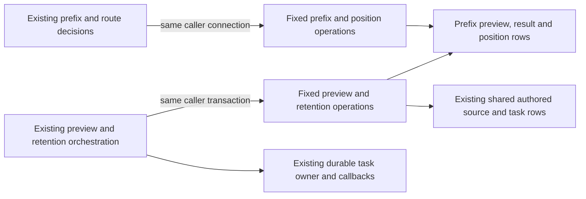

# Canonical prefix preview storage

**Current source; live schema and deployment unverified.** This directory holds the existing legacy authored-repertoire prefix queries, certified-position writes, preview projections and bounded-retention operations. It changes file ownership only. There are no schema, SQL, locking, transaction or feature changes.

| File | Database responsibility | Application owner |
| --- | --- | --- |
| [scope.py](scope.py) | Prefix row read/lock, certified route lookup, SQLite batch transaction start, preview source revision and dialect-specific position upsert with the existing source-epoch/ranking guard. | [canonical_prefix.py](../../../../../backend/app/services/canonical_prefix.py) keeps chess legality, canonical-prefix matching, origin ranking/closure, route selection, scope response and best-position selection. |
| [preview.py](preview.py) | Fixed preview reuse/insert/read, eligible card/line pages, conflict projection, prior origin, stale/result/completion writes and retention priority. Reuses existing fixed repertoire-presence, local-lease and prefix-reference operations. | [canonical_prefix_preview.py](../../../../../backend/app/services/canonical_prefix_preview.py) keeps validation, source/revision checks, pass/cursor/suggestion selection, timestamps, task payloads, lease/callback order and response projection. |
| [retention.py](retention.py) | Original retention query constants, PostgreSQL query warming, victim/task reads and fixed row-count-returning retirement, invalidation and child/parent deletion operations. | The preview application retains the eight-preview retention policy, four-victim/64-row slice budget, prepared-victim recheck, atomic invalidation/retirement policy and durable task checkpoints. Its three-child loop calls the same three deletions in the same order. |
| [SQLite DDL](../../../ddl/canonical_prefix_preview_schema.py) | The existing three table definitions, conditional source-revision column addition, preview-version index and scope-schema initializer. | `canonical_prefix_preview` re-exports `TABLE_DEFINITIONS` and `initialize_sqlite_schema` for existing callers. Retention constant names and existing module compatibility imports also remain available. |

All operations borrow the caller's connection; no helper commits or creates a connection. The application still opens the original read/write scopes, locks the repertoire before the task, closes the read connection before chess traversal and advances/completes tasks in the write transaction. Position upserts retain source-epoch fencing and the shortest/lexically ranked route guard, including the original native JSON-recordset and SQLite batch branches.

## Stored data and relationships

The [canonical opening-graph dictionary and ER diagram](../../../schema/opening-graph/README.md) are the canonical full definitions, including every field/type, key, nullability and enforced FK. The [authored repertoire dictionary](../../../schema/authored-content-3/README.md), [saved-line dictionary](../../../schema/authored-content-2/README.md), [card dictionary](../../../schema/study-queue-review-1/README.md) and [runtime task dictionary](../../../schema/runtime-metadata/README.md) describe referenced legacy storage. Ordered PostgreSQL migrations remain in [DDL migrations](../../../ddl/migrations); the moved SQLite initializer retains its compatibility schema.

| Table | Stored data | Keys and ownership |
| --- | --- | --- |
| `canonical_prefix_previews` | `id`, `repertoire_id`, `moves_json`, `state`, `suggestion_json`, `last_error`, `created_at`: text; `expected_revision`, `source_revision`: bigint. | PK `id`; enforced `repertoire_id` FK to `repertoires.id`, cascade delete. Legacy authored-repertoire compatibility scan. |
| `canonical_prefix_results` | `preview_id`, `item_id`, `name`, `status`, `reason`, `origin_json`: text; `disagreement_ply`, `scope_start_ply`: bigint. | Composite PK `(preview_id, item_id)`; enforced preview FK, cascade delete. Per-line/card scan result. |
| `canonical_prefix_positions` | `preview_id`, `fen_key`, `fen`, `route_json`: text; `in_scope`, `ply`, `source_revision`: bigint. | Composite PK `(preview_id, fen_key, in_scope)`; enforced preview FK, cascade delete. Certified route at a source epoch. |

The application compares repertoire source/prefix revisions against preview revisions; those checks are logical freshness relationships. A result's `item_id` is an application-constructed `line:`/`card:` identifier, without a line/card FK. The repertoire's active preview reference and a background task's kind/deduplication key also match logically; this move adds no FK. Retention preserves the existing active-preview exclusion, task-generation fence and child-first cleanup.

This is existing legacy authored-source/card/task coupling. Moving the operations grants no new cross-owner permissions, creates no independent domain package and establishes no Games/Study resource or shutdown isolation. No Study-to-Games dependency is added. The application still composes concrete same-owner storage helpers; broader domain interface/composition work remains separate.

## Focused evidence

The selected existing preview, stale-source, restart/replay, retention, ranked-batch validation and source-epoch route certification cases pass: **33 tests**, using task-temporary SQLite and fakes. Task-local source reconstruction reproduces both complete retained non-import application ASTs, restores the finite three-deletion loop, and verifies all **40 original query/DDL callsites**, the initializer, three DDL definitions and nine retention constants. Both application files contain no SQL-bearing literals or direct query/driver calls; seven affected Python modules compile.

Native PostgreSQL execution/locking/rollback, installed-package discovery, GitHub rendering, live schema and deployment remain unverified. No live database, native service or full-system suite was used.
