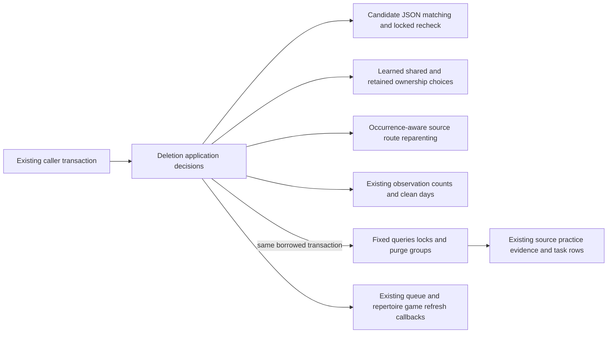
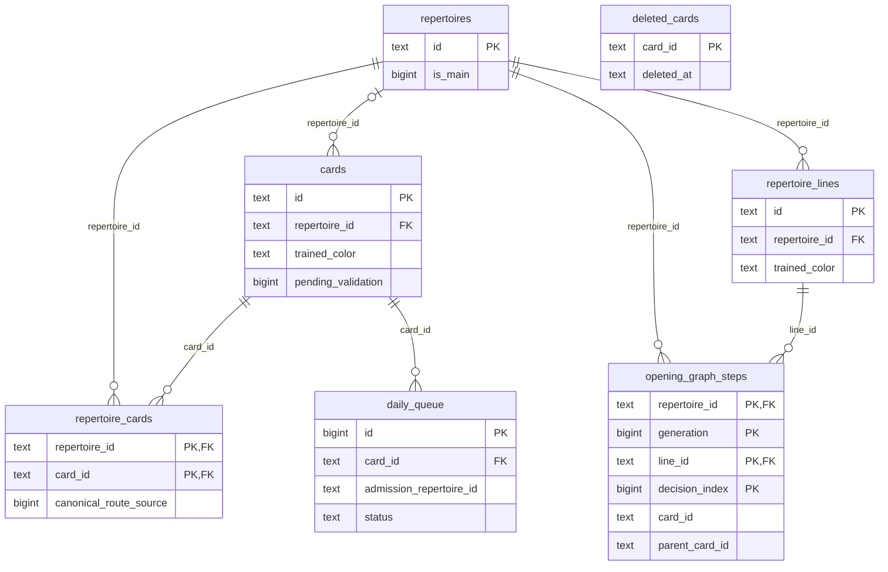

# Existing card and repertoire deletion storage

**Current source; live schema/deployment unverified.** Complete existing queries,
locks, dialect handling and fixed purge targets moved from
[card_deletion.py](../../../../../backend/app/card_deletion.py) to
[storage.py](storage.py). Application code retains cancellation matching,
learned/shared-card retention, color inference, evidence aggregation, graph
ancestor selection, HTTP errors and queue/task callbacks. This is legacy storage
organization, with no schema, deletion policy, receipt or transaction change.

| Storage group | Exact existing scope |
| --- | --- |
| `is_card_deleted` | Original native/compatibility tombstone lookup and boolean fact. The application compatibility import remains; `require_card_not_deleted` still raises the original HTTP error. |
| `cancellation_candidates`, `locked_cancellation_candidate`, `cancel_task` | Original candidate SQL/dialect transformation, application UTC factory **after query and before fetch**, native-only row lock and cancellation write. Application still decodes each payload and repeats exact-match validation after the lock before clearing a lease. |
| `purge_sources`, `purge_tactic_attempts`, `clear_source_references`, `purge_training_records`, `record_tombstones`, `purge_queue_and_cards` | Original queue/puzzle facts, fixed training-record deletions, source nulling/pause, identity tombstones, then queue/card deletion. The pause clock remains inside its original write parameter evaluation; tombstone clock remains before the batch. Empty IDs still do no work. |
| Evidence reads/purge/summary writes | Original affected-decision read and deletion order, remaining observation cursor, six counters/distinct-day summary insert and clean-day batch. All JSON aggregation and set iteration choices remain in the application. |
| Repertoire locks/reads/retained writes/deletion | Original main-repertoire advisory lock, affected-card lock order, learned/shared facts, fixed writes and comparison-table dialect branch. Application retains which cards survive, inferred color, new-main selection decision and refresh payloads. |
| Preview, card lock/revision and graph route/dependency operations | Original reads and batch writes. The application rejects stale revisions before mutation and computes predecessor changes using the unchanged occurrence-aware algorithm. |

`native_cleanup_supported` is the original native-driver capability fact needed
by the existing legacy-only evidence branch; it adds no new storage requirement.
The private `_delete_matching` implementation moved intact and remains available
through its old private compatibility import, with no external caller found.
Changed application flows call only fixed target/group operations; they pass no
table, column or arbitrary SQL. Static purge-target metadata stays beside its
queries. The same placeholder string is reconstructed privately for source
updates from the unchanged ID list, avoiding SQL fragments in the application.

**Existing coupling remains:** this legacy workflow directly changes queue,
review-associated card state, authored sources, evidence, game findings and
practice-family records, and invokes queue/task application callbacks. The
adapter imports no application implementation and creates no connection,
transaction, commit, rollback or lifecycle authority. Physical colocation does
not establish isolated domain interfaces, optional-feature isolation or completed
whole-backend centralization.

## Source relationships and data map

This bounded ER view shows the deletion identities and actual key relationships.
The canonical dictionaries below contain every stored field/type, nullability,
ordered DDL and full owner ER diagrams. `opening_graph_steps.card_id` and
`parent_card_id` are **logical** occurrence links, without card FKs; tombstones
also have no card FK. No relationship edge is inferred for those names.

| Canonical field dictionary / ER view | Stored data used or affected here |
| --- | --- |
| [Repertoires](../../../schema/authored-content-3/README.md#publicrepertoires), [membership](../../../schema/authored-content-2/README.md#publicrepertoire_cards), [saved lines](../../../schema/authored-content-2/README.md#publicrepertoire_lines) | Original ID/main/source/creation/new-card-limit facts, composite membership and trained-color fallback. Kept learned cards use the existing `__retained_cards__` repertoire with zero new-card limit. Existing repertoire and line FKs retain their cascade behavior. |
| [Cards](../../../schema/study-queue-review-1/README.md#publiccards), [reviews](../../../schema/study-queue-review-2/README.md#publicreviews), [daily queue](../../../schema/study-queue-review-1/README.md#publicdaily_queue) | Original content/color/learned-history/ownership facts; retained cards keep schedules and surviving shared admissions follow their primary owner. `admission_repertoire_id text` is a logical scope value, not an inferred FK. Card FKs from reviews/queue still cascade. |
| [Tombstones](../../../schema/study-queue-review-1/README.md#publicdeleted_cards), [revision history](../../../schema/study-queue-review-1/README.md#publiccard_revisions), [projection diagnostics](../../../schema/study-queue-review-1/README.md#publicqueue_projection_diagnostics), [Study attempts](../../../schema/study-queue-review-2/README.md#publicstudy_attempts) | Deletion identities/timestamps and the original fixed training-record cleanup by card/queue ID. Immutable operation receipts and admission-origin records remain outside this purge. No new card FK is asserted for revision history or diagnostics. |
| [Stored graph steps](../../../schema/opening-graph/README.md#publicopening_graph_steps) | Composite occurrence PK `(repertoire_id,generation,line_id,decision_index)` and logical card/predecessor IDs. Only changed predecessor IDs are written before deleting the targeted card's steps. Other cards and schedules remain untouched by reparenting. |
| [Opening evidence dictionaries and ER](../../../schema/opening-evidence-1/README.md) | Attempts/presentations/queue-context identities, observation JSON and six summary counters plus distinct clean days. Observation attempt FK cascades; presentation/context and summary/day constraints retain the original delete ordering. The application still reconstructs remaining decision summaries from stored observations. |
| [Game findings](../../../schema/game-projections-1/README.md#publicgame_findings), [comparison rows](../../../schema/game-projections-3/README.md), [threat candidates](../../../schema/practice-families-2/README.md#publicthreat_training_candidates) | Existing nullable card/repertoire association clearing, comparison owner cleanup and candidate `paused_at` text timestamp. Native comparison cleanup uses the existing legacy/staged tables; compatibility uses its existing table. |
| [Tactic records](../../../schema/practice-families-1/README.md) | Fixed `tactic_progress.card_id` and `tactic_discovery_attempts.puzzle_id` cleanup; original tactic source IDs come from the selected cards. |
| [Background tasks](../../../schema/runtime-metadata/README.md#publicbackground_tasks) | Candidate ID/deduplication/payload JSON, state and cancellation phase; exact matches are completed with cleared lease/token fields and application UTC timestamps. Payload matching remains JSON application logic rather than a new JSONB cast. |

## Focused relocation proof

[Seven fake-only checks](../../../../../backend/tests/test_card_deletion_storage_boundary.py)
cover native/compatibility cancellation with locked payload recheck, purge clock
and tombstone order, both learned-card retention policies with shared ownership,
occurrence-aware graph reparenting before purge/refresh, and stale revision
rejection before mutation. Source expansion reproduces all nine retained
function bodies/signatures and both moved compatibility functions, plus the
dependency dataclass/constants. All 40 original query/batch sites and 39 SQL
literal occurrences (35 distinct) remain; multiline SQL runtime bytes are exact.
Three application UTC factories reduce to their original evaluation points.
Only the repeated pure placeholder construction is normalized for comparison.
Native PostgreSQL constraints/locks/rollback, SQLite integration, Main/startup,
full-system, live-schema and installed-artifact behavior remain unverified.
No previously denied loopback operation was retried.
