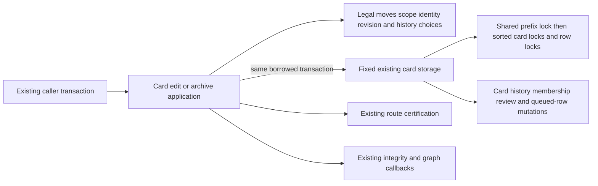
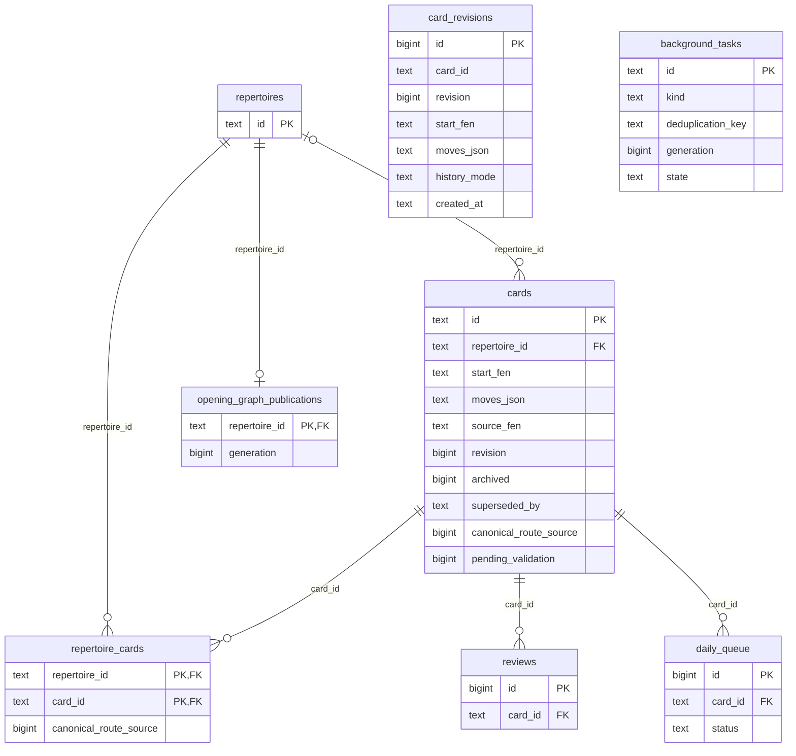

# Existing card edit and archive storage

**Current source; live schema/deployment unverified.** This directory owns the
complete existing queries and locks moved from
[card_commands.py](../../../../../backend/app/card_commands.py) into
[storage.py](storage.py). Application code retains card-edit, archive and
integrity-refresh decisions. No schema, history policy, queue authority,
transaction ownership or public command contract changes.

| Fixed operations | Original responsibility retained |
| --- | --- |
| `current_publication`, `graph_task` | Existing generation/task facts. Application invalidates first, then chooses integrity scan versus graph rebuild using the same conditions and callback order. |
| `card_scope`, `card_repertoires` | Original compatibility/native membership reads return their cursors without eager materialization; original comprehensions still iterate in the application. |
| `lock_prefix_transition`, `lock_card_edit`, `locked_card`, `locked_replacement`, `locked_archive_identity` | Same shared prefix-transition lock, advisory edit lock and row-lock statements. Application retains sorted ID iteration and the two late deletion guards before reading the old/replacement rows. |
| `record_revision`, `replace_content`, `mark_canonical`, `insert_replacement` | Original history write and chosen card mutation. Legal moves, expected revision, new revision/UTC time, same-ID versus merge/copy choice and copied/reset scheduling fields remain in the application. The dynamic insert is fixed to `cards` and uses the same root-owned `card_columns` result and parameter order. |
| `transfer_reviews`, `complete_queued`, `rebind_queued`, `supersede` | Original branch-selected history/queued-row/archive effects. Existing-target merge completes queued source rows; new-target copy rebinds them. The application still decides history mode and does not reset an existing target's schedule. |
| `copy_membership`, `remove_membership`, `admit_membership`, `mark_pending`, `archive` | Original membership changes, validation marker and archive writes. Certification, per-repertoire dates/refresh and response summaries remain after the same mutations. |

The adapter has no connection/commit/rollback/lifecycle ownership. It accepts
only the existing operation-specific facts, with no arbitrary SQL/table port.
`PostgresConnection` and `card_columns` compatibility exports refer to the same
existing class/helper. Six identical semantic statements are reused at their
original call points; all 28 application query sites and branch order remain.

**Existing legacy coupling remains:** these commands write review and daily
queue rows directly and call separately owned scope/certification, deletion,
integrity and graph code. The existing Games publication-refresh decorator is
unchanged. Physical organization neither grants new cross-owner access nor
establishes the target public domain interfaces or optional-feature isolation.
No Study/Games independence or whole-backend centralization claim is made.

## Source data map

The ER view shows the touched keys and enforced FK cardinality; canonical links
below provide every stored field/type, nullability, actual constraints and DDL.
`card_revisions.card_id` and `cards.superseded_by` are logical identity links
without enforced foreign keys, so no FK edge is drawn for them.

| Canonical dictionary | Stored content used here |
| --- | --- |
| [`cards`](../../../schema/study-queue-review-1/README.md#publiccards) | The locked existing row supplies all original copied columns. Content/source FEN and move JSON, revision, archive/supersession, canonical-route and validation markers are updated in the original branches. New-copy reset retains the original due-date, interval/repetitions/lapses, FSRS JSON, first-correct/reinforcement/stability, guided/state/mode/streak/recent-attempt field resets. All other copied fields remain unchanged. |
| [`card_revisions`](../../../schema/study-queue-review-1/README.md#publiccard_revisions) | Original content and chosen history mode at the new revision and UTC text timestamp. `id bigint` is PK; (`card_id text`, `revision bigint`) is unique, not the primary key and not an FK to cards. |
| [`repertoire_cards`](../../../schema/authored-content-2/README.md#publicrepertoire_cards), [`repertoires`](../../../schema/authored-content-3/README.md#publicrepertoires) | Composite membership PK/FKs, cascading on either parent delete, with the existing `canonical_route_source bigint` marker. The old card's nullable repertoire field also contributes to the original scope union. |
| [`reviews`](../../../schema/study-queue-review-2/README.md#publicreviews), [`daily_queue`](../../../schema/study-queue-review-1/README.md#publicdaily_queue) | Existing preserved-history FK reassignment and queued-status/card-ID changes only; no new rows or second settlement/queue authority. Both card FKs cascade on delete. |
| [`opening_graph_publications`](../../../schema/opening-graph/README.md#publicopening_graph_publications), [`background_tasks`](../../../schema/runtime-metadata/README.md#publicbackground_tasks) | Generation/state facts determine the existing application refresh callback. The query joins task kind, deduplication key and generation logically; no FK connects a publication to the task. The task's (`kind`, `deduplication_key`) tuple is unique. |

## Focused relocation proof

[Eight fake-only checks](../../../../../backend/tests/test_card_edits_storage_boundary.py)
cover same-ID, existing-target preserve and new-target reset edits, sorted locks,
late deletion guards, revision/history/column/clock order, membership before
certification, archive queue completion before refresh/summary, conditional
integrity refresh and ordered card insertion. Decorated-handler checks call the
unchanged inner functions; the existing outer Games refresh wiring is not
qualified here. One-time expansion reproduces all five original function
bodies/signatures/decorators and three registrations exactly, including all 28
statement ASTs and original SQL bytes/parameters/branches. All 22 distinct
statements remain, including the existing fixed-card-table dynamic insert.
Native PostgreSQL locking/rollback/constraints, Main/startup, full-system,
live-schema and installed-artifact behavior remain unverified for this slice.
No native/SQLite integration or previously denied loopback test ran.
