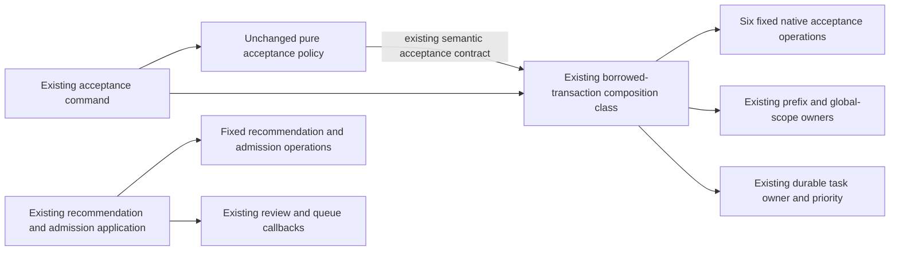
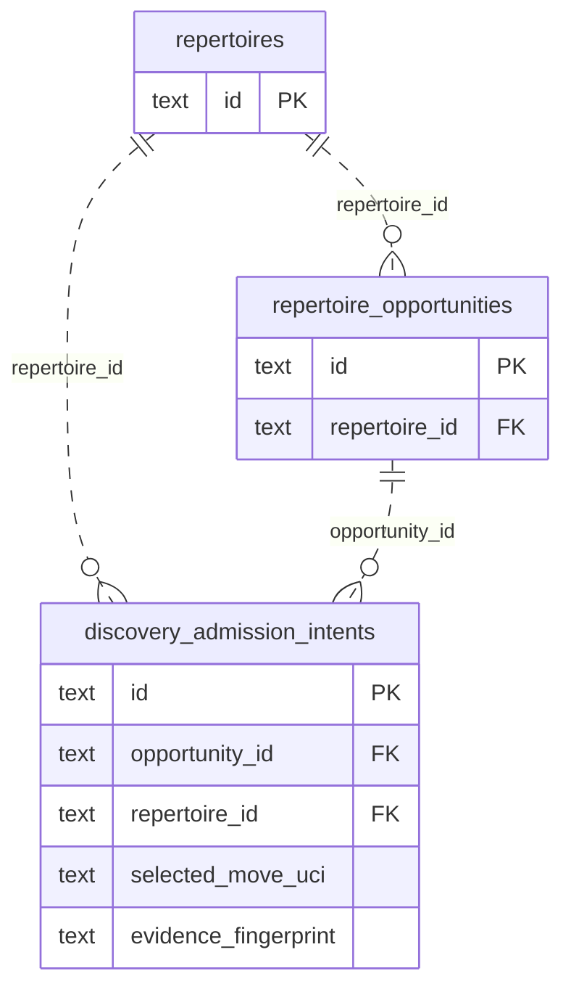
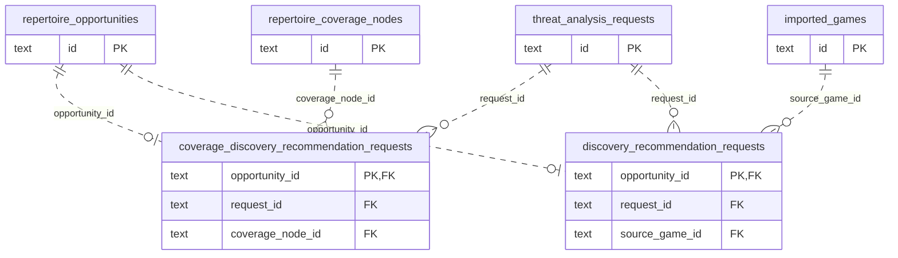

# Legacy Discovery recommendation and admission storage

**Current checked-in source; live schema and deployment unverified.** Existing SQL is centralized here; existing application behavior is retained. No schema, model, feature, policy or permission changes.

| Location | Responsibility |
| --- | --- |
| [storage.py](storage.py) | Fixed recommendation/source/intent/branch/coverage/integrity/card/queue/task reads and writes, configuration probe, bounded saved-report relation/constraint/parameter selection and complete current-scope coverage query. |
| [Existing root acceptance queries](../../discovery_acceptance_store.py) | Six fixed native operations: matching intent, owner lookup, locked opportunity, task-state lookup, intent insert and preparing marker. No application imports, scope orchestration or task enqueue. |
| [Discovery admission application](../../../../../backend/app/services/discovery_admission.py) | Source/history/chess selection, engine report validation/ranking, preview/cache/fingerprint/route identity, scope/source/lease fences, foreground waits, clocks/JSON, materialization/coverage/admission/retry policy and queue/task callbacks. |
| [Acceptance composition](../../../../../backend/app/services/discovery_acceptance_store.py) | Existing `PostgresDiscoveryAcceptanceStore` class/constructor and contract projection, scope-before-opportunity locking and priority/task coordination, borrowing the caller's transaction. |
| [Acceptance command](../../../../../backend/app/discovery_commands.py) | Existing HTTP translation and composition. Its import now points to the application composition class. The [pure policy](../../../../../backend/app/services/discovery_acceptance_application.py) and [public contract](../../../../../backend/app/services/discovery_acceptance_contracts.py) are unchanged. |

The class moved out of the database tree because it coordinates existing application owners; it is not duplicated or replaced with a new framework. Root acceptance storage now contains only those six fixed queries. The constructor and protocol are unchanged. Prefix metadata and global scope still lock before the opportunity, with authoritative scope facts read after that lock; matching-intent replay and duplicate recheck retain their order. Intent insert, opportunity marker and task enqueue still share one caller-owned transaction, with no internal commit.

Read scopes still close before engine/chess/recommendation work. Source/prefix revisions, exact evidence identity, task generation/lease and materialized branch checks still fence writes. Saved-report lookup chooses only the same two fixed relation/constraint shapes and preserves their original query/parameter evaluation order. Coverage predicate construction and its parameter mapping stay together in root storage. Configuration probes run at the same points. Cursor rowcount facts are returned to the application, which retains the original first-insert decision. No arbitrary SQL/predicate input, shared execution interface, runtime generator or new abstraction is introduced.

## Acceptance storage

The [canonical Discovery dictionary and ER diagram](../../../schema/discovery-priority/README.md) list all stored fields/types, nullability, unique tuples and enforced keys.

All shown FKs cascade delete; parent rows may have no children. The unique accepted-choice tuple is `(opportunity_id, selected_move_uci, evidence_fingerprint)`. Intent `line_id` and nullable `card_id`, task deduplication identity and JSON recommendation/evidence references are **logical associations**, not inferred FKs.

## Recommendation storage

Full definitions are in the [Discovery dictionary](../../../schema/discovery-priority/README.md), [coverage-request/imported-game dictionary](../../../schema/authored-content-1/README.md), [analysis-request dictionary](../../../schema/practice-families-2/README.md), [authored lines/memberships/integrity](../../../schema/authored-content-2/README.md), [opening graph/prefix](../../../schema/opening-graph/README.md), [cards/queue](../../../schema/study-queue-review-1/README.md) and [task/settings dictionary](../../../schema/runtime-metadata/README.md).

All displayed recommendation FKs cascade delete. A request can be referenced by zero or more opportunity-specific rows; each relation table has at most one row per opportunity. Route JSON, source ply, prefix/source revisions, report identity and freshness checks add no constraint beyond the linked DDL.

| Storage | Stored facts used or changed here | Keys/ownership |
| --- | --- | --- |
| `discovery_admission_intents` | Text intent/opportunity/repertoire/evidence identity, starting FEN/selected move, preview/recommendation JSON, target line, preparation/queued state, optional card/error and creation/update time. | Intent PK; enforced opportunity/repertoire FKs; unique accepted-choice tuple. Existing durable Discovery admission state. |
| `threat_analysis_requests` | Text ID/request JSON/state/report/error/lease/times; bigint attempts. | Request PK; report validation/version/history remains application policy. |
| `coverage_discovery_recommendation_requests` | Text opportunity/request/node IDs, route JSON and creation/update time. | Opportunity PK/FK; request/node FKs. |
| `discovery_recommendation_requests` | Text opportunity/request/game IDs and creation/update time; bigint source ply. | Opportunity PK/FK; request/game FKs. |
| Existing authored/graph/integrity/coverage rows | Source line/FEN/moves/color and initial training depth, published line/card, current scan status/check time/block facts, coverage run/node/settings/time. | Existing keys and generation/revision relationships retain their owners; only existing operations move. |
| Existing cards, daily queue and background tasks | Card state/introduction time, explicit queue admission source, intent/task state/priority/payload/generation/lease/retry time. | Existing borrowed transaction and singular queue/task authority remain. The full linked dictionaries distinguish actual FKs from logical source/deduplication IDs. |

**Legacy coupling remains:** successful admission updates cards and `daily_queue` and calls the existing review owner; scope mutation requests graph/coverage rebuilds and task progress. This move does not grant new cross-owner table access, introduce a Study-to-Games dependency, or establish clean domain/Learning authority or optional-feature resource/shutdown isolation. It removes the acceptance store's application coordination from the database tree while preserving those existing seams.

## Focused evidence

**47 existing acceptance/policy-boundary cases pass**, including service-free policy execution, semantic contract, command composition/HTTP translation, preparation read closure, duplicate/replay/readmission/freshness and the unchanged semantic protocol. **12 selected recommendation/admission cases pass** (53 other collected cases unselected), covering cache changes, Black full-history decisions, illegal recommendation roots, accepted/stale/resurfaced branches, stalled-task promotion, bounded foreground-free materialization, terminal status and recommendation replay. The specifically selected native-style recommendation worker fake also passes. **Four selected canonical-source cases also pass**, covering stale recommendation publication, verified new-gap admission/replaced-prefix rejection and source-version recheck before insert. Existing Starlette/AnyIO warnings appear in the recommendation/admission selections; no assertions/fixtures changed.

Task-local fixed-operation expansion restores the complete retained admission application AST (48 queries and 14 configuration probes), the entire moved acceptance class AST (six native queries plus scope/contract/task/priority coordination), and the unchanged non-import command AST. All 54 SQL statements, dynamic relation/coverage construction, parameters/rowcounts/iterator/clock/source/engine/recommendation/scope/lease/materialization/coverage/admission/queue/retry/callback order correspond to the original source. Neither application file contains SQL or direct query/driver calls; root acceptance storage has no application imports. Six affected Python modules compile.

Native PostgreSQL execution/locking/rollback/permissions, installed-package discovery, GitHub rendering, live schema/deployment and resource isolation remain unverified. No live/native service, full-system campaign, schema/security/CI change, new issue or proposed canonical model implementation was used.
