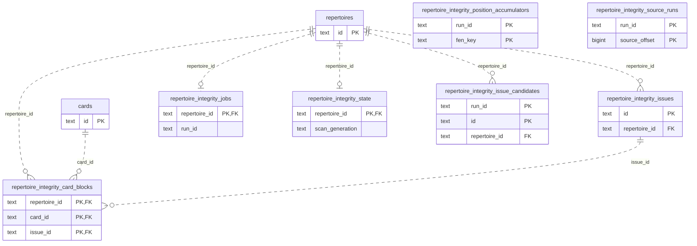

# Legacy authored repertoire integrity storage

**Current checked-in source; live schema and deployment unverified.** [storage.py](storage.py) contains the existing compatibility integrity scan, published projection and guided-repair SQL. [native.py](native.py) contains existing PostgreSQL source staging, position aggregation, issue/block publication, card validation and certificate queries; [postgres_integrity.py](../../../../../backend/app/services/postgres_integrity.py) retains their worker/application owner. [repertoire_integrity.py](../../../../../backend/app/services/repertoire_integrity.py) retains source/chess validation, position and issue reduction, signatures, user-selected repair policy, route/card identity, JSON/time, generation checks, transaction composition and existing publication/queue callbacks. No schema, model, SQL, feature or permission is changed.

Every operation borrows the caller's transaction. Source read scopes still close before chess traversal in prepared repairs and sliced scans; generation checks still precede publication and card-block replacement. Existing card membership, archive/supersession, review-history preservation, canonical-route certification, game-publication invalidation and queue refresh authority remain at the same application callpoints. This preserves legacy shared-storage coupling; it does not establish clean domain or Learning isolation.

The two non-system repertoire target queries are prepared as **two local fixed-operation closures** at the original pre-connection callpoint. The original exclusion-placeholder join therefore still runs before connection entry; tuple parameter iteration still occurs at its original query callpoint. They accept bound values for those two named projections, never arbitrary SQL or predicates. Replacement-card column interpolation and its parameter iterator move together into the fixed insert operation; the existing metadata read and application card values/clock remain at their original points. No generic execution interface or shared abstraction is introduced.

## Data and actual relationships

The [canonical authored-content dictionary and ER diagram](../../../schema/authored-content-2/README.md) list every stored field, SQL type, nullability and constraint for integrity/source/membership tables. [Cards and reviews](../../../schema/study-queue-review-1/README.md), [review history](../../../schema/study-queue-review-2/README.md), [repertoires](../../../schema/authored-content-3/README.md) and [background activity](../../../schema/runtime-metadata/README.md) retain their existing owners and definitions.

All shown FK edges are enforced and use cascade delete. Parent rows can have zero children. `run_id`, `scan_generation` and source JSON references are **logical associations**; source-run/position staging has no enforced FK to jobs. The native issue-candidate repertoire FK is enforced; its run identity remains logical. This chart adds no inferred constraint.

| Storage | Stored facts used here | Key/relationship |
| --- | --- | --- |
| `repertoire_integrity_jobs` | Text repertoire/run/status/error/update time; bigint source offset, total sources and attempts. | Repertoire PK/FK; one job per repertoire. Run identity is logical. |
| `repertoire_integrity_issue_candidates` | Text run/issue/repertoire/kind, optional FEN/key/color, signature and moves/source JSON. | Composite `(run_id, id)` PK; repertoire FK. Run identity is logical. |
| `repertoire_integrity_position_accumulators` | Text run/FEN key/FEN/color, moves/source JSON; duplicate positions merge JSON arrays using the original native statement. | Composite `(run_id, fen_key)` PK; no FK. |
| `repertoire_integrity_source_runs` | Text run ID, observation/invalid JSON; bigint source offset. | Composite `(run_id, source_offset)` PK; no FK. |
| `repertoire_integrity_state` | Text status/check time, scan status/generation/error; bigint completed/total source counts. | Repertoire PK/FK; one published/scan status row per repertoire. |
| `repertoire_integrity_issues` | Text ID, repertoire, kind, optional FEN/key/color, signature, moves/source JSON and creation/update time. | Issue PK; repertoire FK. JSON line/card descriptors are logical references. |
| `repertoire_integrity_card_blocks` | Text repertoire/card/issue IDs, scan generation and publication time. | Composite `(repertoire_id, card_id, issue_id)` PK; enforced FKs to all three referenced rows. |
| Existing `repertoire_lines`, `cards`, `repertoire_cards`, `reviews` | Source text FEN/moves/color/identity, authored membership flags, card validation/archive/supersession state, and review counts. | Existing source/membership/card/review constraints are in the linked full dictionaries; repair writes add no owner permission. |

Scans preserve existing source ordering, staged observation ordering, retry limits and stale-generation publication rejection. Guided repair still validates the issue signature and legal move before changing source rows; authored route certification and publication invalidation remain outside this adapter. Ordinary Study independence and optional-feature resource/shutdown isolation are unverified.

## Focused evidence

The existing owning integrity suite passes **15 cases**, covering transient lock retries, transpositions/endpoints, affected-card blocking, atomic stale/illegal repair rejection, shared memberships, invalid sources, review-history preservation, guided selection, close-before-chess and generation-guarded block publication. One existing Starlette/AnyIO deprecation warning remains. After restoring the exact original literal indentation in the local target closures, the two affected scan/retry cases pass again. Assertions and fixtures are unchanged; only task-temporary SQLite and fakes are used.

Task-local fixed-operation expansion restores the **complete retained non-import application AST and all 73 original query sites** (72 `execute`, one `executemany`), including target preparation before connection entry, raw cursor iteration, dynamic card column/parameter construction, SQL bytes and clock/transaction/chess/repair/queue/callback order. Application source has no SQL literals or direct query/driver calls. Three Python modules compile. No live/native PostgreSQL, full-system campaign, schema/security/CI change or proposed canonical model is involved. Native locking/rollback/permissions, package installation/discovery and GitHub rendering remain unverified.

## Native integrity slice

[native.py](native.py) owns all 24 existing native queries, three batch statements and construction of the three raw cursor contexts. The application still composes the cursor contexts at the original callpoints, so cursor entry precedes its JSON/parameter-list evaluation exactly as before; only root-owned fixed operations use the cursors. No helper commits independently. Source/card read limits, two-position aggregation, lease checks and task cursors are unchanged. Publication still refuses more than 32 issues or 64 card-source blocks before writes. Certificate readiness/time/generation validation, graph-current decisions, clocks and the existing segmentation/prefix-transition/queue callbacks stay in the application.

**Nine existing focused fake-method cases pass**: invalidation in the caller transaction, close-before-chess, restartable one-source staging, two-position aggregation, conflicting-position evaluation, stale graph rejection, foreground yielding/replaced leases, the publication bounds and the single-read certificate contract. One existing Starlette/AnyIO warning occurs in the worker selection. No assertions/fixtures changed and no native database was opened.

Task-local expansion restores the complete retained non-import native application AST, all 27 statements and three cursor construction sites, including SQL bytes, parameters, cursor entry/JSON evaluation, source-close, bounded publication, generation/lease, transaction/clock/callback/queue order. Application SQL/direct query/raw-driver calls are absent; the two affected Python modules compile. Native execution, rollback/locking/permissions, installation/discovery and resource isolation remain unverified. This preserves existing legacy shared-card/queue authority and does not add cross-owner access or a new model.
