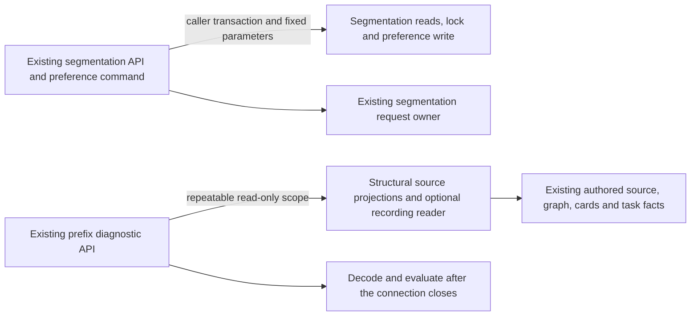

# Legacy opening advisory storage

**Current source; live schema and deployment unverified.** These are the existing segmentation advisory and prefix-evaluation database operations. This extraction changes physical ownership only; it adds no schema, query, permission, command or model behavior.

| Module | Database responsibility | Application owner |
| --- | --- | --- |
| [segmentation.py](segmentation.py) | Repeatable read-only transaction statement; segmentation state/task projection; recommendation, source fingerprint, part/route pages and invalidated-pin count; existing state lock, preference upsert, prepared-graph lookup and failed-build invalidation. Reuses the existing authored repertoire-presence and PostgreSQL configured probes. | [opening_segmentation_api.py](../../../../../backend/app/opening_segmentation_api.py) keeps HTTP validation, snapshot identity and source/version checks, rationale and JSON/response projection, timestamp creation, preference choices, refresh/task callbacks and command registrations. |
| [evaluation.py](evaluation.py) | Source count/byte projection, bounded saved-line/graph-step/split reads, published-card membership projection, and the original repeatable-read scope with optional recording reader. Reuses existing [diagnostic connection, repertoire and graph publication operations](../../prefix_reads/diagnostics.py). | [prefix_evaluation_api.py](../../../../../backend/app/prefix_evaluation_api.py) keeps availability/error policy, source/byte/row limits, deadlines, capture callback, JSON decoding, graph/source validation, evaluation iteration/closure, freshness checks and HTTP contracts. |

Segmentation retains its first-statement repeatable/read-only setup, ready-state gates, 20-recommendation list and nine-row keyset reads for eight-row response pages. Preference validation still precedes its original upsert, with the same state-lock/source-check/timestamp order. The application retains the existing failed-build refresh policy and task request owner.

Evaluation opens the same `read_only=True`, `background=True`, `repeatable_read=True` connection and conditionally wraps it with the existing [RecordingReader](../../snapshot_reads.py). Source existence, publication, source size, lines, steps, global split map and published cards are read in their original order. The optional existing capture callback runs on that same connection/wrapper, after those reads and before connection close. JSON/chess/source validation and metrics remain outside the connection. The source/graph budgets and extra-row checks are unchanged; this move does not add a new read limit. Concrete driver modules/error classes remain available through the API's compatibility imports, with the original HTTP error mapping.

## Where the data live

Canonical source dictionaries and rendered ER diagrams list every field/type, primary/composite key, enforced FK, cardinality and nullability:

| Storage | Data used here | Schema documentation |
| --- | --- | --- |
| `opening_segmentation_state` | Repertoire PK/FK; bigint content/graph versions; text run ID, state and publication time. | [Segmentation definitions](../../../schema/opening-evidence-2/README.md) |
| `opening_segmentation_recommendations` | Composite `(run_id, id)` PK; repertoire FK; kind/fingerprint text; bigint structural decision/start/segment counts. | [Segmentation definitions](../../../schema/opening-evidence-2/README.md) |
| `opening_segmentation_preferences` | Composite `(repertoire_id, recommendation_id)` PK; repertoire FK; text choice, source fingerprint and update time. | [Segmentation definitions](../../../schema/opening-evidence-2/README.md) |
| `opening_segmentation_parts`, `opening_segmentation_sources` | Composite run/recommendation/segment or card identities; segment JSON and structural counts/discriminator. Their `run_id` references the run table. | [Segmentation definitions](../../../schema/opening-evidence-2/README.md) |
| `repertoire_lines`, `repertoire_line_training_depths`, `repertoires` | Stored line identity/name/FEN/move JSON/color, saved learner-decision depth and repertoire identity. | [Lines and depths](../../../schema/authored-content-2/README.md), [repertoires](../../../schema/authored-content-3/README.md) |
| `opening_graph_publications`, `opening_graph_steps`, `prefix_splits` | Published generation/state, ordered line/decision/card graph fields and split-card IDs/source revision. | [Opening graph definitions](../../../schema/opening-graph/README.md) |
| `cards`, `repertoire_cards`, `repertoire_integrity_state`, `background_tasks` | Current presentation FEN/moves/color/revision/archive status and membership; integrity scan/status; durable task kind/key/generation/state/error. | [Cards](../../../schema/study-queue-review-1/README.md), [authored memberships/integrity](../../../schema/authored-content-2/README.md), [runtime tasks](../../../schema/runtime-metadata/README.md) |

Source fingerprint/snapshot/version comparisons, state run IDs, task kind/deduplication-key joins and recommendation IDs in preferences/parts/sources are existing logical relationships. A matching name is not an enforced FK: the segmentation source schema enforces the documented run and repertoire constraints, without a recommendation FK. The global split map is intentionally the same existing evaluation input. No key, constraint, table access or ownership is expanded.

These are legacy authored-source, presentation/card, graph, integrity and task dependencies, not a new isolated domain boundary. The database modules do not import the application. The APIs still compose concrete same-owner operations and existing lifecycle callbacks; broader composition/domain migration is separate. No Study-to-Games dependency is introduced, and this move does not prove resource/shutdown isolation.

## Focused evidence

The two existing API suites pass: **36 tests**, using fakes and in-process HTTP clients, including reader-pool selection, repeatable-read ordering, close-before-decoding, stale snapshots, bounded pagination, preference source guards, deadline/preemption and retryable errors. One existing Starlette/AnyIO deprecation warning is reported. No native connection is opened.

Task-local fixed-operation/context expansion reproduces both complete non-import application ASTs, preserving all **21 original query callsites** (14 segmentation, seven evaluation), parameters, context entry/wrapper/capture/close, application limits/HTTP/error/deadline/iteration/callback order and old public helper signatures. Both application files have no SQL-bearing literals or direct query/PostgreSQL configuration/resource calls. Five affected Python modules compile.

Native PostgreSQL execution/locking/rollback/permissions, installed-package discovery, GitHub rendering, live schema and deployment remain unverified. No native/live service, broad suite, planned canonical model or data migration was used.
