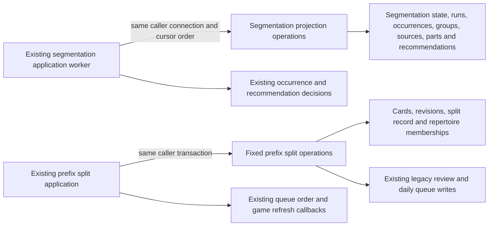

# Legacy opening mutation storage

**Current source; live schema and deployment unverified.** This directory contains the existing segmentation worker persistence and prefix-card split storage. It is a mechanical extraction: no schema, feature, algorithm, SQL or permission change.

| Module | Database responsibility | Application owner |
| --- | --- | --- |
| [segmentation.py](segmentation.py) | Existing state/run writes and locks, current-publication fence, eligible presentation/group/occurrence reads, cursor batch inserts, JSON-recordset source/part inserts, group summary/fingerprint writes, publication, finite retention queries and writer connection. | [postgres_opening_segmentation.py](../../../../../backend/app/services/postgres_opening_segmentation.py) keeps run IDs, task admission/lease/checkpoint/completion, occurrence/group/candidate construction, JSON serialization, recommendation eligibility/savings/fingerprint calculations, page/cleanup progression, timestamps and phase dispatch. |
| [prefix_splits.py](prefix_splits.py) | Existing card/color/split/membership reads, schema-column-aware card copy, revision/history write, review/queue reassignment, queue collision/follow-up/position operations, membership provenance writes, source archive and split record. | [prefix_split.py](../../../../../backend/app/services/prefix_split.py) keeps legal split planning and identities, revision/idempotency checks, policy field overrides/JSON, clocks, membership fallback and child decisions, queue-placement ordering, responses and existing refresh/order-preservation callbacks. |

Segmentation retains its task lock before the source/publication fence and its original stale-task completion. Presentation traversal and candidate construction stay outside the read connection. During staging, the same cursor opens before the occurrence batch, the application constructs groups between the two batch writes, and the cursor closes before task advancement. The source/part recordsets retain conflict-ignore/returning behavior. Publication and task completion remain one caller-owned write transaction.

The existing occurrence column choice remains exactly `trunk_key` for shared trunks and `suffix_key` otherwise. The existing five-table retention list and eight-row deletes remain finite and unchanged. Application code keeps cleanup table-index progression and group page size; SQL identifiers/selection and bounded deletions now live here. The writer connection still uses `read_only=False, background=True` inside the existing application background lease. No helper independently commits.

Prefix split still enumerates actual card columns before copying the source row and applying caller-supplied overrides. Every override, split identity, JSON value, revision, clock and queue-placement choice remains in application code. Membership reads execute eagerly and retain lazy row iteration at the original comprehension; position changes remain a lazily consumed batch generator. Source provenance is installed before promotion, source archival precedes membership deletion, and split follow-ups/order preservation precede the final durable split record. Retry/revision and rollback behavior are unchanged.

## Stored data and relationships

Canonical source dictionaries and rendered ER diagrams describe every stored field/type, primary/composite key, enforced FK, cardinality and nullability:

| Storage | Facts used or changed here | Canonical schema |
| --- | --- | --- |
| `opening_segmentation_state`, `opening_segmentation_runs` | Repertoire PK/FK, text state/current run/publication time, bigint content/graph versions; run text PK/repertoire FK. | [Segmentation definitions](../../../schema/opening-evidence-2/README.md) |
| `opening_segmentation_occurrences`, `opening_segmentation_groups` | Composite run/card/decision or run/kind/group keys; text occurrence JSON, trunk/suffix keys and source fingerprint; bigint structural counts and boolean diversity. | [Segmentation definitions](../../../schema/opening-evidence-2/README.md) |
| `opening_segmentation_sources`, `opening_segmentation_parts`, `opening_segmentation_recommendations` | Composite run/recommendation/card or segment keys and run/recommendation identity; text discriminator/JSON/kind/fingerprint, bigint decision/start/segment counts. | [Segmentation definitions](../../../schema/opening-evidence-2/README.md) |
| `cards`, `card_revisions`, `repertoire_cards` | Complete copied card row and caller-supplied presentation/scheduling/provenance overrides; revision history FEN/moves/mode/time; composite repertoire/card membership and canonical source flag. | [Cards and revisions](../../../schema/study-queue-review-1/README.md), [memberships](../../../schema/authored-content-2/README.md) |
| `prefix_splits` | Source card PK/FK, source revision bigint, shortened and continuation card FKs, creation time text. | [Opening graph definitions](../../../schema/opening-graph/README.md) |
| `reviews`, `daily_queue` | Existing review card reassignment; queue card/cycle/status changes, follow-up admission/attempt state and position. | [Reviews](../../../schema/study-queue-review-2/README.md), [daily queue](../../../schema/study-queue-review-1/README.md) |
| `repertoire_lines`, `opening_graph_steps`, `opening_graph_publications`, `repertoire_integrity_card_blocks`, `background_tasks` | Trained-color fallback; published presentation generation/source fields, integrity exclusion and durable lease/checkpoint facts. | [Authored source/integrity](../../../schema/authored-content-2/README.md), [graph](../../../schema/opening-graph/README.md), [runtime tasks](../../../schema/runtime-metadata/README.md) |

Segmentation run FKs enforce the relationships documented in its schema. State run IDs, task-derived run identity, publication/content freshness checks and recommendation IDs in sources/parts are existing logical relationships; this extraction adds no FK. Prefix splits retain their three actual card FKs and existing membership/history/queue relationships. No absent constraint is implied.

The segmentation worker continues to write only its advisory projections. Prefix splitting retains pre-existing direct writes to the legacy shared review/queue/card tables and its existing refresh decorator and queue-order callbacks. This is recorded coupling, not a clean domain or Learning authority boundary; physical colocation grants no new access or permissions. No new Study-to-Games dependency is introduced, and optional-feature resource/shutdown isolation remains unverified.

## Focused evidence

The existing worker and prefix-split suites pass: **27 tests**, using fakes/task-temporary SQLite and in-process HTTP. Coverage includes bounded generation-fenced staging, close-before-traversal, legal white/black splits, history/repertoire preservation, idempotency, source provenance, queue order and transactional rollback. One existing Starlette/AnyIO deprecation warning is reported. The existing no-Learning/queue-writes source guard now reads both the application worker and its relocated segmentation storage; that adjusted guard separately passes, preserving its assertions.

Task-local fixed-operation expansion restores both complete non-import application ASTs, all **46 original query/driver callsites** (including the cursor acquisition), the writer connection, finite retention list and dynamic SQL selection, SQL bytes/parameters, cursor/batch/iterator order and all application algorithms/callbacks/clocks. Both application files contain no SQL-bearing literals or direct query/driver calls. Five affected Python modules compile. No generic SQL execution port, adapter generator, new framework or duplicate implementation is shipped.

Native PostgreSQL execution/locking/rollback/permissions, installed-package discovery, GitHub rendering, live schema and deployment remain unverified. No native/live service, security/schema change, full-system suite or planned canonical model was used.
