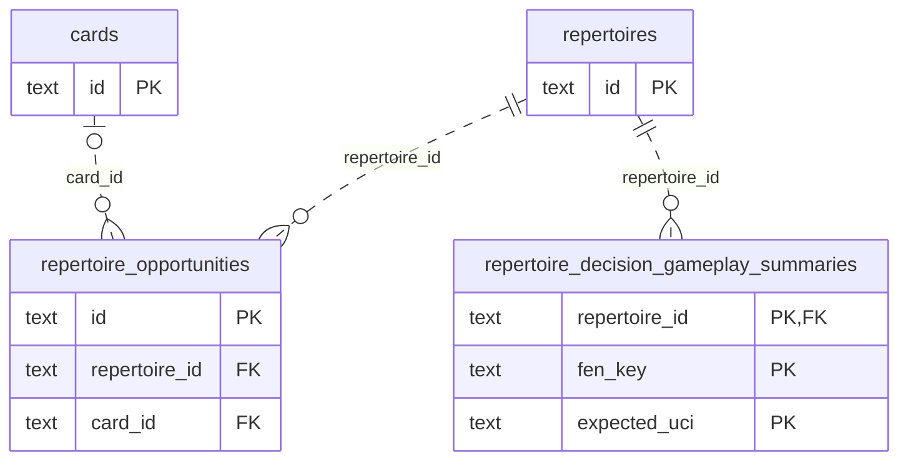

# Legacy repertoire opportunity storage

**Current checked-in source; live schema and deployment unverified.** [storage.py](storage.py) holds the existing opportunity queries and SQL/driver/dialect mechanics from [repertoire_opportunities.py](../../../../../backend/app/services/repertoire_opportunities.py). Application code retains scoring, sample/window thresholds, chess/routes, evidence/fingerprint/JSON, dismissal/reopening/handling policy, scope/generation/lease checks, foreground admission, clocks, task phases, HTTP projections and explicit training decisions. This is an extraction of existing behavior; no schema, feature, canonical model or permission changes.

The caller still owns read scopes and publication/admission transactions. Prefix and global-game-scope locks still precede task and opportunity publication checks. Provider-independent calculation still happens between read and write scopes. Current-slice and coverage-source snapshots still fence publication, with the same cursor advancement on stale work. Existing priority/task/recommendation and review/queue callbacks remain outside storage.

Three **local fixed-query readers** retain separate preparation points: publication row-lock selection before fingerprint calculation; scoped-gap filtering at the original prefix read; and feed identifier/limit construction before iteration. Their operations accept only the existing semantic data and bound parameters, never arbitrary SQL or predicates. Dynamic game/feed parameter iteration remains after query construction. Recurring decision SQL retains its native/compatibility driver selection, modulo syntax and three native per-event LATERAL lookups. Cursor rowcounts move into the two fixed state writes; the application still decides whether a changed count means success. No generic execution interface or shared abstraction is introduced.

## Stored facts and actual relationships

The [opportunity dictionary and ER diagram](../../../schema/discovery-priority/README.md) list every opportunity field/type and actual constraint. [Authored source, membership, integrity and decision summaries](../../../schema/authored-content-2/README.md), [cards and daily queue](../../../schema/study-queue-review-1/README.md), [imported games](../../../schema/authored-content-1/README.md), [opening graph/prefix](../../../schema/opening-graph/README.md), [game finding projections](../../../schema/game-projections-1/README.md), [analysis/position projections](../../../schema/game-projections-2/README.md), [event/scope projections](../../../schema/game-projections-3/README.md) and [runtime tasks/settings](../../../schema/runtime-metadata/README.md) give the full canonical definitions.

The shown repertoire FKs cascade delete; the optional opportunity card FK uses `SET NULL`. Parent rows may have zero children. `admitted_card_id`, coverage IDs and finding/game descriptors inside evidence JSON, generation/revision fields and source/phase/cursor associations are **logical**, with no FK implied by this chart.

| Storage | Stored facts used or changed here | Keys/ownership notes |
| --- | --- | --- |
| `repertoire_opportunities` | Text identity/repertoire/kind/FEN/card/opponent move/status, evidence/fingerprint/dismissed/handled JSON, creation/update/resolution/seen/snooze times and admission/card state; double-precision score; bigint prefix/source/game revisions and nullable text preview ID. | Text opportunity PK, repertoire FK and optional card FK. Legacy repertoire discovery projection. Admitted-card identity is logical. |
| `repertoire_decision_gameplay_summaries` | Text repertoire/FEN/expected move, last encounter/update time; bigint encounter/success/miss and recent counts, nullable bigint route-success count. | Composite `(repertoire_id, fen_key, expected_uci)` PK; repertoire FK. Derived summary, no FK to individual events. |
| Existing game event/match/finding/analysis/position projections | Event/game/card/FEN/move/time/outcome, analysis loss/evaluation/mate facts, current repertoire matches, gap finding evidence and position frequencies. | Read projections retain existing generation/source filters and native/legacy backing ownership. They are not new stored tables. |
| Existing coverage runs/nodes/candidates | Current run/settings/status/time, FEN/routes/replies, Explorer/Maia probabilities/status/sample count and covered flags. | Existing run/node and composite candidate keys/FKs remain as documented in the coverage dictionary. |
| Existing source/graph/card/integrity/queue/task/settings rows | Saved line/graph routes, card availability/introduced state, integrity blocks, explicit queue admission source, task payload/generation/lease/cursor progression and discovery window. | Complete dictionaries remain canonical at the linked owners; this extraction adds no access or authority. |

The [source-schema read-projection index](../../../schema/README.md#read-projections) links actual view DDL. `current_repertoire_decision_events`, `current_game_repertoire_matches`, `current_game_findings`, `game_move_analysis` and `game_position_occurrences` are SQL views over existing versioned/legacy tables. Joins by FEN, evidence JSON IDs or scope snapshots are logical relationships, not newly enforced constraints.

**Existing legacy coupling remains:** explicit training updates cards and `daily_queue` in the same caller transaction and calls the existing review/queue owner. This move does not grant new table access, create a Study-to-Games import, replace that legacy authority seam or prove optional-feature resource/shutdown isolation. No clean domain/Learning boundary is claimed.

## Focused evidence

**25 selected existing opportunity cases pass** (39 unselected), covering route/engine qualification, transpositions, personal/coverage gaps, current evidence, prefix isolation, training eligibility/admission/replay, feed pagination, handled/dismissed material-evidence transitions and stale source/snapshot fencing. **Three existing fake native-dialect/worker cases pass** for foreground yielding/replaced leases, native modulo/parameters and per-event LATERAL lookups. **21 existing state-action contract cases also pass**, covering current/missing/inactive/wrong-repertoire results and stale prefix/source/global-scope rejection for dismiss/acknowledge/snooze. The two earlier selected runs report the existing Starlette/AnyIO warning. Assertions/fixtures are unchanged; selected storage checks use task-temporary SQLite and fakes.

Task-local fixed-operation expansion reconstructs the **complete retained non-import application AST**, including all **64 query sites** (one hidden behind a dialect-selected local executor), four configuration probes, original transaction/dialect checks, rowcount decisions, three preparation points, SQL bytes and parameter/iterator/clock/scope/lease/scoring/chess/admission/task/queue/callback order. The application contains no SQL-bearing literals or direct query/driver/dialect operations; three Python modules compile. No runtime generator, generic SQL port or new framework is shipped.

Native PostgreSQL execution/locking/rollback/permissions, installed-package discovery, GitHub rendering, live schema/deployment and resource isolation remain unverified. No live/native service, full-system campaign, schema/security/CI change or proposed canonical model was used.
