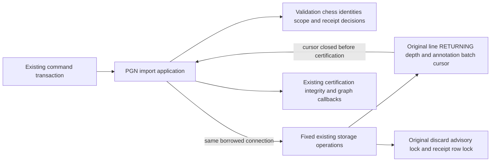
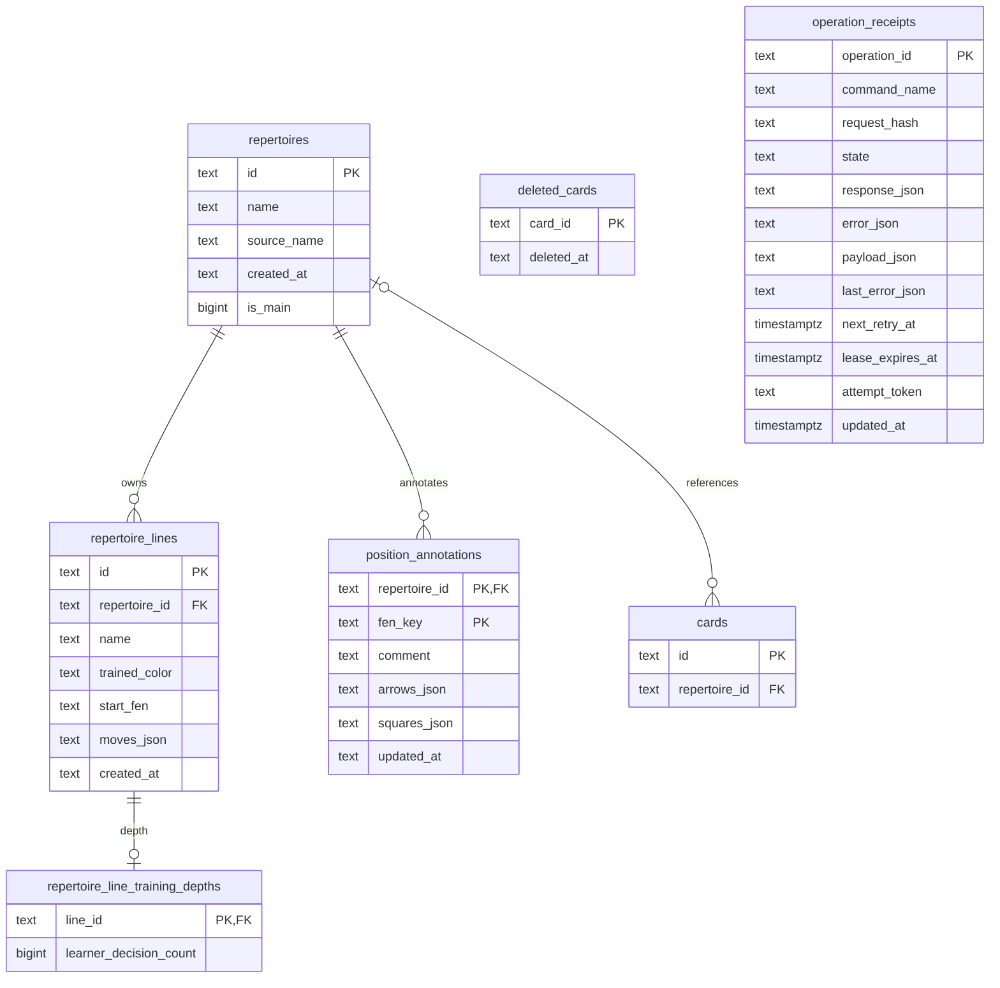

# Authored PGN import and explicit preparation

**Current source; not installed.** Complete statements,
borrowed-driver calls and the existing batch cursor live beside
[pgn_import_commands.py](../../../../../backend/app/pgn_import_commands.py) to
[storage.py](storage.py). This remains legacy authored-repertoire storage,
not the imported/authored Studies bundle format or the planning-only canonical
model. No schema or database-role changes are needed.

The current PostgreSQL upload route dispatches `imports.pgn.explicit` with the
same durable operation identity as its idempotency key. Old `imports.pgn.admit`
receipts stay paused in Study-only mode. Strict legal-source and own-response
validation rejects the entire proposed import before content writes. New
repertoires start with `is_main=0`; adding lines preserves every existing main
selection and existing line training depth. The gateway owns atomic receipt,
savepoint rollback and same-key replay. Card counts in the response are planned
counts until the existing graph owner publishes them.

```mermaid
flowchart LR
  upload[Deliberate PGN upload] --> receipt[Existing foreground command receipt]
  receipt --> validate[Strict sources and existing conflict owner]
  validate --> source[Save authored sources and graph task atomically]
  source --> pin[Complete receipt pins graph ID and generation]
  pin --> claim[Existing durable one-slice claim]
  claim --> graph[Graph owner]
  graph --> integrity[Integrity owner with inherited receipt and graph pin]
  integrity --> queue[Normal Study queue and introduction controls]
  pause[Foreground and manual pause controls] --> claim
  pause --> graph
  pause --> integrity
```

`preparation.py` supplies one fixed PostgreSQL predicate to the existing lease
writer. It admits only graph/integrity work matching a completed explicit-import
receipt, repertoire, graph ID and current generation. Integrity additionally
requires the completed parent graph and its exact origin. The worker rechecks
the leased row, phase, payload and manual pause before execution and inside each
owner transaction. Stale/superseded scope fails closed. Daily queue claims retain
first priority; this exception adds no task kind or general optional-work grant.
Providers, engines, segmentation and old import work remain paused. Graph and
integrity retain their existing finite cursors, foreground leases, maintenance
guards and short background transaction limits.
Explicit import also refuses graph cleanup that would retire an existing card
membership, and reuses the graph owner's protected-card classification guard for
learned or issued cards. Such a refusal is visible as failed preparation and
requires a separate deliberate content decision; the import does not repair it.

The UI observes preparation for at most 30 seconds (individual reads retain their
existing timeout), then reports saved/pending, ready or held. Normal Study-only
and quota holds are not bypassed. Failed preparation retains the acknowledged
import for publication-only checks, without another PGN POST. This branch does
not claim native PostgreSQL, assembled worker or installed release qualification
without the separately recorded disposable-fixture evidence.



| Storage operations | Original scope retained |
| --- | --- |
| `lock_main_repertoire`, `matching_repertoire`, `save_repertoire` | Existing advisory serialization and source/color lookup; saving never replaces main selection. Naming, UUID choice and UTC timestamp remain in application code. |
| `current_sources` | Bounded authored-line and active-card snapshot for strict conflict validation, on the same borrowed transaction. |
| `existing_lines`, `existing_card_ids`, `deleted_card_ids` | Complete parameter-bound reads return the same cursors; the original application comprehensions still iterate them. Empty-segment reads remain skipped by the application. |
| `insert_import_rows` | The original single raw cursor scope: line batch with `RETURNING`, each original `fetchall`/`nextset`, then depth and annotation batches, then close. Empty input still executes all three batches without fetching result sets. Returned inserted-ID facts drive the original application certification loop only after cursor exit. |
| `lock_discard_operation`, `insert_discard_receipt`, `discard_receipt`, `mark_discarded` | Original raw-driver advisory lock, receipt insert, `FOR UPDATE` read and conditional discard mutation. Application retains identity validation, marker/error JSON, command/state checks, complete-result decoding and response construction. |

Application code also retains segment generation, deduplication/counting,
line-ID hashing, route validation/certification, annotation serialization,
tombstone exclusions, depth choice, prefix-subset validation and every callback,
clock and registration. The existing `refresh_game_publications_after_mutation`
decorator is unchanged legacy coupling; this split makes no Games/Study
independence claim. No new cross-owner access is introduced. Storage creates no
connection, transaction, commit or rollback; the caller retains authority.
The `PostgresConnection` compatibility export refers to the same existing class.

## Source data map

This bounded source ER view includes only touched identity/relationship fields.
The linked canonical dictionaries contain **all** fields/types, nullability,
DDL and rendered owner diagrams. Solid relationships below are enforced FKs.



| Table / canonical field dictionary | Data used here |
| --- | --- |
| [`repertoires`](../../../schema/authored-content-3/README.md#publicrepertoires) | Source/name/main-selection metadata; the seven existing reserved IDs remain excluded. |
| [`repertoire_lines`](../../../schema/authored-content-2/README.md#publicrepertoire_lines) | Existing saved FEN/move JSON, trained color, source name and text timestamp; ID conflicts are ignored without replacing the saved line. Repertoire FK deletes cascade. |
| [`repertoire_line_training_depths`](../../../schema/authored-content-2/README.md#publicrepertoire_line_training_depths) | One optional learner-decision count per saved line; line PK/FK deletes cascade. |
| [`position_annotations`](../../../schema/authored-content-1/README.md#publicposition_annotations) | Comment, arrows/squares JSON and update time keyed by repertoire plus FEN key; repertoire FK deletes cascade. |
| [`cards`](../../../schema/study-queue-review-1/README.md#publiccards) | Only existing segment identity is read to retain original admission counts. This import does not insert card rows directly. |
| [`deleted_cards`](../../../schema/study-queue-review-1/README.md#publicdeleted_cards) | Existing identity tombstones exclude deleted segments. `card_id` has **no enforced FK** to `cards`; matching the generated ID is an application relationship. |
| [`operation_receipts`](../../../schema/runtime-metadata/README.md#publicoperation_receipts) | Discard fences admission using the operation PK, command/hash/state/result/error fields; the original update clears saved payload/result, retry/error/lease/token fields and updates database time. Import-to-repertoire association is not an enforced FK. |

## Historical relocation proof

The original [fake-only checks](../../../../../backend/tests/test_pgn_import_storage_boundary.py)
cover empty/multiple-result batches, source identity/UTC/UUID ordering, lazy
read iteration, certification after cursor close, refresh callback ordering,
and discard validation/receipt branches. The application callback test invokes
the decorated handler's inner function; it does not qualify the outer
Games refresh wiring. The current explicit-import tests extend this boundary
with main-selection preservation and receipt-scoped graph preparation; the
earlier statement-for-statement relocation claim no longer applies. Native database locking/constraints/rollback,
application startup, full-system behavior and live schema remain unverified.
No native/SQLite integration or previously denied loopback test was run.
