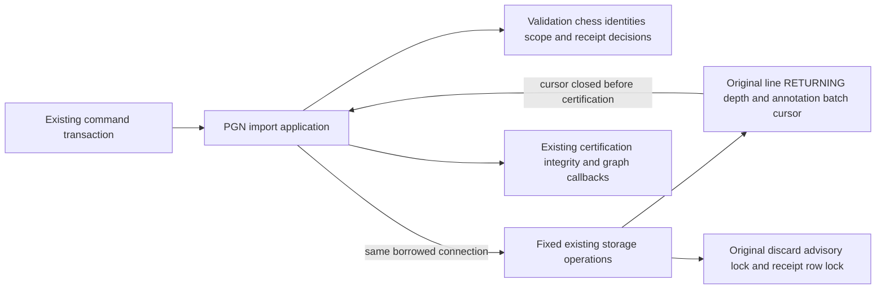
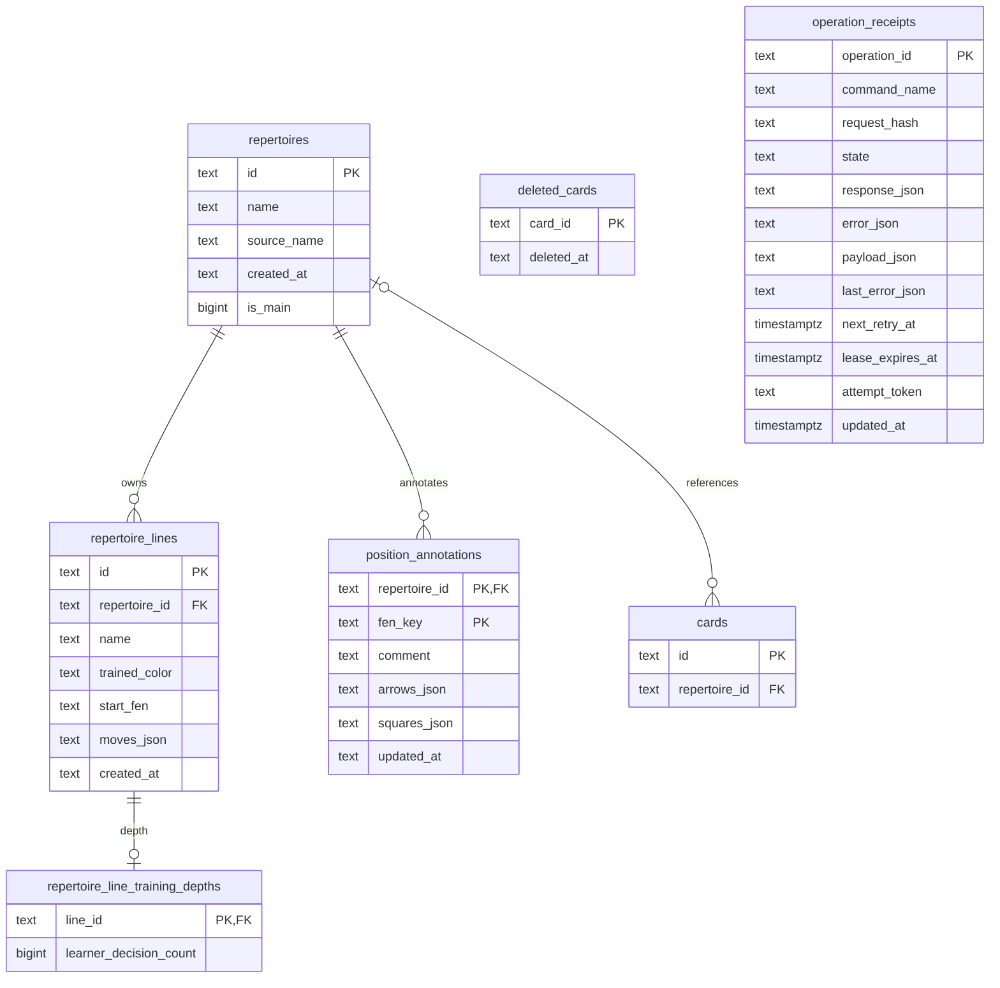

# Existing PGN import persistence

**Current source; live schema/deployment unverified.** Complete statements,
borrowed-driver calls and the existing batch cursor moved from
[pgn_import_commands.py](../../../../../backend/app/pgn_import_commands.py) to
[storage.py](storage.py). This remains legacy authored-repertoire storage,
not the imported/authored Studies bundle format or the planning-only canonical
model. No schema, stored format, permission or transaction behavior changes.

| Storage operations | Original scope retained |
| --- | --- |
| `lock_main_repertoire`, `matching_repertoire`, `clear_main_repertoire`, `upsert_main_repertoire` | Advisory lock, reserved-repertoire exclusions, source/color lookup and main-repertoire write in the original order. Naming, UUID choice and UTC timestamp remain in application code. |
| `existing_lines`, `existing_card_ids`, `deleted_card_ids` | Complete parameter-bound reads return the same cursors; the original application comprehensions still iterate them. Empty-segment reads remain skipped by the application. |
| `insert_import_rows` | The original single raw cursor scope: line batch with `RETURNING`, each original `fetchall`/`nextset`, then depth and annotation batches, then close. Empty input still executes all three batches without fetching result sets. Returned inserted-ID facts drive the original application certification loop only after cursor exit. |
| `lock_discard_operation`, `insert_discard_receipt`, `discard_receipt`, `mark_discarded` | Original raw-driver advisory lock, receipt insert, `FOR UPDATE` read and conditional discard mutation. Application retains identity validation, marker/error JSON, command/state checks, complete-result decoding and response construction. |

Application code also retains segment generation, deduplication/counting,
line-ID hashing, route validation/certification, annotation serialization,
tombstone exclusions, depth choice, prefix-subset validation and every callback,
clock and registration. The existing `refresh_game_publications_after_mutation`
decorator is unchanged legacy coupling; this split makes no Games/Study
independence claim. No new cross-owner access is introduced. Storage creates no
connection, transaction, commit or rollback; the caller retains authority.
The `PostgresConnection` compatibility export refers to the same existing class.

## Source data map

This bounded source ER view includes only touched identity/relationship fields.
The linked canonical dictionaries contain **all** fields/types, nullability,
DDL and rendered owner diagrams. Solid relationships below are enforced FKs.

| Table / canonical field dictionary | Data used here |
| --- | --- |
| [`repertoires`](../../../schema/authored-content-3/README.md#publicrepertoires) | Source/name/main-selection metadata; the seven existing reserved IDs remain excluded. |
| [`repertoire_lines`](../../../schema/authored-content-2/README.md#publicrepertoire_lines) | Existing saved FEN/move JSON, trained color, source name and text timestamp; ID conflicts are ignored without replacing the saved line. Repertoire FK deletes cascade. |
| [`repertoire_line_training_depths`](../../../schema/authored-content-2/README.md#publicrepertoire_line_training_depths) | One optional learner-decision count per saved line; line PK/FK deletes cascade. |
| [`position_annotations`](../../../schema/authored-content-1/README.md#publicposition_annotations) | Comment, arrows/squares JSON and update time keyed by repertoire plus FEN key; repertoire FK deletes cascade. |
| [`cards`](../../../schema/study-queue-review-1/README.md#publiccards) | Only existing segment identity is read to retain original admission counts. This import does not insert card rows directly. |
| [`deleted_cards`](../../../schema/study-queue-review-1/README.md#publicdeleted_cards) | Existing identity tombstones exclude deleted segments. `card_id` has **no enforced FK** to `cards`; matching the generated ID is an application relationship. |
| [`operation_receipts`](../../../schema/runtime-metadata/README.md#publicoperation_receipts) | Discard fences admission using the operation PK, command/hash/state/result/error fields; the original update clears saved payload/result, retry/error/lease/token fields and updates database time. Import-to-repertoire association is not an enforced FK. |

## Focused relocation proof

[Eight fake-only checks](../../../../../backend/tests/test_pgn_import_storage_boundary.py)
cover empty/multiple-result batches, source identity/UTC/UUID ordering, lazy
read iteration, certification after cursor close, refresh callback ordering,
and discard validation/receipt branches. The application callback test invokes
the unchanged decorated handler's inner function; it does not qualify the outer
Games refresh wiring. One-time source expansion reproduces all three original
function bodies/signatures/decorators, all three payload models and both command
registrations. All 14 SQL occurrences (13 distinct strings), parameters and
cursor order remain exact. Native database locking/constraints/rollback,
application startup, full-system behavior and live schema remain unverified.
No native/SQLite integration or previously denied loopback test was run.
