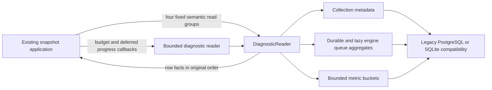

# Legacy background diagnostic reads

**Current source; live schema/deployment unverified.** Existing complete
diagnostic queries and their bounded PostgreSQL/SQLite reader moved from
[background_diagnostics.py](../../../../backend/app/services/background_diagnostics.py)
to [storage.py](storage.py). No SQL, stored shape, schema, migration, writer,
deadline or resource policy changed. This remains the legacy assembly's own
diagnostic projection; it creates no independent component or cross-owner access.

| Storage operation | Existing query/responsibility |
| --- | --- |
| `diagnostic_reader` | Original read-only connection scope, PostgreSQL JIT disable, private query closure, translation before the remaining-budget callback, at-least-one-millisecond statement timeout, fresh deferred SQLite progress callback at interval 1,000, execution and `fetchall`. |
| `metadata` | Collection start from `background_diagnostic_metadata`, singleton `id=1`. |
| `durable_rows` | Complete durable-task state/count/minimum-age aggregate with activity pause and existing admission predicates. |
| `engine_rows` | Existing game/defensive queue aggregates and eligibility predicates. This is a lazy generator: application formatting of one queue still precedes the next queue's query. |
| `metric_rows` | Existing inclusive time-window aggregate over stored buckets, using `MAX` for maximum-duration fields and `SUM` for the other declared counts/durations. |

The application retains clocks, partial-bucket/window arithmetic, remaining
budget and progress-deadline expressions, queue/counter formatting, age and
eligibility durations, unavailable/error classification and runtime telemetry
merge. It supplies the existing task/search admission callbacks and threat
eligibility constant; storage imports no application module. The private query
closure stays inside the adapter; the application receives only fixed semantic
read methods. Existing connection/driver/error aliases remain re-exported for
compatibility, including `read_connection` monkeypatching. The existing threat
compatibility alias and scheduling modules are unchanged.

## Source data map

These are stored inputs to the read projection, not new derived tables. Follow
the linked dictionaries for every field, nullability and actual constraint.

| Stored source | Keys/types and diagnostic use |
| --- | --- |
| [Runtime metadata](../../schema/runtime-metadata/README.md) | `background_diagnostic_metadata`: `id bigint` PK, `collection_started_at text`. `background_metric_buckets`: composite PK (`kind text`, `shard bigint`, `slot bigint`), `bucket_start text`, declared `bigint` counts and `double precision` durations. `background_tasks` supplies states, kinds and age/eligibility origins. |
| [Runtime activity](../../schema/runtime-metadata/README.md#publicbackground_activity) | Composite PK (`source text`, `work_id text`); `paused bigint` affects the three queue projections. The activity-to-work associations are logical joins, not added foreign keys. |
| [Game jobs](../../schema/game-projections-1/README.md#publicgame_analysis_jobs) | `game_id text` PK/FK to imported games; `status text`, nullable `pending_since text`/`generation_started_at text`, `age_origin_estimated bigint`. Existing imported-game eligibility reads are unchanged. |
| [Defensive requests](../../schema/practice-families-2/README.md#publicthreat_analysis_requests) | `id text` PK, `state text`, `created_at text`; existing eligibility/admission predicates also consult their original recommendation/opportunity/settings relations. |

The reader does not query raw `background_task_events` history or payload/error
columns. It preserves the indexed bounded projection and exposes no new tables.
No relationship or constraint changed; source DDL remains authoritative and no
live database was inspected.

## Focused relocation proof

[Eight fake-only boundary cases](../../../../backend/tests/test_background_diagnostics_storage_boundary.py)
cover PostgreSQL/SQLite reader ordering, JIT before budgeted reads, deadlines,
fresh deferred progress callbacks, storage-error classification, lazy engine
iteration, public projection types and compatibility aliases. No database is
opened by these cases. A one-time AST comparison restores the complete original
snapshot and helpers from the moved sections, including all query fragments,
parameters, configured checks, callback/clock and iteration order. Existing
[SQLite/native contracts](../../../../backend/tests/test_background_diagnostics.py)
remain their original owners and were not run for this move. These source/fake
checks establish neither live query timing nor native resource isolation.
