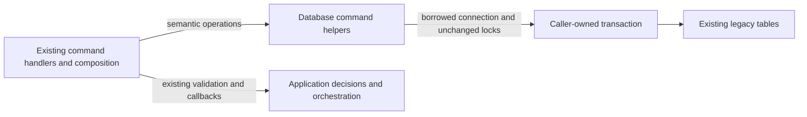

# Legacy command persistence

**Current source in the unmerged database extraction; live schema/deployment unverified.** These are existing parameter-bound operations moved from legacy command modules. The database connection and transaction still belong to the command caller. No helper opens, commits or rolls back a connection, registers a command, calls an application service or introduces a second writer.

| Module / application caller | Data read or written | Canonical source-schema relationships and field types |
| --- | --- | --- |
| [accounts.py](accounts.py) / [account_commands.py](../../../../backend/app/account_commands.py) | Updates the singleton settings usernames, then upserts or deletes provider/username `game_accounts` rows. Trimming, missing-settings HTTP errors and profile-refresh orchestration stay with the caller. | [Settings](../../schema/runtime-metadata/README.md), [game accounts](../../schema/game-projections-1/README.md). |
| [activity.py](activity.py) / [activity_commands.py](../../../../backend/app/activity_commands.py) | Locks the current analysis lease; stores progress generation/phase/completed/total/time. Manual retry locks a failed task, clears its retry/lease/error fields, then records the activity and `manual_retry` event and returns the current task row. Validation, lease acceptance, clock, queue wake/status callbacks and serialization stay outside this directory. | [Analysis job](../../schema/game-projections-1/README.md), [background activity/task/event fields](../../schema/runtime-metadata/README.md). |
| [annotations.py](annotations.py) / [annotation_commands.py](../../../../backend/app/annotation_commands.py) | Locks the repertoire and deletes or upserts `position_annotations` by `(repertoire_id,fen_key)`, storing comment, JSON arrows/squares and update time. FEN normalization and the empty-note decision stay with the caller. | [Authored content](../../schema/authored-content-1/README.md). |
| [statistics.py](statistics.py) / [statistics_commands.py](../../../../backend/app/statistics_commands.py) | Upserts `daily_statistics_jobs(local_day,status,last_error,updated_at)` as queued. Local-day validation and durable-task admission remain in application composition, in the same transaction. | [Study/statistics storage](../../schema/study-queue-review-1/README.md). |
| [endgames.py](endgames.py) / [endgame_commands.py](../../../../backend/app/endgame_commands.py) | Locks an enabled template and inserts `endgame_attempts(id,template_id,start_fen,target,created_at)`. The caller retains not-found/removed-feature errors, UUID/time creation and returned move data; moves are not added to this insert. | [Practice-family storage](../../schema/practice-families-1/README.md). |
| [teaching.py](teaching.py) / [teaching_commands.py](../../../../backend/app/teaching_commands.py) | Locks the active card; inserts `(card_id,revision,ply,taught_at)` idempotently or reads the existing timestamp on conflict. Request validation, not-found error, clock and response mapping stay with the caller. | [Teaching state](../../schema/study-queue-review-3/README.md), [cards](../../schema/study-queue-review-1/README.md). |
| [coverage_maia.py](coverage_maia.py) / [coverage_maia_commands.py](../../../../backend/app/coverage_maia_commands.py) | Existing coverage node/run/lease reads and locks, lease/heartbeat/release/failure/completion writes, bound candidate JSON upsert and background progress publication. Latest-attempt/current-scope query fragments reuse the existing root freshness owner. | [Coverage fields, keys and enforced relationships](../../schema/discovery-priority/README.md), [background activity fields](../../schema/runtime-metadata/README.md). |

The linked canonical READMEs contain actual stored types, primary/composite keys and enforced versus logical relationships; these moves change none of them. SQL literals, parameter order, row-lock order and callback positions are preserved. In particular manual retry still resets the task, performs the existing queue wake/status work, then records activity and event data before returning the serialized row.

The six source command modules are legacy call-site composition, not a claim of complete backend domain isolation. Their existing orchestration dependencies and other mixed application/SQL files remain on the [central extraction checklist](../../../INVENTORY.md). This folder is an owner/category organization with ordinary functions, not a shared runtime or dispatch framework.

Focused proof: six existing command cases and eight cases across `backend/tests/test_legacy_command_database_split.py` and the affected retry-status test passed (14 total). Tests retain fake controls and use in-memory/task-temporary SQLite only. A one-time source comparison found all 19 SQL literals byte-identical, and the named boundary guard rejects direct SQL/cursor calls in these six application modules. Existing native PostgreSQL execution and complete system qualification were not run or claimed.

Coverage Maia composition retains invalid/stale-lease/current-run HTTP decisions, five-minute expiry clocks, UUID, duplicate-move final-value selection, probability JSON, recalculation and priority/opportunity refresh calls. The new storage helper keeps the original selected node → prefix lock → row recheck sequence, `FOR UPDATE OF n,r` / `FOR UPDATE SKIP LOCKED`, and all twelve bound query expressions. Stored node IDs/run/repertoire/FEN, Maia status/lease/expiry/error/time, candidate `(node_id,move_uci)` probabilities/covered/source state and run settings/status remain unchanged; canonical linked dictionaries show all types/keys/FKs. Lease identity and latest-attempt/generation/current-scope checks retain their logical freshness meaning without added constraints. Three existing fake-native claim/submit cases pass, including pause, row lease, duplicate-move collapse and bounded candidate/progress/refresh effects. Whole application non-import AST restoration and source compilation pass. No native PostgreSQL, live schema, worker/service execution or full-system qualification ran.
