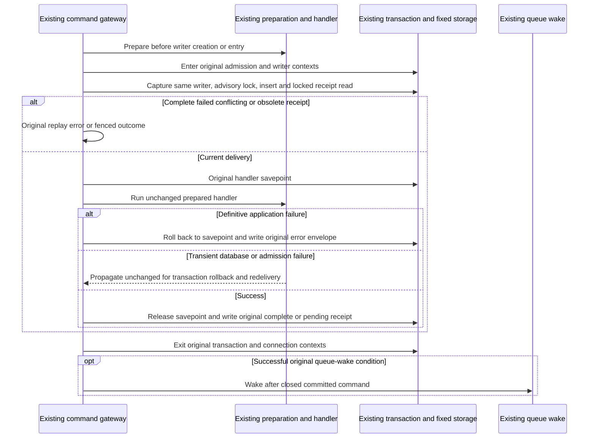
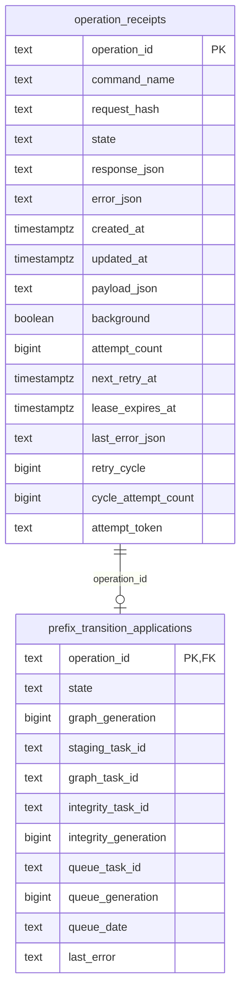

# Existing durable command receipt storage

**Current source; live schema/deployment unverified.** Complete receipt queries,
advisory/row locks, savepoints, bounded recovery SQL and driver facts moved from
[command_gateway.py](../../../../../backend/app/command_gateway.py) to
[storage.py](storage.py). Application code retains registration, identity hashing,
preparation, replay/attempt fences, retry/state decisions, HTTP translation,
context/admission order, response decoding and post-commit wake behavior.
No schema, receipt format, retry policy or transaction authority changes.

| Storage operations | Existing boundary retained |
| --- | --- |
| `_writer_connection`, `foreground_receipt_reader`, `receipt_writer` | Same foreground/background factory and read-only option; no new context wrapper. The raw writer is captured exactly once at each original capture point, then passed only to fixed receipt operations. The existing background reader import/call remains at its original application composition point. |
| `insert_queued`, `locked_attempt`, `save_missing_payload`, `restart_blocked`, `block_exhausted`, `start_attempt` | Complete original attempt/retry-cycle/lease statements. Application retains terminal-PGN protection, matching request/retry cycle, future lease checks, attempt limit, token and duration choice. Lease arithmetic runs at its original parameter point through an application callback. |
| `blocked_operation`, `locked_retry`, `save_retry`, `defer_for_foreground` | Original guarded reads/writes and affected-row fact. Retry/exhaustion/backoff choices stay outside; clock and error serialization callbacks run after driver method lookup in their original order. Foreground deferral retains its exact counter decrement and one-second deadline. |
| `recoverable_receipt`, `reserve_recovery` | Original optional allowed/paused filters, sorted bound arrays and three indexed due-state heads, each `LIMIT 1 FOR UPDATE SKIP LOCKED`, then oldest-head selection and reservation. No generic query builder or dispatch layer. Application still decides filters and decodes/resubmits the selected envelope. |
| `lock_operation`, `insert_pending`, `locked_publication`, handler savepoint operations and terminal/pending writes | Same advisory lock, receipt row lock and savepoint statements at the same application call points. Error/HTTP/transition rejection decisions remain between rollback and the selected fixed receipt write. |
| `operation_status`, `transition_progress` | Original read projections. Application retains identity checking, historical position-claim recovery, JSON decoding, pending/blocked messages and transition recovery instructions after leaving the original read context. |
| Driver predicates and exception exports | Same transient exception classes, SQL-state and constraint-name facts. HTTP status/detail construction remains in the gateway, including structured-detail limits and legacy fallback. Original exception/module and `_writer_connection` exports remain compatible. |

The gateway still owns the original outer `with`/exception scopes and coordinates
existing handler, activity/admission, prefix-transition, policy-refresh and queue
wake code. The adapter creates no new transaction, commit/rollback, savepoint
policy or lifecycle owner. Existing cross-domain command composition and Games
position-claim recovery remain disclosed legacy coupling; this move does not
establish isolated public domain interfaces or Study/Games independence.

## Source schema and stored data

The diagram includes all receipt fields and only transition fields read here.
The linked dictionaries contain full nullability, DDL, fields and owner charts.
The operation PK/FK below is enforced. Task IDs/generations, repertoire/plan IDs
and command-specific payload references are not inferred foreign keys.

- [`operation_receipts`](../../../schema/runtime-metadata/README.md#publicoperation_receipts) stores one durable command identity/hash, original payload, completion/failure JSON, attempt/cycle counts, retry/lease timestamps and fence token. The advisory lock key is the original operation ID; it adds no stored column. Terminal discarded PGN receipts remain terminal and never regain a saved payload.
- [`prefix_transition_applications`](../../../schema/opening-graph/README.md#publicprefix_transition_applications) supplies current source transition progress and linked task/generation facts for this operation. Its operation PK/FK uses `NO ACTION` on delete. This gateway only reads those progress fields; existing transition application code owns their mutations.

## Focused relocation proof

[Eight fake-only boundary cases](../../../../../backend/tests/test_command_receipt_storage_boundary.py)
cover writer capture, complete/current/stale delivery, handler savepoint order,
connection closure before wake, retry clock/error evaluation, three-stream bound
filter order and terminal PGN payload protection. The existing
[transport checks](../../../../../backend/tests/test_command_transport_errors.py)
pass 26 selected cases for HTTP/legacy detail, failure replay and preparation
failure; two Main-dependent cases were excluded. One existing fake-only
[queue replay wake case](../../../../../backend/tests/test_queue_refresh_wakeup.py)
also passes. These use fake drivers and in-process ASGI, with no socket listener.

One-time source expansion reproduces all eleven retained function bodies and
the moved writer factory, including signatures, exception scopes, constants and
`CommandConflict`. All 24 query/savepoint sites, SQL bytes/parameters and bounded
stream construction remain exact. Three explicit lease/clock/error callbacks
reduce to their original parameter evaluation points. Cached-module imports in
the moved factories resolve the same already-loaded `postgres_store`; background
read imports remain at the original point. Native locking, rollback, resource
isolation, service startup, full-system, live schema and installed artifacts
remain unverified for this slice. No native/SQLite integration, previously
denied loopback operation or full-system campaign ran.
