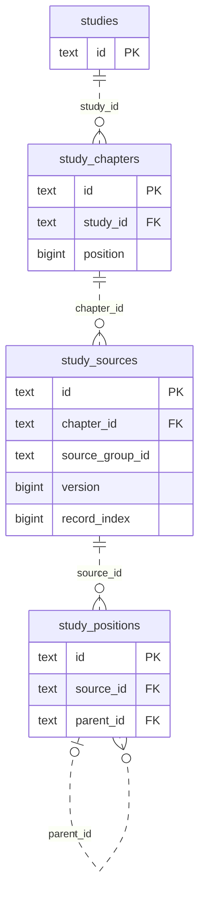
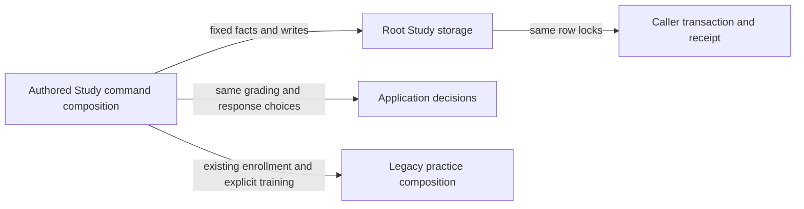

# Authored Study command storage

**Current source; live schema and deployment unverified.**
[storage.py](storage.py) contains the 61 existing database sites from
[study_commands.py](../../../../../backend/app/study_commands.py), expressed as
49 fixed operations. These operations borrow the command caller's connection;
none opens, closes, commits or rolls back a transaction. The command gateway
retains its receipt and transaction authority. No DDL or stored format changed.

The application retains model/HTTP/ownership validation, grading, UUID/date/time
and hash/JSON generation, source-copy/update and selected-record decisions,
revision/material/reset decisions, chapter-order validation and its two update
passes, link target checks, queue-refresh callbacks and returned responses.
Storage owns complete SQL, row locks, query filters and row-to-ID projections.
The existing record lookup keeps its exact four-table allowlist; it accepts no
arbitrary SQL. All previous facade bindings and handler signatures remain.

## Where authored data live

This bounded view shows actual enforced FKs from the current source DDL.
`o|` on the self-reference denotes a nullable parent position. Source-group,
version and record-index values do not create another parent FK.

| Stored data | Fields, types and keys |
| --- | --- |
| Study metadata | `studies.id text PK`; `title`, `description`, `source_json`, `created_at`, `updated_at` are non-null `text`; `archived bigint` is non-null. [Full source dictionary](../../../schema/study-queue-review-2/README.md#publicstudies). |
| Chapter order | `study_chapters.id text PK`, `study_id text FK`, `title/description text`, `position/archived bigint`; all non-null. `(study_id,position)` is unique. Parent locking and negative-then-final positions preserve that constraint. [All fields and constraints](../../../schema/study-queue-review-2/README.md#publicstudy_chapters). |
| Parsed source versions | `study_sources.id text PK`, `chapter_id text FK`; group/raw PGN/digest/filename/header JSON/diagnostic JSON/time are `text`, version/index/validity are `bigint`. `(chapter_id,source_group_id,version,record_index)` is unique; the source group association is logical. [Every field and type](../../../schema/study-queue-review-3/README.md#publicstudy_sources). |
| Position tree | `study_positions.id text PK`, `source_id text FK`, nullable `parent_id text FK`, nullable `move_uci text`; child index and validity are `bigint`, FEN/history/comment/starting-comment/NAGs/arrows/squares/path are `text`. `(source_id,node_path)` is unique. [Full dictionary](../../../schema/study-queue-review-2/README.md#publicstudy_positions). |
| Exercise and revision | `study_exercises.id text PK`, non-null `study_id/position_id text FK`; current revision is `bigint`, status/source JSON/times are `text`, nullable sibling group is `text` and nullable point value is `double precision`. `study_exercise_revisions` has composite PK `(exercise_id text FK,revision bigint)` and non-null specification JSON/hash/time `text`. `current_revision` is an existing logical revision association, not an added composite FK. [Fields, keys and enforced links](../../../schema/study-queue-review-2/README.md#publicstudy_exercises). |
| Teaching links | `study_links.id text PK`, non-null `study_id/source_position_id text FK`, nullable `target_position_id/target_exercise_id text FK`, non-null `relation text`. Application target and same-study checks remain at the original points. [Actual target cardinality and every field](../../../schema/study-queue-review-2/README.md#publicstudy_links). |
| Existing practice enrollment | Existing card identity, exercise/FEN/revision/archive/validation/schedule facts and queue date/card/cycle/position/explicit bucket are unchanged. The queue/card dictionary records actual PK/FK/unique constraints; date, bucket and revision associations are not inferred FKs. [Card and queue fields](../../../schema/study-queue-review-1/README.md), [exercise/attempt relations](../../../schema/study-queue-review-2/README.md). |

The linked canonical dictionaries include every stored field, primary/composite
key, unique tuple, enforced FK/delete action and cardinality. They are source
schema descriptions; no live database was inspected.

## Existing command boundary

Study here means authored/imported **Studies**, distinct from daily Study
practice. Existing enrollment/archive/reset/explicit-training commands touch
Learning card/queue storage under their existing legacy composition. That
coupling is preserved and disclosed; this extraction grants no new cross-owner
permission and does not establish an isolated authored-Studies runtime. The
existing queue-date lock and refresh callback remain with the command caller;
no second queue writer, transaction or settlement owner was introduced.

The 15-site exercise revision operation retains metadata-only versus material
changes, both schedule branches, archived old-card history and callback order.
Source imports retain selected-record replay, copy/update grouping, version
selection and parent-before-child node insertion. Chapter queries execute and
consume the same cursor before application order decisions. SQL bytes are
unchanged, including the separately retained whitespace variant in revision
blocking; no query/policy consolidation or framework was added.

Focused proof: six existing fake/task-owned SQLite import/archive/availability/
enrollment/revision/explicit-training cases and four chapter/link/allowlist/storage
boundary cases pass. A one-time comparison expands all fixed operations to the
exact original application and registration AST, including SQL bytes, parameters,
query results, locks, grading, clocks, UUID/hash/JSON and callbacks. Original
module bindings and current consumers were checked. Native PostgreSQL locking,
live data/schema, deployment and complete system qualification remain unverified.

Proposal only: later boundary work can replace legacy authored-to-practice
composition with the receiving owner's public command capabilities. The parallel
revision-block SQL variants may be simplified after separate behavioral review;
this move implements neither change.
