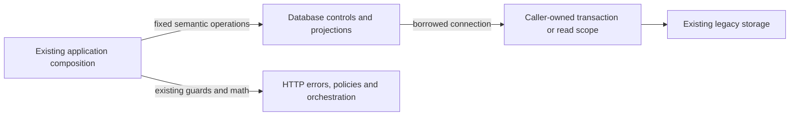

# Legacy settings, evidence and recovery controls

**Current unmerged source; live schema/deployment unverified.** These are complete existing queries and three fixed reconciliation savepoint operations moved out of six legacy application modules. They use the caller's existing connection and transaction, without opening or committing either. No schema, stored payload, query/parameter order, pagination bound or lock clause changes.

| Database module / application callers | Facts and operations | Canonical stored fields, keys and relationships |
| --- | --- | --- |
| [settings.py](settings.py) / [repertoire_settings.py](../../../../backend/app/repertoire_settings.py), [study_mode.py](../../../../backend/app/services/study_mode.py) | Reads global/inherited per-repertoire daily limits and the singleton Study-only setting. System-repertoire guards, response validation, missing-setting HTTP errors, bool conversion, Redis admission policy and reader/control lifecycles stay outside this directory. | [Repertoire fields](../../schema/authored-content-3/README.md) and [settings fields](../../schema/runtime-metadata/README.md). The existing `COALESCE` query supplies inheritance; it declares no new relationship or constraint. |
| [review_reconciliation.py](review_reconciliation.py) / [review_commands.py](../../../../backend/app/review_commands.py) | Executes the existing named `reconcile_review` savepoint, rollback and release statements. Application composition still chooses when to submit a review and converts only the existing handled conflict. The savepoint stays inside the caller's command transaction; other exceptions still propagate to that caller. | No table/schema change. Existing review/evidence effects remain owned by the called review implementation. |
| [opening_evidence.py](opening_evidence.py) / [opening_evidence_api.py](../../../../backend/app/opening_evidence_api.py) | Reads one `opening_evidence_attempts` row by `attempt_id`, then at most 256 `opening_evidence_events.event_json` strings ordered by sequence. PostgreSQL availability, not-found HTTP errors, reader selection and JSON decoding remain in application composition. JSON decoding still occurs after closing the read scope. | [Opening evidence types, actual keys and enforced/logical relationships](../../schema/opening-evidence-1/README.md). |
| [coverage.py](coverage.py) / [postgres_coverage_candidates.py](../../../../backend/app/services/postgres_coverage_candidates.py), [postgres_coverage_recovery.py](../../../../backend/app/services/postgres_coverage_recovery.py) | Reads move/explorer/Maia probabilities and stores the existing JSON-projected `blended_probability`, `required` and `source_state` values. Probability blending, normalization and required-reply decisions remain outside database. The bounded recovery query selects one eligible unpaused Explorer run with queued nodes and no matching active task, retaining `FOR UPDATE OF r SKIP LOCKED`; connection lifecycle and task admission remain application composition. | [Coverage candidate/node/run fields and keys](../../schema/discovery-priority/README.md), [background activity/task storage](../../schema/runtime-metadata/README.md). |

The linked schema READMEs are canonical for all stored types, primary/composite keys, enforced foreign keys and logical links. These function moves do not make the SQLite and PostgreSQL schemas equivalent, inspect a live schema, add cross-owner access, or create a shared runtime.

All 11 SQL/savepoint strings match the previous application source. The six originals now contain no direct SQL/cursor calls, while their existing lifecycle/policy composition remains explicit legacy coupling on the [unfinished extraction checklist](../../../INVENTORY.md). No generic SQL execution interface or new dispatch framework is introduced.

Fourteen focused cases pass: seven existing evidence/reconciliation/Study-policy cases, six boundary/settings/coverage/savepoint cases in `backend/tests/test_legacy_control_database_split.py`, and the existing single-run Explorer recovery case. Only fake controls and in-memory SQLite ran; native PostgreSQL locking/execution and full-system behavior remain unverified. The known stale migration-directory assertion in `test_repertoire_settings.py` is owned by a separate PR334 repair and was neither edited nor claimed as passing here.

[claim_sql.py](claim_sql.py) contains the two existing shared `claimable`/`control_order` SQL builders, moved intact. `background_activity.py` re-exports their original names; its complete fixed queries,finite source metadata and configuration probe now live in [activity storage](activity/README.md). Application pause/resume/fairness/clock and response decisions stay outside.
