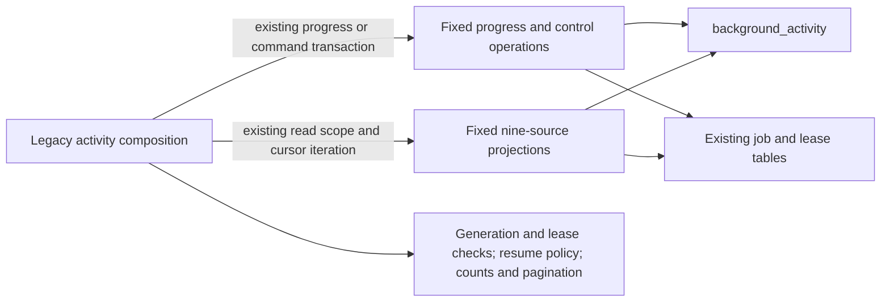
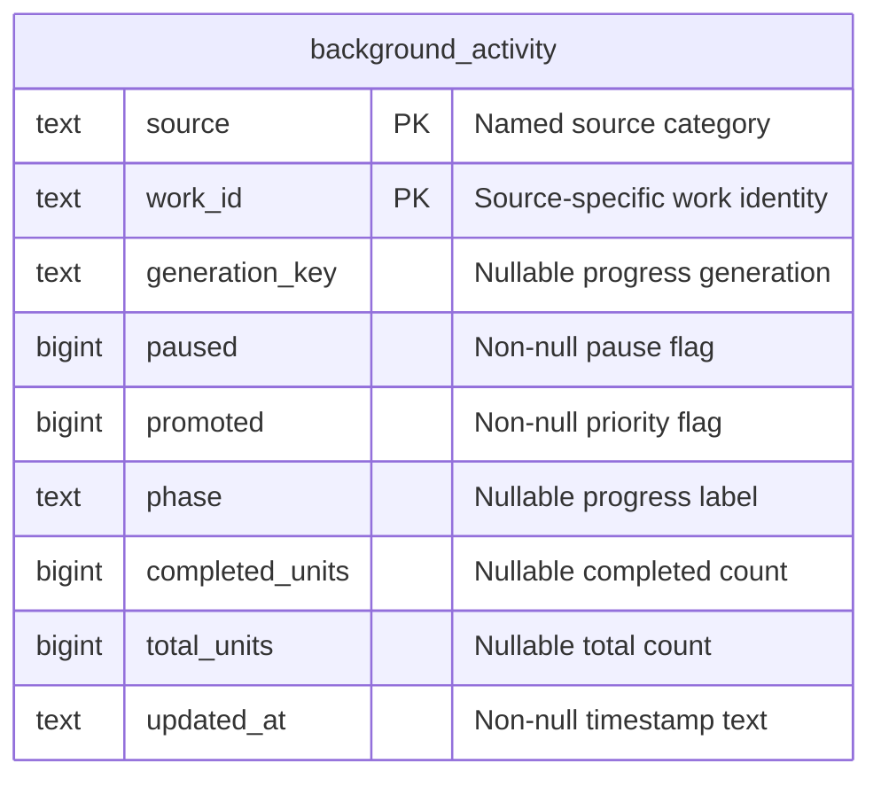

# Legacy background activity storage

**Current source implementation; live schema and deployment unverified.** This directory owns the 22 existing complete background-activity queries and their finite source/column mapping. [Application composition](../../../../../backend/app/services/background_activity.py) retains progress validation, generation/lease matching, pause/resume decisions, clocks, HTTP conflicts, presentation and pagination. The existing shared [claim predicates](../claim_sql.py) stay in their original root storage home and remain re-exported by the application.

[storage.py](storage.py) borrows the caller's connection; it never opens, commits or closes a transaction. The existing progress write scope, caller-owned activity-command transaction and projection read scope remain in application composition. Projection operations return the original cursors, so row iteration and each subsequent query occur in the same order within that read scope.

Three small local preparations preserve existing evaluation timing. `prepare_progress_read` resolves only the nine named sources and existing generation columns at the original point inside the progress scope; its one fixed reader runs only when that source has a generation check. `prepare_control_read` prepares the existing source/state column, PostgreSQL `FOR UPDATE` suffix and settings-admission expression before its fixed reader. `prepare_control_update` chooses only the existing paused/promoted column before the caller computes the flag value. None accepts caller SQL, table names, column names or predicates. The canonical root defensive SQL builders are reused with the same application-owned defensive task kinds; the previous application wrapper names remain available.

## Stored control and progress fields

The canonical [runtime metadata dictionary](../../../schema/runtime-metadata/README.md) and [initial DDL](../../../ddl/migrations/001_initial.sql) describe `public.background_activity`. All fields below use the checked-in PostgreSQL source types; compatibility SQLite remains its separate existing implementation. Both marked fields form the composite primary key. There are **no enforced foreign keys** from this table to its source jobs; `source` plus `work_id`, and generation matching, are logical application relationships.

| Stored fields | Data and nullability |
| --- | --- |
| `source`, `work_id` | Non-null text; together identify one durable control/progress record. |
| `paused`, `promoted` | Non-null bigint flags; control changes preserve the other flag. |
| `generation_key`, `phase` | Nullable text supplied by the existing progress producer. |
| `completed_units`, `total_units` | Nullable bigint progress counts, validated in application composition. |
| `updated_at` | Non-null text timestamp produced by the caller's clock. |

## Source jobs and existing relationships

`SOURCES` is the existing finite projection/control lookup, moved intact and re-exported by the application. The identities below are logical associations to `background_activity`, without a source-job foreign key. Each linked canonical dictionary supplies all stored fields/types, actual primary/composite keys, enforced foreign keys and cardinalities within that job's owning storage.

| Source | Existing source table and identity | Generation read by progress | Canonical storage dictionary |
| --- | --- | --- | --- |
| `durable` | `background_tasks.id` | `generation` | [Runtime metadata](../../../schema/runtime-metadata/README.md) |
| `sync` | `game_sync_jobs.id` | No generation query | [Game sync](../../../schema/game-projections-2/README.md) |
| `derivation` | `game_derivation_jobs.game_id` | `derivation_version` | [Game derivation](../../../schema/game-projections-1/README.md) |
| `integrity` | `repertoire_integrity_jobs.repertoire_id` | `run_id` | [Authored integrity](../../../schema/authored-content-2/README.md) |
| `coverage` | `repertoire_coverage_runs.id` | `id` | [Coverage](../../../schema/discovery-priority/README.md) |
| `priority` | `repertoire_priority_jobs.repertoire_id` | `generation` | [Repertoire priorities](../../../schema/discovery-priority/README.md) |
| `game_analysis` | `game_analysis_jobs.game_id` | `analysis_version:analysis_evidence_version`, plus current leased status/lease identity | [Game analysis](../../../schema/game-projections-1/README.md) |
| `threat_analysis` | `threat_analysis_requests.id` | No generation query | [Threat requests](../../../schema/practice-families-2/README.md) |

Projection queries also read existing `imported_games` provider/move metadata, repertoire names, coverage-node completion/lease facts and analysis-position reports. Pausing game analysis releases its current job lease then marks the imported game pending; pausing coverage or threat analysis releases the existing respective lease. These updates retain their original order in the caller's transaction. Coverage's terminal-work exception and generation/lease rejection remain application decisions.

The reused [defensive predicates](../../defensive_analysis.py) retain existing reads of global settings and active, unmaterialized repertoire opportunities through discovery/coverage recommendation request relations. Their [recommendation, opportunity and coverage dictionary](../../../schema/discovery-priority/README.md), [coverage recommendation and imported-game dictionary](../../../schema/authored-content-1/README.md) and the runtime dictionary document those source tables; this relocation introduces no new relationship or permission.

This is existing legacy shared-storage coupling across background work owners. Physical colocation does not create owner isolation or authorize another domain to use these tables. The application's existing `sqlite3.OperationalError` handling for best-effort progress, concrete connection composition and HTTP translation remain explicit compatibility responsibilities; moving query mechanics does not claim an infrastructure-independent domain boundary.

## Focused verification

A task-local source reconstruction restores the complete retained non-import application AST from the fixed operations, including exact SQL literal/f-string values, parameters, preparation points, raw cursor iteration, callback/clock order, generation/lease checks and transaction scopes. The nine-source mapping matches exactly; the three existing defensive SQL wrappers were verified before substituting their canonical root builders. The application has no SQL text, direct query/cursor operation or dialect probe after extraction.

Twenty-three existing focused cases pass: six activity/progress cases, sixteen defensive-settings/recommendation activity cases and one idempotent activity-command dispatch case, using task-temporary SQLite or fakes. No tests were edited. Each test command emitted the same existing Starlette/AnyIO deprecation warning. No native PostgreSQL execution/locking, live database, service activation or full-system check is claimed. The existing 1,000-job timing benchmark is outside this bounded relocation check.

Daily statistics no longer has an activity projection or control source in this
branch. Old day-job rows do not need recovery or drain, and controls for the
retired source are rejected. Other sources and the shared activity schema remain
unchanged; no live row or table cleanup is performed.
