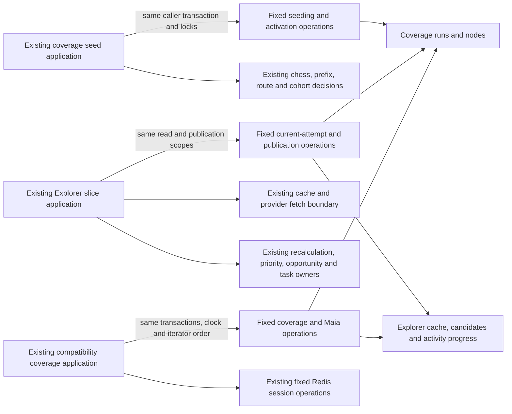

# Legacy coverage generation storage

**Current source; live schema and deployment unverified.** These are the existing coverage seeding, Explorer publication, compatibility coverage/Maia and Explorer session storage operations. No schema, SQL, model, backfill, feature or permission is changed.

| Module | Database responsibility | Application owner |
| --- | --- | --- |
| [seeding.py](seeding.py) | Existing source MD5 projection, coverage advisory lock, repertoire/active run/settings reads, run admission/failure, bounded source/position reads, position insert/merge and generation activation. Native and compatibility run-lock/failure operations retain their original SQL dialects. | [postgres_coverage_seed.py](../../../../backend/app/services/postgres_coverage_seed.py) keeps prefix/source fingerprint composition, cohort/settings policy, UUID/time, route discovery/merge, minimum ply/reply selection, canonical/current-scope validation, empty/changed/pending-route handling, activation and task cursors/admission/completion. |
| [explorer.py](explorer.py) | Existing task lease read, next/locked current-attempt node queries, failure writes, Explorer cache/candidate upserts, completion/progress/count projection and activity update. The two dynamic queries reuse the original [root-owned current-attempt predicate](../repertoire_scope/freshness.py). | [postgres_coverage_explorer.py](../../../../backend/app/services/postgres_coverage_explorer.py) keeps lease/scope/status decisions, cache-versus-fetch selection, provider admission/error handling, reply counts/probabilities, JSON/time, recalculation, priority/opportunity callbacks and durable task checkpoints. |
| [repertoire.py](repertoire.py) | Compatibility cohort/source/run/cache reads, coverage admission, Explorer/Maia claim and publication, candidate updates, lease expiry and summary/gap projections; fixed complete dynamic claims reuse the original root predicates. | [repertoire_coverage.py](../../../../backend/app/services/repertoire_coverage.py) keeps chess/discovery/cohort/probability/required-reply policy, clock/UUID/JSON, scope/lease decisions, HTTP/cache choice, foreground waits, transaction composition and opportunity/priority/progress callbacks. |
| [session.py](session.py) | Existing configuration probe and Redis Explorer session key with 24-hour set, get and delete operations. | The same application keeps environment-versus-session selection, rejected-token state, in-memory fallback/lock, decoding and missing-token policy; its existing `redis_client` seam is preserved. |

All operations borrow the caller's existing connection. Application transaction composition through root `background_read_connection` / `connection(background=True)` remains unchanged. Prefix/source locks still precede task locks and freshness checks. Explorer node/run locks, pause/latest-current-attempt filters, native JSON-recordset upsert/conflict behavior and progress calculation preserve their original order. No helper commits independently or accepts arbitrary SQL/predicates.

Source reads still close before chess traversal or provider fetch. The application retains token/cache/network decisions and actionable missing-token errors, one-position staging, one-node activation/publication, route merge and reply ordering, original source-change/empty-scope failure rules, task payload/cursor transitions and every clock call. The unchanged source hash combines saved line fields in their original ordered SQL projection; application code still appends prefix/source-certificate identity. No stored fingerprint or identity format changes.

## Stored data and relationships

The [canonical coverage dictionary and rendered ER diagram](../../schema/discovery-priority/README.md) list every stored field/type, key, nullability and enforced FK. Additional definitions describe [Explorer cache and imported game cohort](../../schema/authored-content-1/README.md), [activity/tasks/settings](../../schema/runtime-metadata/README.md), [source lines](../../schema/authored-content-2/README.md), [repertoires](../../schema/authored-content-3/README.md) and [canonical prefix certificates](../../schema/opening-graph/README.md).

| Storage | Stored facts used or changed here | Keys and relationships |
| --- | --- | --- |
| `repertoire_coverage_runs` | Text run/repertoire IDs, status/settings JSON/error and creation/update time; bigint total/completed node counts. | Text `id` PK; enforced repertoire FK with cascade delete. |
| `repertoire_coverage_nodes` | Text node/run/repertoire IDs, FEN/key/color, routes/replies JSON, Explorer/Maia status, error/time/lease fields; bigint ply/Explorer games. | Node PK; enforced run/repertoire FKs with cascade delete; unique `(run_id, fen_key)`. |
| `repertoire_coverage_candidates` | Text node/move/source state; nullable double-precision Explorer/Maia/blended probabilities; bigint required/covered flags. | Composite `(node_id, move_uci)` PK; enforced node FK with cascade delete. |
| `explorer_position_cache` | Text cache key, FEN key, speeds, ratings, response JSON and fetch time. | Cache-key PK; cache identity and freshness are existing application conventions, not new FKs. |
| `imported_games` | Existing cohort reads use text game ID, play time and speed, nullable bigint player rating and bigint adaptive-excluded flag. | Text game ID PK; the cohort read adds no relationship or permission. |
| Redis Explorer session | Existing string token stored at fixed key `tempo:coverage:explorer-session-token`; 86,400-second expiry. | No relational keys/FKs. Configuration and TTL are unchanged; no token value is documented or inspected. |
| `background_activity` | Source/work/generation/phase identity and text update time, bigint completed/total units; existing pause state used by node selection. | Composite source/work PK. Coverage run/generation association is logical. |

Task generation/lease comparisons, settings JSON scope revisions, prefix preview references, newest-current-attempt filtering and cache identity are existing logical freshness relationships. They do not imply new constraints. The complete dynamic query construction lives here and reuses the same already-centralized predicate; application code still decides whether a selected run/node is current and what to do when it is stale.

Existing authored-source/cohort, cache/provider, coverage, activity, priority/opportunity and task coupling is preserved. No new cross-owner table access or Study-to-Games dependency is introduced. This extraction does not create a clean domain/Learning authority boundary or prove optional-feature resource/shutdown isolation. Compatibility candidate/Maia/source operations are included here. Native controls, HTTP composition and remaining independently coordinated implementations retain their existing owners; this directory is not a claim of complete legacy domain separation.

## Focused evidence

**11 existing selected fake-based cases pass**, covering superseded active seed admission, foreground yielding/replay fences, source change before activation, verified Explorer admission, close-before-network, stale/replaced leases, missing-token failure, unverified canonical routes and scoped/unscoped fingerprint behavior. One existing Starlette/AnyIO deprecation warning is reported. No provider or native database request was made; test assertions/fixtures are unchanged.

Task-local fixed-operation expansion restores both complete retained non-import application ASTs and all **31 original queries** (11 Explorer; 18 native plus two compatibility seeding statements), including dynamic predicate calls, SQL bytes/parameters/locks/scope/lease/clock/network/cache/probability/route/fingerprint/task/callback/transaction order. Both application files contain no SQL-bearing literals or direct query/driver calls. Five affected Python modules compile. No generic SQL port, new framework, generator or duplicate implementation is shipped.

The compatibility extraction additionally passes **15 existing selected SQLite/fake cases**: coverage math/cohort/discovery/gap publication, missing/rejected/in-memory session behavior, paused Maia lease invalidation/resume, separate-worker Redis session handoff and building-summary projection. One existing Starlette/AnyIO warning remains. All 46 original SQL sites expand back to the exact retained non-import application AST; three Redis operations, two configuration probes and the moved session-key definition also correspond exactly. Application source has no SQL literals or direct query/Redis driver calls; three affected Python modules compile. The dynamic unattended-failure operation receives the original application clock callable so query-builder evaluation still precedes the clock call. Cursor iteration and repeat-per-candidate Explorer count reads retain their original timing.

Native PostgreSQL/Redis execution/locking/rollback/permissions, installed-package discovery, GitHub rendering, live schema/deployment and resource isolation remain unverified. No native/live service, full-system campaign, schema/security/CI or planned canonical model change was used.
