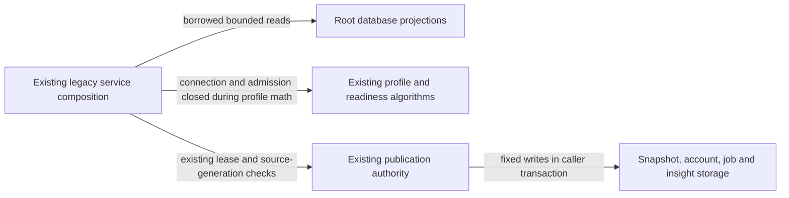

# Legacy next-opponent publications

**Current unmerged source; live schema/deployment unverified.** These fixed operations were extracted from two small legacy derived-data services. They borrow existing read/write connections and never open, commit or close one. SQL values, parameter/query order, native timestamp projections, locks, bounded reads and generation/lease authority remain unchanged. These are existing optional game-evidence/statistics projections; moving them adds no Study dependency or owner permissions.

| Database module / application caller | Stored facts and operations | Canonical fields, keys and relationships |
| --- | --- | --- |
| [next_opponent.py](next_opponent.py) / [postgres_next_opponent.py](../../../../backend/app/services/postgres_next_opponent.py) | Reads the configured Lichess account, account input/published generations, method, future-evidence time, sync state, existing task and published profile JSON. Source reads keep the existing rated/non-excluded/account/as-of predicates, sample-limit lookahead, per-speed latest rating and next future evidence query. `next_opponent_game_time` remains PostgreSQL-native and the future timestamp remains projected as text. | [Account/snapshot and imported-game fields](../../schema/authored-content-1/README.md), [sync state](../../schema/game-projections-2/README.md), [settings/background tasks](../../schema/runtime-metadata/README.md), and [044_next_opponent_profiles.sql](../../ddl/migrations/044_next_opponent_profiles.sql) for the timestamp function/indexes, immutable snapshot trigger and input-generation trigger. |
| The same next-opponent module | Ensures an account row, locks refresh state and publishes immutable profile JSON plus accepted generation/method/version/next-evidence time. Publication keeps the existing settings `FOR SHARE` → account `FOR UPDATE` → task-fence order. The application still checks source/account/delivery/method identity, samples the clock, serializes the profile and chooses whether to publish or only complete the stale task. | `next_opponent_accounts.account` and `next_opponent_snapshots.version` are the stored primary keys. The account's nullable `profile_version` has the actual enforced FK to snapshot `version`; configured-account/task/sync comparisons remain logical application relationships. The linked canonical dictionary supplies every field/type and constraint. |

Application responsibilities remain outside database: profile math and freshness/availability presentation, account normalization, future-evidence due checks and refresh coalescing, plus JSON serialization. Existing connection/admission lifecycles, clock points, foreground yields, lease checks and task completion callbacks stay at their original call sites. The next-opponent profile calculation still holds neither a database connection nor an admission lease.

`next_opponent_snapshots.profile_json` follows the existing typed [NextOpponentProfile contract](../../../../backend/app/contracts/next_opponent.py).

The linked schema READMEs remain canonical for actual stored field types, primary/composite keys, enforced FKs and explicitly logical relationships. No schema or stored representation changes, live queries or migrations were performed. SQLite-compatible test projections are not claimed equivalent to PostgreSQL execution/locking. Existing legacy service/task coupling remains explicit and is not an isolation claim.

All 23 original direct database call sites are delegated; the identical configured-account SELECT used twice now shares one fixed helper, leaving runtime query count/order unchanged. Source comparison checks query/method/parameter expressions and restores delegation calls to verify unchanged application functions. Focused existing fake cases cover refresh coalescing, future-evidence timing, stale publication fences, closed-connection computation, foreground denial, read-only freshness responses and accepted daily publication. Additional task-owned SQLite cases cover daily readiness/query-only metrics, and one local guard prevents SQL returning to the two originals. Native PostgreSQL execution, deployment/resource isolation and full-system behavior remain unverified. Other mixed files remain on the [unfinished extraction inventory](../../../INVENTORY.md).

## Daily-statistics source retirement

The daily-statistics projection/publication module and its command/worker are
removed in this branch; the [last source](https://github.com/aaweaver-actuary/tempo/tree/1a0fd5c582c13f9d0de428d2f66d7e7cb358c4bf) records their daily readiness,
metric and insight purpose. Original extraction receipts above are dated proof,
not a current daily-runtime claim. The remaining next-opponent module and its
SQL boundary are unchanged. No daily table or live data is deleted.
