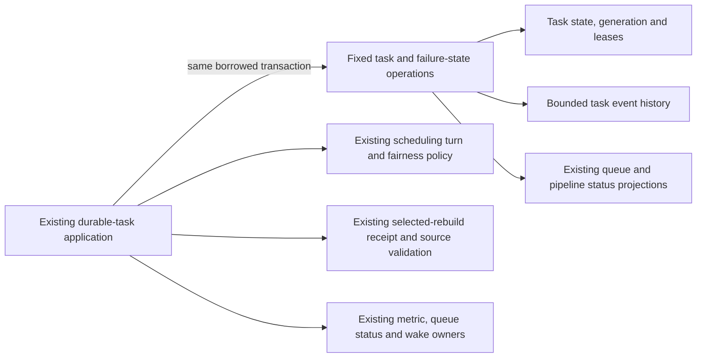
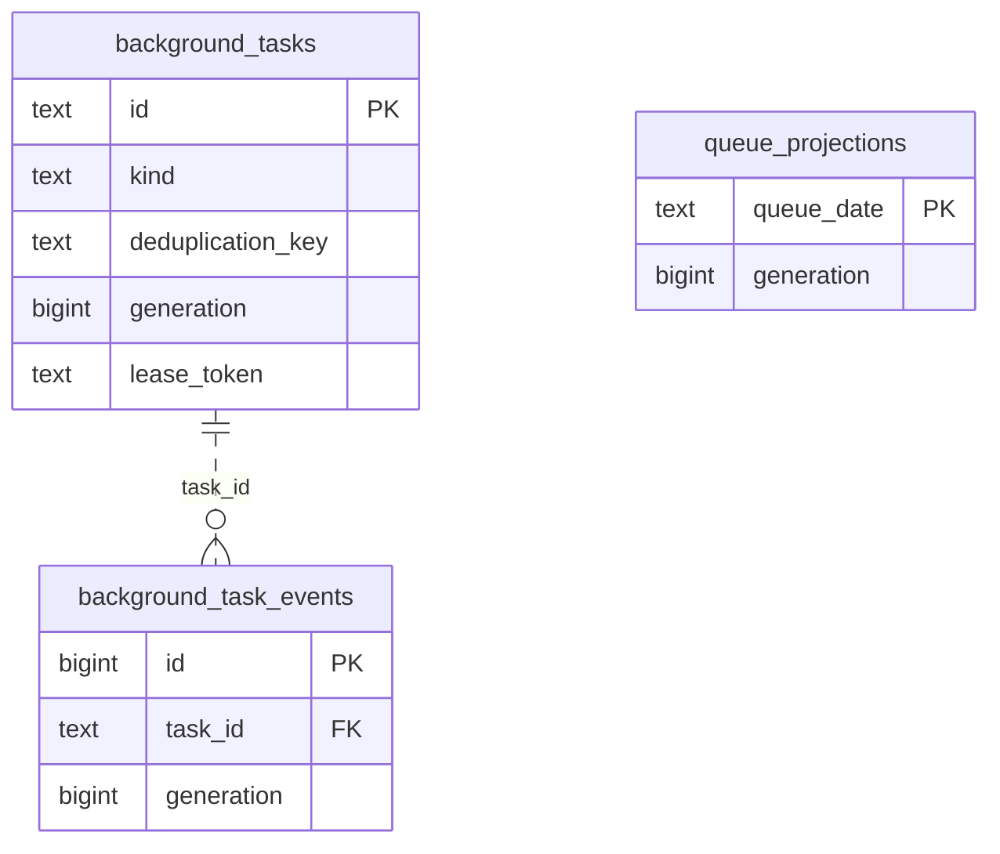

# Legacy durable-task storage

**Current checked-in source; live schema and deployment unverified.** [storage.py](storage.py) contains the existing durable-task SQL, complete query/dialect mechanics, nine SQL constants and `warm_completion_sql`. [durable_tasks.py](../../../../backend/app/services/durable_tasks.py) retains scheduling and selected-rebuild policy, priorities, UUIDs/clocks/JSON, attempt/timeout/backoff decisions, lease/generation validation, metrics/events, foreground admission and queue/wake/receipt callbacks. No schema, SQL, model, behavior or permission change.

The application re-exports all nine existing SQL constant names and `warm_completion_sql` for current consumers. The SQL warm-up implementation moved unchanged and still runs at its existing pre-transaction callpoints. [Scheduling storage](../scheduling/README.md) and the existing [claim predicates](../controls/claim_sql.py) retain their owners; no new dispatcher or generic SQL interface is introduced.

## Query preparation and transaction authority

Six small local preparations retain the existing finite query shapes: selected/ordinary upsert; filtered native/compatibility lease reclaim plus candidate selection; and failure/contention/manual-retry/interrupted-phase updates. They accept semantic data and bound parameters, never arbitrary SQL, table names or predicates. The selected fence is prepared after its existing owner validation and before the original clock/UUID/JSON evaluation. Both absent-prior `WHERE FALSE` and prior identity/generation/state/phase/no-lease fences remain unchanged; returned task identity stays authoritative.

Claim preparation keeps filter/parameter construction before reclaim and leaves the candidate predicate evaluation lazy until after reclaim metrics. Native reclaim still translates the same statement and adds `FOR UPDATE SKIP LOCKED` to the bounded inner selection. The unchanged defensive-kind tuple is passed to the same canonical root builder used by the prior application wrapper. Scheduling selection and persisted turn still occur in the application, with the same lease write and commit.

The application retains the two distinct configuration-probe points in failure handling. The fixed root parameter helper owns the original dialect-dependent extra phase parameter, preserving its place before clock formatting. Slice completion and timeout/retry/error projections still borrow the caller's transaction; event insertion, aggregate metrics and pruning keep their original order. No helper commits, sleeps, reschedules policy independently or creates another receipt/queue writer.

## Stored facts and relationships

The [canonical runtime dictionary and ER diagram](../../schema/runtime-metadata/README.md) list every task/event/settings/metric/scheduling field, type, nullability and constraint. [Queue projections](../../schema/study-queue-review-2/README.md), [refresh-input versions](../../schema/authored-content-1/README.md), [sync state](../../schema/game-projections-2/README.md), [analysis/publication state](../../schema/game-projections-1/README.md), [integrity](../../schema/authored-content-2/README.md) and [coverage](../../schema/discovery-priority/README.md) retain their full canonical dictionaries.

The only shown FK is the enforced task-event relationship with cascade delete. A task may have no events. `(kind, deduplication_key)` is a unique tuple. Task event generation, queue dates/payloads, selected maintenance pins, publication/receipt links and pipeline-specific identities are **logical associations**, not new constraints. The queue projection is deliberately unconnected in this chart because it has no task FK.

| Storage | Existing stored facts used or changed here | Keys/ownership notes |
| --- | --- | --- |
| `background_tasks` | Text ID/kind/deduplication/state/phase/payload JSON, next-attempt/lease/error/times and timeout checkpoint; bigint generation/priority/payload version/attempt budgets, generation/age diagnostics and timeout counter. | Task PK; unique kind/deduplication tuple. Lease, generation and selected-return validation remain application authority. |
| `background_task_events` | Bigint event ID/generation; text task/event/optional phase/detail/creation time. | Event PK; task FK. Existing pruning retains the most recent 100 events per task. |
| `queue_projections` | Text queue date/state/error, nullable update time; bigint generation/refresh-pending/blocked count. | Queue-date PK; task payload date mapping is logical. Existing refresh/error updates remain in the same transaction as accepted task transitions. |
| `analysis_refresh_requests` | Text kind/repertoire/input/publication identities and request/pending times. | Composite kind/repertoire PK; repertoire FK. Existing claim clears pending time for the two specified refresh kinds. |
| Existing sync, integrity, coverage and analysis status rows | Pipeline-specific text error/status/update/completion state, imported-game analysis state and scan generation/error. | Existing terminal-failure propagation only; no new table access, schema or authority. |

Existing legacy cross-pipeline failure propagation and queue-projection writes remain explicit. This relocation does not establish clean domain/Learning authority or optional-feature resource/shutdown independence. Ordinary Study receives no new Games dependency.

## Focused evidence

**36 existing focused cases pass**: returned enqueue identity, native phase preservation, scheduling/fairness/paused/delayed classes, bounded expired-lease recovery, task coalescing/restart/stale results, terminal retry, transaction-deadline backoff and generation fencing, queue error/status rollback, selected prior/absent handoff races and native parameter binding, selected checkpoint postconditions and supported-kind claims. The first two selected runs report the existing Starlette/AnyIO warning. Only fakes and task-temporary SQLite are used; assertions/fixtures remain unchanged. Production-scale/full-system tests are unselected.

Task-local expansion restores the complete retained non-import application AST for all **47 query sites**, seven configuration probes and finite preparation points. It separately verifies the existing application admission wrapper before equating its canonical root builder and unchanged policy tuple. All **nine SQL constants and the full warm-up function match exactly**. SQL bytes, parameter/clock/receipt/lock/fairness/lease/retry/error/metrics/queue/wake/callback/transaction order correspond to the original source. Application SQL/direct query/dialect-driver operations are absent; three affected Python modules compile.

Native PostgreSQL execution/locking/rollback/permissions, installed-package discovery, GitHub rendering, live schema/deployment and resource isolation remain unverified. No live/native service, schema/security/CI change, new issue, full-system campaign or proposed canonical model was used.
