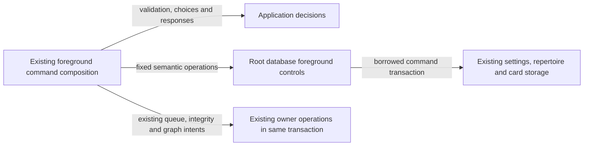

# Legacy foreground settings and authoring controls

**Current unmerged source; live schema/deployment unverified.** These are complete existing parameter-bound operations extracted from three foreground command handlers. They borrow the existing command transaction and never open or commit one. Command signatures, SQL values, query/parameter order, advisory/row locks, validation and HTTP error decisions remain unchanged.

| Database module / application caller | Facts and operations | Canonical stored fields, keys and relationships |
| --- | --- | --- |
| [settings.py](settings.py) / [settings_commands.py](../../../../backend/app/settings_commands.py) | Locks the singleton settings row, writes settings in the same server-derived `Settings.model_fields` order, and upserts/removes the existing provider account rows. Pydantic/supplied-field checks, omitted boolean preservation, unsupported discovery/coverage cutover checks, provider trimming/selection, Study-only profile-refresh decision, queue-refresh date and response conversion remain outside database. The ordered field tuple is an application schema input to this fixed settings-table operation, not a SQL execution port. | [Settings fields and singleton key](../../schema/runtime-metadata/README.md), [provider account fields/key](../../schema/game-projections-1/README.md). |
| [repertoires.py](repertoires.py) / [repertoire_commands.py](../../../../backend/app/repertoire_commands.py) | Retains the main-repertoire transaction advisory lock followed by stable eligible-row `FOR UPDATE` ordering, then stores the selected main flag. Also renames one repertoire with the existing affected-row result and stores its nullable daily opening limit. System-repertoire exclusions, not-found guards, name trimming, settings validation, inheritance response, graph/game/queue follow-ups and delete orchestration remain in their existing application owners. | [Repertoire identity/name/main/limit fields](../../schema/authored-content-3/README.md). The application supplies the same fixed system-repertoire exclusion tuple; no owner permissions change. |
| [prefix_splits.py](prefix_splits.py) / [prefix_split_commands.py](../../../../backend/app/prefix_split_commands.py) | Locks the prefix card, reads current published line/repertoire usage and linked memberships, marks the existing parent/continuation pending validation, and records the latest non-invalidated failed Study review used for split rejection. Application code still chooses acceptance/rejection, checks revision/idempotency, translates errors, acquires the existing queue-position lock and requests sorted integrity/graph invalidations. SQL result interpretation and minimum-one usage metrics stay outside database. | [Card fields and revision](../../schema/study-queue-review-1/README.md), [repertoire memberships](../../schema/authored-content-2/README.md), [opening publications/routes](../../schema/opening-graph/README.md), [review fields and keys](../../schema/study-queue-review-2/README.md). |

The linked schema READMEs own stored types, primary/composite keys, enforced foreign keys and explicitly logical relationships. These unchanged queries do not add constraints or make SQLite compatibility tables equivalent to the PostgreSQL schema. No live schema/data was inspected or changed.

Existing command composition still couples legacy settings/provider refresh, queue refresh and authoring invalidation services. Colocating their SQL creates no new permissions, sibling-domain interface or Study dependency and does not establish optional-feature resource isolation. Other mixed modules remain on the [unfinished extraction checklist](../../../INVENTORY.md).

All 15 original direct database call sites now reside in these fixed adapters. SQL values and application guard/clock/response logic were compared with the pre-extraction source. Focused checks cover omitted settings flags, the unsupported-settings guard, main-selection lock order, repertoire-limit checkpoint invalidation, prefix command dispatch, and local prefix acceptance/replay/rejection/rollback behavior plus the three-module SQL boundary. Only fakes and task-owned SQLite ran; native PostgreSQL locking/execution, deployment/resource isolation and full-system behavior remain unverified.
